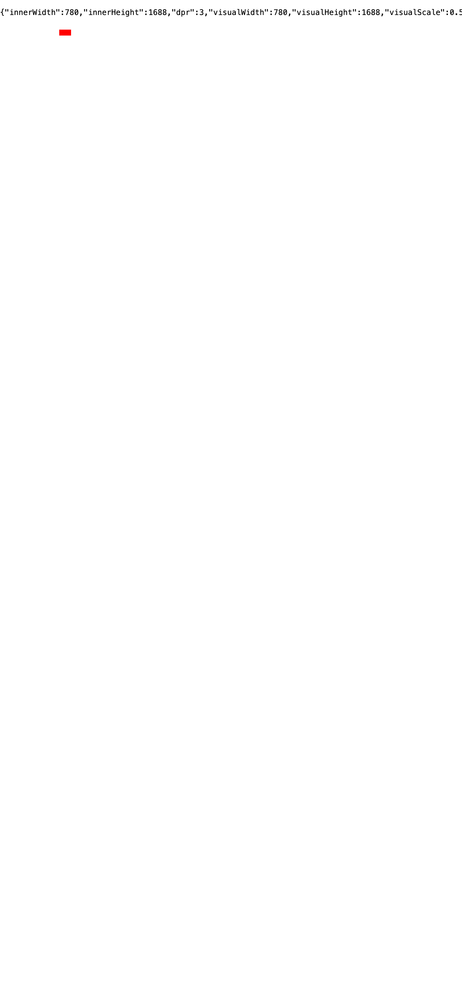
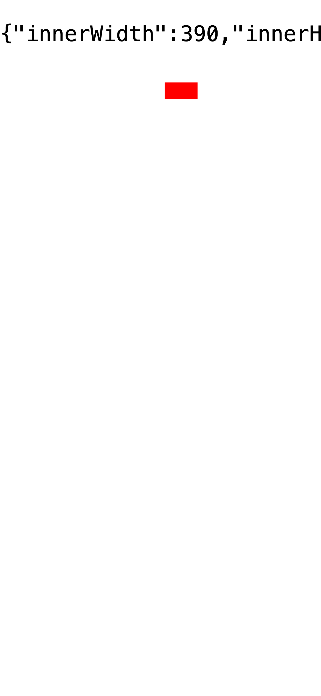
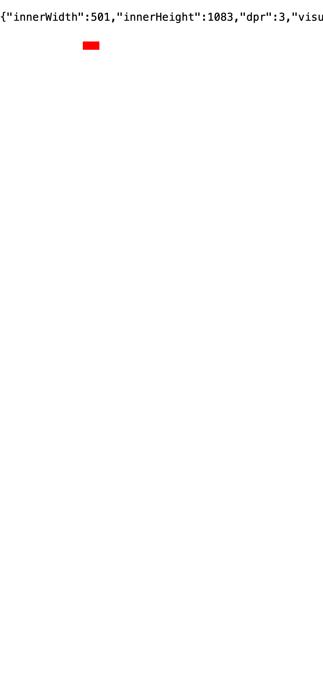
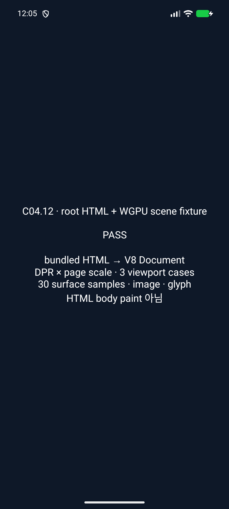
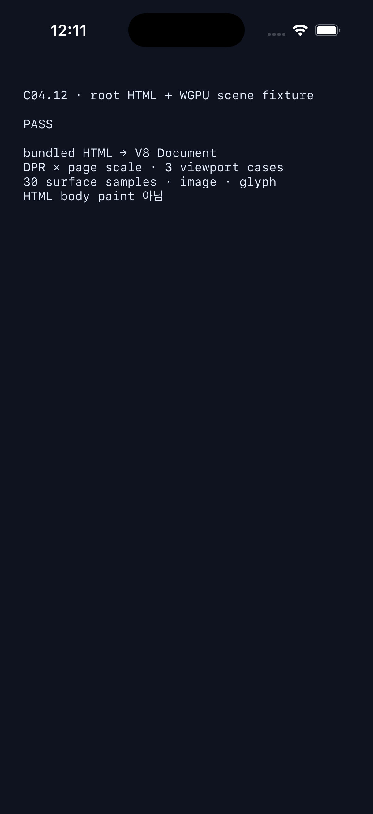

# C04.12 초기 page-scale WGPU scene mapping

## 비교 기준

- Agent Browser CLI `0.31.1`, Chrome `155.0.8059.85`, iPhone 12 emulation, `390×844` CSS px, DPR `3`, physical surface `1170×2532`.
- scene probe는 CSS `(100,50)`, `20×10`이다. 표면 좌표는 `CSS × DPR × page_scale`이며 origin은 `(0,0)`이다.
- Chrome의 layout viewport, visual viewport와 probe 경계는 [page-scale 계획](../../../../plan/c04-12-page-scale-rendering.md)에 고정했다. 세 PNG는 Chrome oracle 캡처이며 Spinon 앱 화면이 아니다.

| Case | Layout viewport | Visual viewport | DPR × scale | Probe physical bounds |
| --- | ---: | ---: | ---: | ---: |
| `initial-scale=0.5` | `780×1688` | `780×1688` | `1.5` | `[150,180) × [75,90)` |
| `initial-scale=2` | `390×844` | `195×422` | `6` | `[600,720) × [300,360)` |
| `width=500, initial-scale=1` | `500×1082.0513` | `390×844` | `3` | `[300,360) × [150,180)` |

## 구현·검증 범위

선택적인 `RuntimePageScaleTransform`이 DPR과 초기 `page_scale`을 분리해 보존하고 WGPU mapping에서 곱한다. Colored box와 border, image, pre-rasterized glyph의 CSS 좌표만 physical surface로 보낸다. layout viewport, CSS hit-test 좌표, transform이 없는 기존 렌더 경로는 유지한다. surface 경계가 확대된 scene을 자른다.

FFI 앱 fixture는 루트 HTML을 V8 document로 열고 viewport/environment ABI 행렬 세 case를 확인한 뒤 각 case의 WGPU offscreen readback을 실행한다. Case마다 probe 및 half-open 경계, 우·하단 surface clip과 바깥쪽 제어 색, image, glyph 등 10개를 읽어 총 30개 표본을 예상 RGBA와 대조한다. 별도 WGPU test는 page-scale과 CSS clip, border paint 순서, opacity group을 같은 GPU readback에서 확인한다. 실행 환경별로 adapter를 요청하지만 adapter 이름은 기록하지 않으므로 Android hardware GPU나 특정 software renderer를 주장하지 않는다.

이것은 고정 scene의 WGPU 검증이다. 일반 HTML body layout·paint, `RuntimeSession` 자동 연결, native surface 표시의 픽셀 동일성, text 재래스터화, surface-to-CSS input mapping, pinch/pan/scroll, safe-area, 실기기는 포함하지 않는다. 화면 캡처는 두 Simulator의 fixture PASS 안내 화면이며 HTML 콘텐츠 화면이 아니다.

## Simulator 실행

- Android: AVD `spinon_api37_1_compat16k`, API 37, ARM64, `1080×2400`, density `420`; `emulator-5554`만 사용했다. 새 APK를 설치한 뒤 `spinon_c0412_root_html_asset`을 실행했다. logcat에 `page_scale_wgpu=PASS cases=3 samples=30`과 함께 세 viewport case 통과가 기록됐다.
- iOS: iPhone 17 Pro Simulator, iOS 26.2, Xcode 26.2 (`17C52`). 새 앱을 설치한 뒤 `--spinon-c0412-root-html-asset`을 실행했다. UI는 FFI report의 root-HTML 및 `page_scale_wgpu=PASS` token이 모두 있을 때만 PASS를 표시한다. unified log marker는 `status=pass`다.
- Android [화면](./android-api37.png)과 [원본 실행 로그](./android-run.log), iOS [화면](./ios-26.2-iphone17pro.png), [unified log](./ios-run.log)와 [simulator/build 정보](./ios-simulator-info.txt)를 보존한다.

## 테스트와 artifact 경계

- `cargo fmt --all -- --check`: 통과.
- `cargo test --locked -p spinon-render -p spinon-render-wgpu -p spinon-ffi --features spinon-ffi/c04-12-root-html-fixture-test`: 총 172개 통과. FFI 23, render 97, WGPU 45, opacity integration 3, stacking integration 4. 원본 출력은 [cargo-test.log](./cargo-test.log).
- `cargo clippy --locked -p spinon-render -p spinon-render-wgpu -p spinon-ffi --features spinon-ffi/c04-12-root-html-fixture-test --all-targets -- -D warnings`: 통과, [cargo-clippy.log](./cargo-clippy.log).
- Android `:app:assembleDebug -PspinonC04RuntimeGpu=0` 및 `tools/build-ios-sim.sh`: 성공. 둘 다 `c04_12_root_html_fixture_test=1`, 일반 `c04_runtime_gpu=0`으로 빌드했다. 원본은 [Android build log](./android-build.log)와 [iOS build log](./ios-build.log).
- iOS link에는 `libspinon_wgpu_r08_spike.a`와 fixture를 포함한 `libspinon_ffi.a` 사이 `RawWindowMetalLayer` duplicate symbol warning 4개가 남는다. Xcode build 및 iOS Simulator 실행은 성공했고, 이 경고는 두 WGPU archive의 linkage 정리 범위에 남긴다.
- 기본과 opt-in host macOS ARM64 static library의 심볼·문자열 positive/negative control과 SHA-256은 [artifact-fixture-boundary.txt](./artifact-fixture-boundary.txt)에 기록했다. 이는 static library 판정이며 앱 번들이나 release artifact 크기 판정이 아니다.
- [계획 실패 관점 검토 20개](./implementation-plan-review-20.md), [구현 실패 관점 검토 20개](./implementation-review-20.md), [PR diff 검토 30개](./pr-delta-review-30.md)를 별도로 보존한다.

## 완료 판정

이 하위 scene slice는 체크했지만 C04.12 상위 항목은 미완료다. 이 실행은 선택 renderer scene transform의 좌표와 고정 adapter readback만 확인한다. 일반 HTML 문서를 그리거나 기본 `RuntimeSession`의 render pipeline에 환경 변환을 자동 연결하지 않는다.
