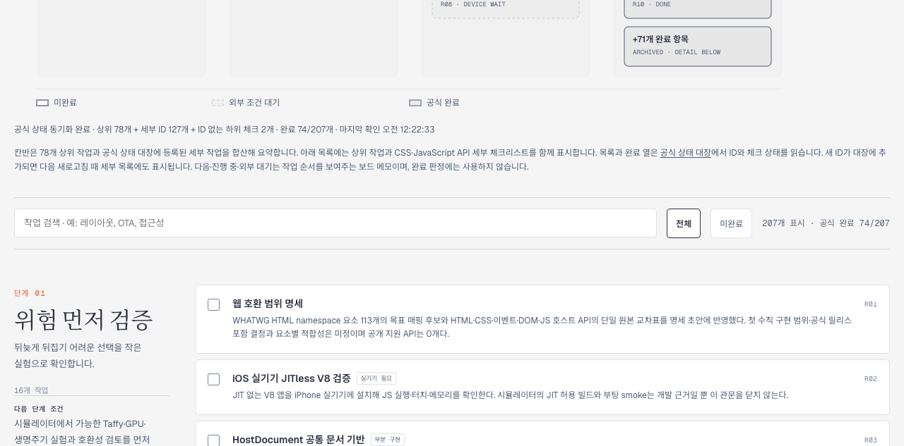
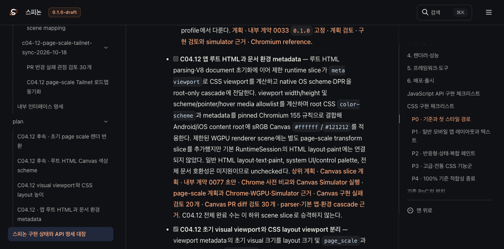
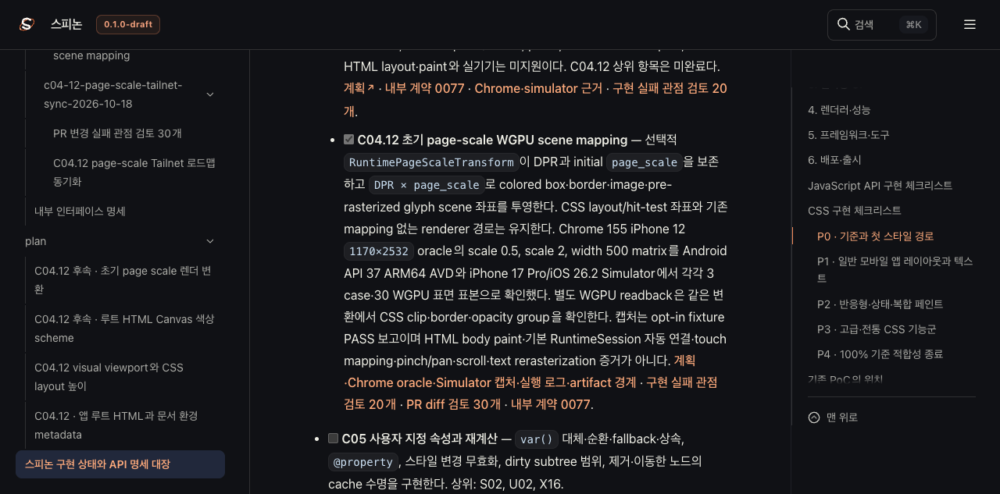
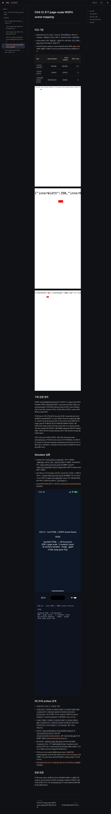

# C04.12 page-scale Tailnet 로드맵 동기화

## 갱신한 내용

PR [#279](https://github.com/ohah/spinon/pull/279)이 main에 병합된 뒤 Tailnet 로드맵의 설명과 링크를 최신 상태로 맞췄다. PR #279는 선택적인 WGPU scene 변환에서 DPR과 초기 `page_scale`을 곱해 box·border·image·pre-rasterized glyph geometry를 physical surface로 보낸다. 기본 `RuntimeSession`의 일반 HTML layout·paint가 자동 연결됐다는 뜻은 아니다.

로드맵에는 Chrome 155 iPhone 12 emulation의 scale 0.5·2·width 500 기준과 Android API 37 AVD, iPhone 17 Pro/iOS 26.2 Simulator에서의 3 case·30 WGPU 표본을 적었다. CSS clip·border·opacity group을 확인한 별도 readback도 연결했다. 두 앱 화면은 opt-in fixture PASS 보고 화면이며 일반 HTML body paint 캡처가 아니다. C04.12 상위 항목은 계속 미완료다.

Agent Browser가 Tailnet에서 읽은 공식 집계는 **207개 표시 · 공식 완료 74/207**이다. `STATUS.html`에서 C04.12 상위 항목은 unchecked, visual viewport 하위 항목과 page-scale WGPU 하위 항목은 checked로 렌더됐다. 이는 선택된 하위 항목의 상태이며 C04.12 전체 지원 완료를 의미하지 않는다.

## Tailnet 화면

Agent Browser 0.31.1 / Chrome 155로 확인한 로드맵 note와 공식 집계다.

상태 대장에서는 C04.12 상위 항목이 unchecked이고 visual viewport 하위 항목은 checked다. page-scale 하위 항목도 별도로 checked 상태로 표시된다.

## 계획·실행 페이지

Tailnet의 [page-scale 계획](https://macstudio.tailed42f2.ts.net/spinon/plan/c04-12-page-scale-rendering.html)과 [Chrome·WGPU·Simulator 실행 근거](https://macstudio.tailed42f2.ts.net/spinon/internal/evidence/c04-12-page-scale-rendering-2026-10-17/README.html)를 Agent Browser에서 열었다. 실행 근거 페이지의 Chrome oracle 이미지 3장과 Android·iOS Simulator 이미지 2장이 각 natural size로 로드됐다. 그 페이지 전체 화면도 보존했다.

## 선택 문서 빌드

Rspress `2.0.22`로 `STATUS`, C04.12 관련 plan 문서, 내부 계약 0077, 내부 인덱스, page-scale 실행 근거와 public `roadmap.html`만 포함한 임시 문서 root를 빌드했다. 선택 결과는 성공이며 16개 HTML route를 렌더했다. 전체 저장소 docs build와 전체 링크 검증은 수행하지 않았다. 선택 config에서 dead-link 검사를 껐다. [build 결과](./render-build-result.md) · [build 로그](./selected-build.log).

## Tailnet 미리보기 복사

미리보기 root는 `/Users/yoonhb/Library/Application Support/SpinonPreview`, 기존 listener는 `127.0.0.1:8768`의 PID 1191이다. 처음 게시할 때 62개 산출물의 local·Tailnet HTTP 응답 124건이 모두 200 및 SHA-256 일치였다. 기존 파일 15개를 별도 백업 경로에 먼저 저장·검증했고 파일 삭제는 0건이었다. 마지막 문서·화면 증거 반영 후의 manifest, 사전 검사, 백업, copy와 served hash는 아래 JSON에 기록한다.

- [첫 게시 manifest](./manifest-first.json), [첫 게시 preflight](./preflight-first.json), [첫 백업 검증](./backup-verification-first.json)
- [첫 복사 검증](./copy-verification-first.json), [첫 served hash 검증](./served-verification-first.json)
- [최종 manifest](./manifest-final.json), [최종 preflight](./preflight-final.json), [최종 백업 검증](./backup-verification-final.json)
- [최종 복사 검증](./copy-verification-final.json), [최종 served hash 검증](./served-verification-final.json)
- [Agent Browser 관찰값](./browser-verification.json), [Agent Browser 종료 확인](./browser-session-shutdown.json), [SHA-256 목록](./SHA256SUMS)

## 범위와 한계

- C04.12 전체, 기본 RuntimeSession의 일반 HTML body layout·paint, touch 좌표 변환, pinch/pan/scroll 및 실기기 동작을 완료로 판정하지 않는다.
- 전체 docs build, 전체 링크 적합성, Android hardware GPU 또는 iOS compositor 이후 픽셀을 주장하지 않는다.
- listener는 재시작하지 않았다. tmux와 기존 terminal-browser는 건드리지 않았고, 물리 기기 연결도 하지 않았다.
