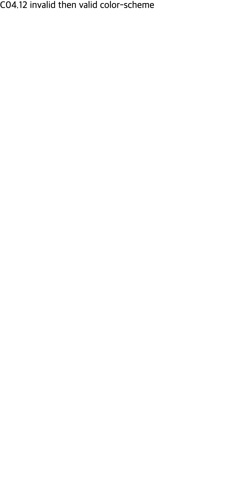
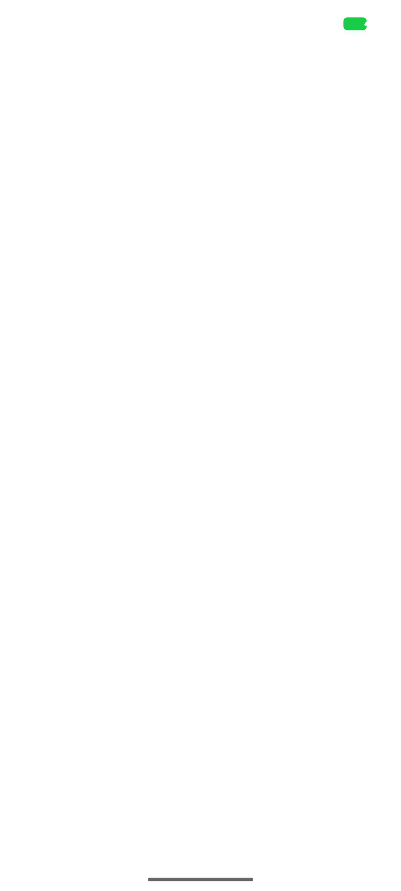
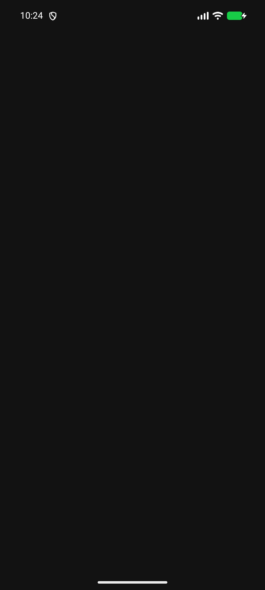
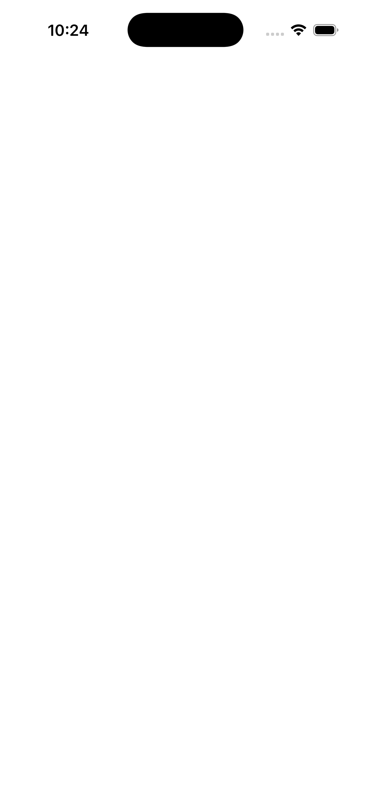
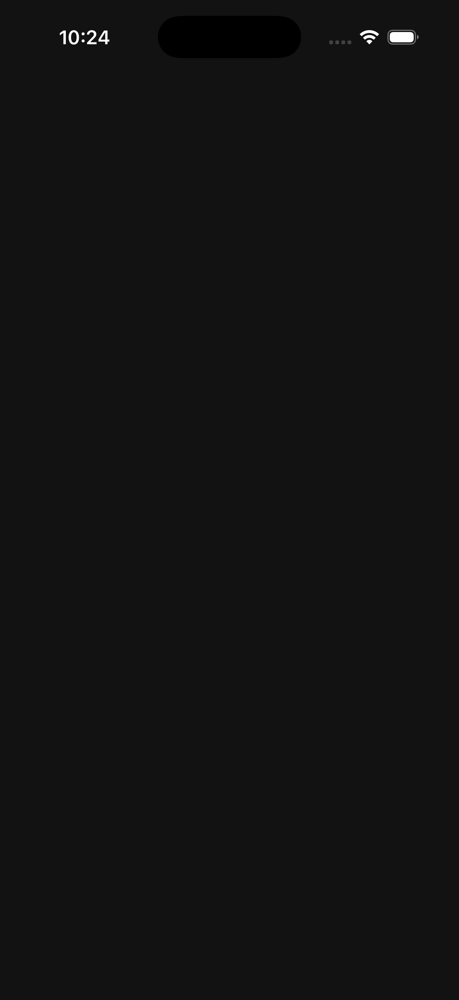

# C04.12 root Canvas color-scheme 사전 비교

이 기록은 구현 전에 고정 Chromium의 CSS Canvas 결과를 확인한 근거다. 캡처는 Chrome oracle 화면이며 Spinon 화면이 아니다.

## 실행 환경

- Agent Browser CLI `0.31.1`, Chrome `155.0.8059.85`, revision `0e66b94549a8bd85f03fbdf189b752d6e7b63c32-refs/branch-heads/8059@{#1304}`.
- macOS `26.5.1` build `25F80`, headless-new, SwiftShader.
- iPhone 12 emulation: CSS viewport `390×844`, DPR `3`, iOS Safari-shaped UA.
- OS light/dark was set with Agent Browser media emulation. Measurements used `getComputedStyle(document.documentElement).colorScheme`, a CSS `Canvas` color probe, and `matchMedia('(prefers-color-scheme: dark)')` independently.

## 관측 결과

| OS preference | 입력 | root computed `color-scheme` | Canvas | `prefers-color-scheme: dark` |
| --- | --- | --- | --- | --- |
| light, dark | metadata 없음 | `normal` | `rgb(255, 255, 255)` | OS 값 유지 |
| light, dark | meta `dark` | `normal` | `rgb(18, 18, 18)` | OS 값 유지 |
| light | meta `light dark` | `normal` | `rgb(255, 255, 255)` | light |
| dark | meta `light dark` | `normal` | `rgb(18, 18, 18)` | dark |
| light, dark | `:root { color-scheme: dark }` | `dark` | `rgb(18, 18, 18)` | OS 값 유지 |
| light | meta `light` + root CSS `dark` | `dark` | `rgb(18, 18, 18)` | light |
| light | meta `only dark` | `normal` | `rgb(18, 18, 18)` | light |
| light, dark | 단일 meta `unknown` | `normal` | `rgb(255, 255, 255)` | OS 값 유지 |
| light, dark | meta `unknown` 뒤 meta `dark` | `normal` | `rgb(255, 255, 255)` | OS 값 유지 |

마지막 행의 입력은 [`meta-invalid-then-valid.html`](meta-invalid-then-valid.html)이다. 두 OS preference에서 root computed scheme은 `normal`, Canvas는 흰색, text는 검정으로 관측했다. 이 문서는 중복 metadata 처리의 제품 호환 규칙을 주장하지 않는다. HTML Standard상 `meta name=color-scheme`은 유일해야 하므로 이 slice는 중복 입력을 fail-closed 처리한다.

## 판정 기준

- 일반 입력에서 Canvas byte는 Chrome `Canvas` probe와 정확히 비교한다: light `#ffffff`, dark `#121212`.
- CSS `prefers-color-scheme` 결과는 Canvas 선택과 독립으로 OS 값을 따라야 한다.
- root CSS computed value가 `normal`이면 metadata가 지원하는 scheme 중 OS preference를 선택하고, 없거나 invalid이면 light를 사용한다.
- 명시적 root CSS scheme은 metadata보다 우선한다.
- duplicate meta, cascade 오류·timeout, 누락된 root style, 오래된 cascade revision은 새 Canvas 결과로 게시하지 않는다.
- 캡처는 oracle 확인용이다. 앱 surface, HTML layout·paint 또는 native background의 검증 근거가 아니다.

## 해시

`SHA256SUMS`는 이 evidence 디렉터리 안의 README, fixture, 원본 로그, 캡처와 검토 문서를 고정한다. manifest 자신은 재귀 해시가 되지 않도록 제외한다.

## 기본 앱 실행 결과

기본 `examples/bootstrap/index.html`과 `root-app.js`를 사용하는 제품 앱 경로에서 OS scheme을 light→dark→light로 전환했다. 호출자는 UI thread에서 cascade를 기다리지 않고, 완료된 revision과 root Canvas 색을 받은 뒤 native content view에 색을 적용했다.

| 플랫폼 | 실제 실행 대상 | revision 순서 | content 중앙 픽셀 | 원본 로그 |
| --- | --- | --- | --- | --- |
| Android | API 37 ARM64 AVD `spinon_api37_1_compat16k`, `emulator-5554`, `sdk_gphone16k_arm64`, density `2.625` | light `0` → dark `1` → light `2` | `(255,255,255)` → `(18,18,18)` → `(255,255,255)` | [환경·cascade revision 로그](android-api37-environment.log) |
| iOS | iPhone 17 Pro Simulator, iOS `26.2`, arm64, scale `3` | light `0` → dark `1` → light `2` | `(255,255,255)` → `(18,18,18)` → `(255,255,255)` | [환경·cascade revision 로그](ios-iphone17pro-environment.log) |

마지막 light 캡처도 각각 [Android](android-api37-light-final.png), [iOS](ios-iphone17pro-light-final.png)에 보존했다. PNG 디코딩으로 여섯 캡처의 content 중앙 원시 RGB를 직접 읽었고 로그의 `canvas_color`와 모두 일치했다. Chrome 사전 비교와 앱 content surface의 표본만 대조했다. OS status/navigation UI는 색 선택 범위에서 제외했다.

이 화면은 native root background만 그린다. HTML body, text, form control, scroll bar, layout·paint는 여전히 그리지 않으며 C04.12 전체 완료를 뜻하지 않는다.

### 실행 로그 요약

- Android 초기 실행과 theme 재적용에서 `canvas_color=#ffffff`, `used_color_scheme=0`, `cascade_environment_revision=0`을 확인했다.
- Android dark 전환에서 `canvas_color=#121212`, `used_color_scheme=1`, environment/cascade revision `1`을 확인했다. 다음 light 전환에서 흰색과 revision `2`로 돌아왔다.
- iOS surface-change도 같은 `#ffffff → #121212 → #ffffff`와 revision `0 → 1 → 2`를 기록했다.
- 각 결과의 `cascade_generation`, `cascade_document_revision`, `cascade_render_tree_revision`, `cascade_style_revision`, `cascade_environment_revision`은 완료한 snapshot key에서 가져왔다. Canvas 색은 반환 environment revision과 완료 cascade environment revision이 같을 때만 게시했다.

## 빌드 소스 연결

마지막 Rust timeout 경계 수정까지 반영한 release Android APK와 iOS Simulator app을 다시 빌드한 뒤 위 전환을 재실행했다. pinned V8 checkout, 구현 소스 파일 해시, APK·iOS executable 해시, AVD/Simulator 식별자는 [`source-revision.json`](source-revision.json)에 연결되어 있다. Android Gradle은 compile SDK 37.2가 현재 Android Gradle Plugin 테스트 상한 36.1보다 높다는 호환 경고를 출력했지만 APK build는 성공했다.
