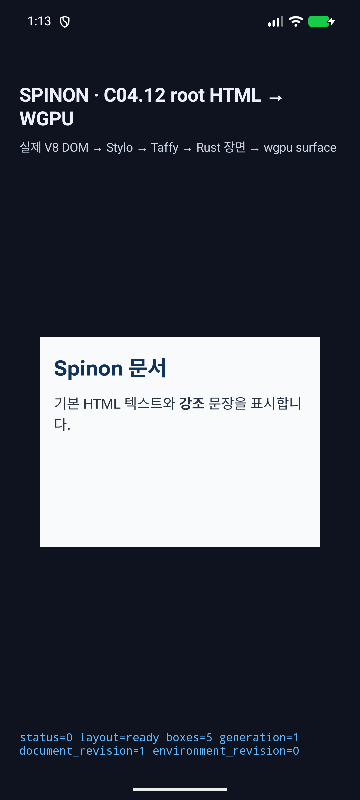
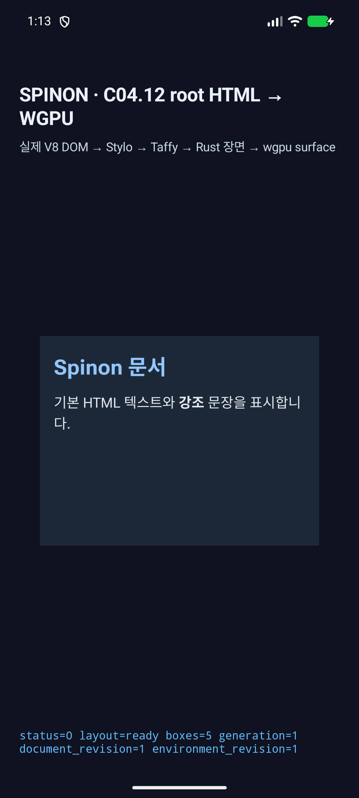
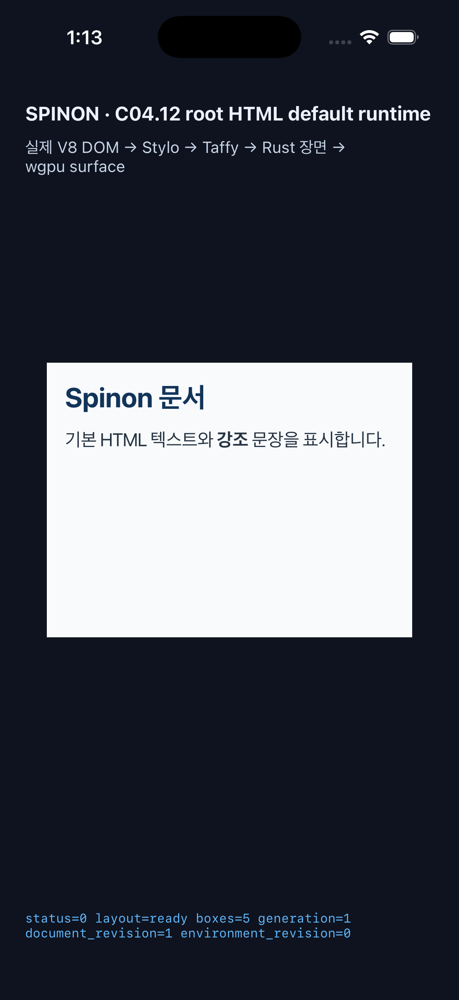
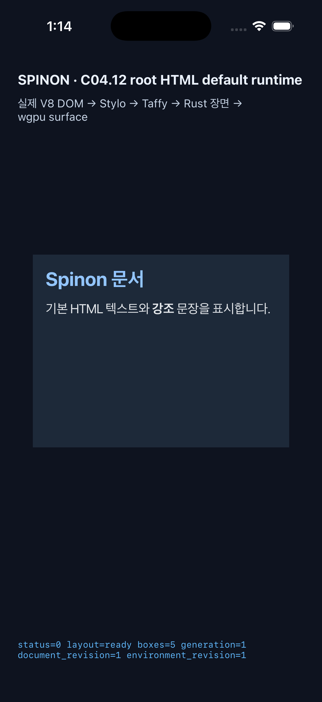

# C04.12 기본 root HTML runtime · Simulator 실행 근거 · 2026-10-19

## 판정

일반 root HTML GPU host 경로가 같은 parsed document의 computed Block layout, system-font text shaping/raster, light/dark 색과 WGPU scene을 연결하는 것을 확인했다. 이 실행은 제한 지원 subset의 근거다. 기본/fixture-test archive 경계, 독립 구현 실패 관점 20개, 최종 PR diff 실패 관점 30개 검토를 통과했다. PR #324는 2026-10-18 UTC에 병합했다. 저장소에는 PR CI workflow와 `main` required status check가 없어서 PR check rollup은 비어 있었다. 이 결과는 C04.12/C15/C16/C19 완료 근거가 아니다.

작업 branch `feat/c04-12-root-html-default-runtime-20261018`은 `8769891a`에서 시작했다. 구현은 이 worktree에서 진행했고 기존 Spinon checkout은 수정하지 않았다. 물리 기기는 연결하거나 사용하지 않았다.

## 공통 입력

- source: [`root-html-default-rendering.html`](https://macstudio.tailed42f2.ts.net/spinon/tests/fixtures/css/c04/root-html-default-rendering.html)
- Android 및 iOS bundle asset은 위 기준 fixture와 byte-identical이며 세 파일의 SHA-256은 `38813ca802618bd20bdf3bbb9ed9bc7525c289f48c0928813c855567f9e7df85`다.
- 입력 길이 1,298 UTF-8 bytes. HTML `<meta name="viewport">`, `<meta name="color-scheme">`, root `color-scheme`, `prefers-color-scheme`, 한국어 heading/paragraph, inline `strong`을 포함한다.
- Android launch: `adb -s emulator-5554 shell am start -n dev.spinon.bootstrap/.MainActivity --ez spinon_c0412_root_html_default_render true`
- iOS launch: `xcrun simctl launch ACA7BF91-E2D5-4CF7-909A-08D1AD95FF3D dev.spinon.bootstrap --spinon-c0412-root-html-default-render`

## Android

- API 37 ARM64 AVD `sdk_gphone16k_arm64`, 선택 serial `emulator-5554`; 연결된 물리 기기는 없었다. `localhost:5555`의 동일 모델 endpoint는 사용하지 않았다.
- CSS viewport `320×240`, device scale factor `2.625`, WGPU surface `840×630`, AVD screenshot `1080×2400`.
- Renderer는 ANGLE/SwiftShader OpenGL ES다. Android hardware GPU 결과가 아니다.
- Light log에서 `source bytes=1298`, `layout=ready`, `boxes=5`, `runtime_text_count=2`, `glyph_batch_draw_count=2`를 확인했다. Dark 전환에서 `dark=true`, `environment_revision=1`과 같은 두 text batch의 redraw를 확인했다. AVD는 마지막에 light (`Night mode: no`)로 복구했다.
- PNG는 AVD 전체 화면 capture다. 이 경로에서는 별도의 `PixelCopy`/GPU readback 비교를 하지 않았다.

| Scheme | 화면 | SHA-256 |
| --- | --- | --- |
| Light | [simulator-screen.png](./android/simulator-screen.png) | `88f557abdd92c4898b67d402b83f6294c17807ffe6a11cf4f9ac80203635b56e` |
| Dark | [simulator-screen-dark.png](./android/simulator-screen-dark.png) | `99ca23abf0a9861f6cb317c72ba31eb4b6aaab9440ed579cff2b0b5382eafb98` |





- [Light Logcat](./android/logcat.txt) · [Dark 전환 Logcat](./android/logcat-dark.txt)

## iOS

- iPhone 17 Pro / iOS 26.2 Simulator, device scale factor `3`, Metal drawable `960×720`, screenshot `1206×2622`.
- Unified log에서 `source bytes=1298`, `layout=ready`, `boxes=5`, `runtime_text_count=2`, `glyph_batch_draw_count=2`를 확인했다. Dark 전환은 `dark=true`, `environment_revision=1`; light 복귀는 `dark=false`, `environment_revision=2`로 새 scene을 제출했다. Simulator appearance는 마지막에 light로 복구했다.
- 기록된 draw는 Metal drawable 단계다. 이 근거는 compositor 이후 pixel readback이나 iOS 실기기 결과가 아니다.

| Scheme | 화면 | SHA-256 |
| --- | --- | --- |
| Light | [simulator-screen.png](./ios/simulator-screen.png) | `743dc660a394b58a35f24ab0277468d451e95611381851be66fc0a2c01b27646` |
| Dark | [simulator-screen-dark.png](./ios/simulator-screen-dark.png) | `4c74d6d2dde36a8e3d2fdcebeaed0a0d8f3cdd50f7d56304c75c9de0a1eb107b` |





- [Focused unified log](./ios/unified-log.txt)

## 빌드와 Rust 검증

V8 source dependency가 temporary worktree에 없어서 원래 checkout의 고정 pinned V8 source를 read-only 빌드 입력으로 사용했다. 해당 source는 pinned revision과 일치하고 clean이었다.

```sh
mise exec -- env SPINON_V8_DIR=<pinned clean V8 source> SPINON_ENABLE_C04_RUNTIME_GPU=1 bun run build:android
mise exec -- env SPINON_V8_DIR=<pinned clean V8 source> SPINON_ENABLE_C04_RUNTIME_GPU=1 bun run build:ios-sim
mise exec -- cargo test --locked -p spinon-runtime c04_12_root_html_default_runtime
mise exec -- cargo test --locked -p spinon-runtime --features c04-12-root-html-text-paint-fixture-test c04_12_root_html_text_paint_fixture_uses_parsed_text_and_owner_clips
mise exec -- cargo test --locked -p spinon-ffi --features c04-runtime-gpu-fixture-test root_html_constructor_rejects
mise exec -- cargo test --locked -p spinon-text-layout
mise exec -- cargo test --locked -p spinon-layout -p spinon-render -p spinon-style-to-layout -p spinon-style -p spinon-runtime -p spinon-ffi
mise exec -- bun test tools/css-reference/fixture-module-boundary.test.mjs
mise exec -- cargo check --locked -p spinon-ffi --features c04-runtime-gpu
mise exec -- cargo fmt --all -- --check
git diff --check
```

최종 Rust source의 text-layout 전체 `37/37`, 관련 layout/render/style/runtime/FFI 패키지, 기본 runtime `2/2`, fixture positive-control `1/1`, FFI 입력 거부 `2/2`, fixture-boundary `6/6`, 제품 feature check, rustfmt, diff check가 통과했다. 각 command output은 아래 log 링크에 보존했다. 앱은 최종 소스 반영 뒤 Android와 iOS Simulator에서 다시 빌드·설치·실행하고 네 light/dark 화면을 recapture했다. Gradle은 AGP `8.13.2`의 SDK 37.2 미검증 경고를 냈고, iOS link는 기존 V8 static archive 관련 duplicate symbol/debug-map 경고를 냈다. `display:none` 아래 미지원 text style 오류와 별도 엔진의 Parley Blob ID만 달라 snapshot equality가 실패하던 회귀를 수정했다. 손상 font index 거부 테스트의 기대 family도 입력 `Roboto`와 맞췄다. `display:none`/inline layout frame은 HostDocument 안의 frame임을 확인한 뒤 box-paint set에서 제외한다.

최종 Android APK SHA-256은 `f940e55ba2c3aac56656c689ae3aafb65ee7a76f30d23b342f74f79a8ebc9357`다. iOS build에서는 C04.12 demo title의 horizontal fit도 확인했다.

- [전체 text-layout package tests](./text-layout-package-test.log) · [관련 Rust package tests](./related-packages-test.log) · [fixture module boundary](./fixture-boundary-test.log)
- [기본 runtime focused test](./root-html-runtime-test.log) · [fixture positive-control](./root-html-fixture-test.log) · [FFI 입력 거부](./root-html-ffi-input-test.log) · [제품 feature check](./root-html-product-check.log)

- [제품 기본 / C04.12 fixture-test archive 경계](./artifact-boundary.txt)
- [구현 실패 관점 20개 검토](./implementation-review-20.md)
- [최종 PR diff 실패 관점 30개 검토](./pr-delta-review-30.md)
- [SHA-256 목록](./SHA256SUMS)은 동기화 manifest 자체와 이 목록 파일 자체를 제외한 근거 파일 해시를 담는다. manifest 해시는 이 목록을 참조한다.

## Tailnet 미리보기

선택한 문서의 RSPress 2.0.22 산출물과 직접 연결된 원본 fixture·시뮬레이터 근거 파일을 기존 Tailnet 미리보기 서버에 복사 동기화했다. 선택 build는 일부 계획·근거 페이지만 포함하므로 RSPress 자동 dead-link check를 끄고, 실제 Tailnet 링크는 Agent Browser에서 직접 요청해 확인했다. 사용한 [선택 문서 config](./rspress-selected-config.txt)와 [빌드 로그](./rspress-build.log)를 보존했다. 동기화된 경로별 해시와 기존 파일 백업, 생성·교체·동일 수는 [동기화 manifest](./tailnet-sync.json)에 기록했다. 파일 삭제나 Pages workflow는 없었다.

Agent Browser로 [로드맵](https://macstudio.tailed42f2.ts.net/spinon/roadmap.html)과 이 근거 페이지를 확인했다. 로드맵의 Android/iOS light·dark 캡처 4개, 근거 페이지의 원본 캡처·로그·HTML fixture 링크가 모두 HTTP 200이었다. 근거 페이지의 네 이미지도 각각 Android `1080×2400`, iOS `1206×2622` 픽셀로 로드됐다. [로드맵 화면](./tailnet-roadmap-agent-browser.png) · [근거 이미지 표시 화면](./tailnet-evidence-agent-browser.png)

## 범위

실제 앱 bundle HTML을 일반 root HTML source constructor로 전달했다. 고정 fixture selector, tag/id/text/font 기반 paint branch는 호출하지 않았다. 현재 surface는 light/dark scheme 변경에 따라 computed style과 revision-bound scene을 갱신한다.

이 화면은 미지원 HTML/CSS, arbitrary font loading, text selection/accessibility, inline decoration, full line breaking/fallback, dynamic rotation/resize matrix, hardware GPU, physical device, full Chrome/WPT compatibility를 검증하지 않는다. 지원 subset과 fail-closed 조건은 [내부 계약 0081](../../0081-c04-12-root-html-default-runtime.md)에 있다.
