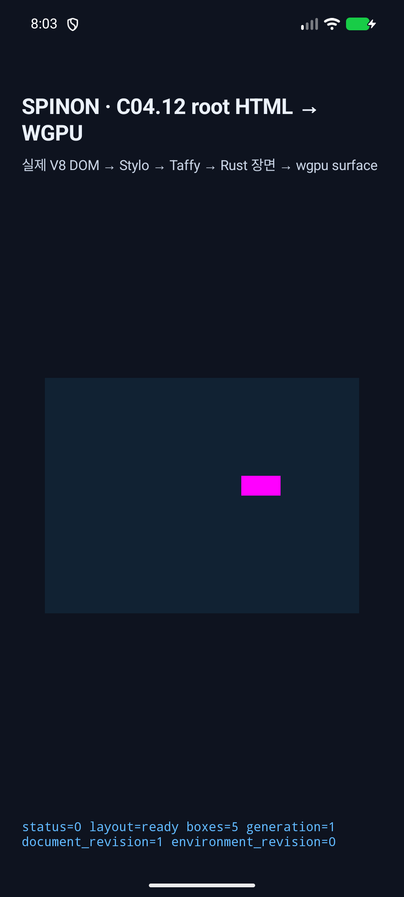
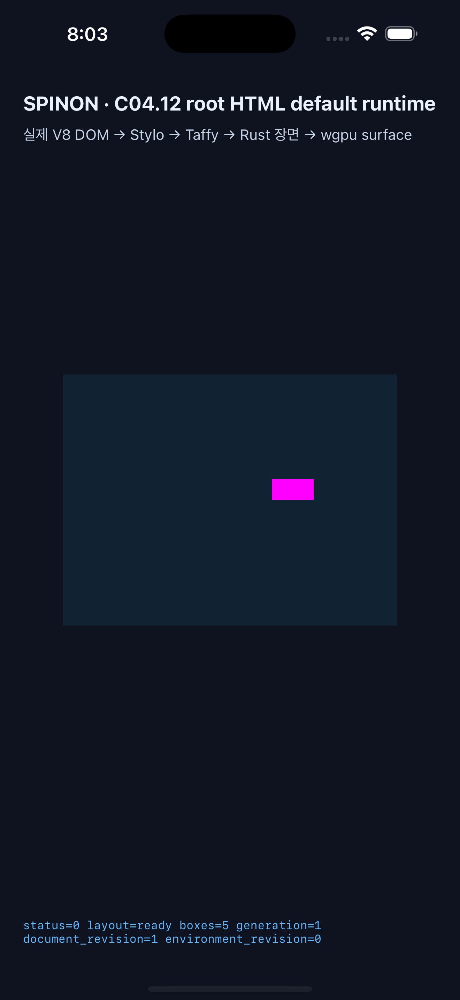
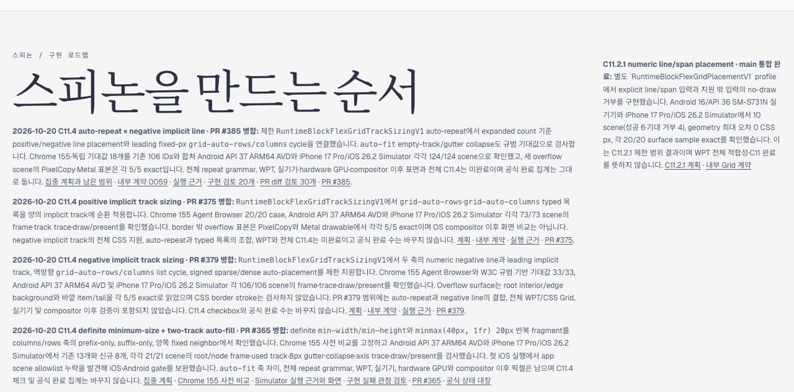
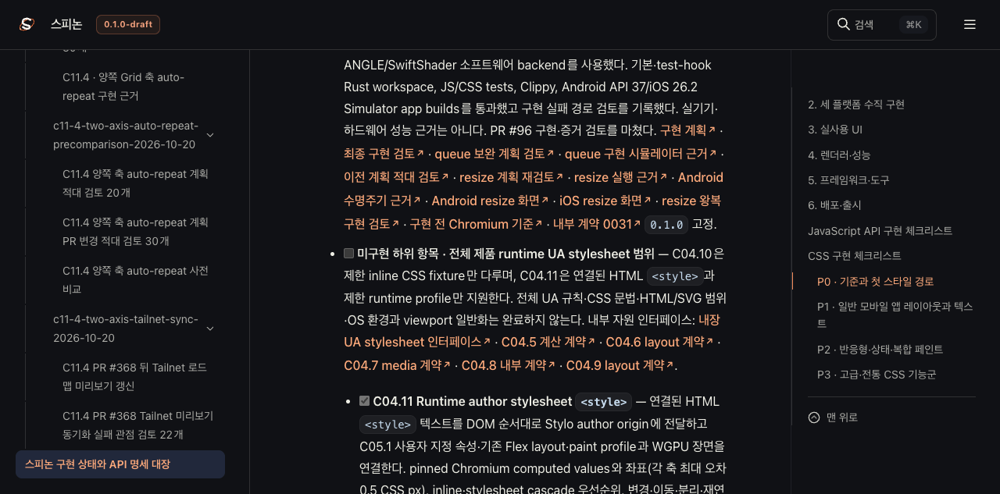
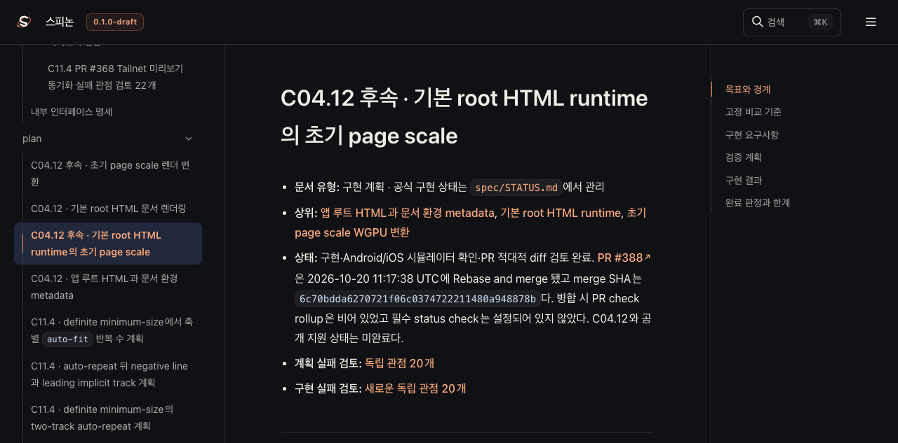
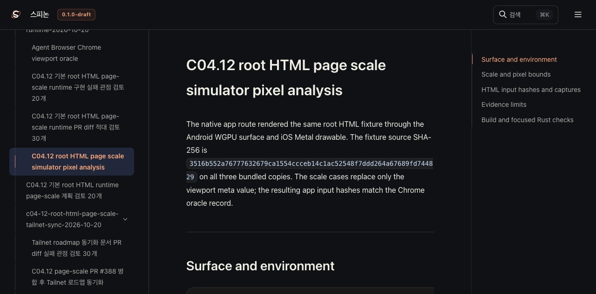

# C04.12 page-scale PR #388 병합 후 Tailnet 로드맵 동기화

## 기준과 범위

- 구현 PR: [#388](https://github.com/ohah/spinon/pull/388), 2026-10-20 11:17:38 UTC Rebase and merge
- merge SHA: `6c70bdda6270721f06c0374722211480a948878b`
- 미리보기: <https://macstudio.tailed42f2.ts.net/spinon/>
- 제공 디렉터리: `~/Library/Application Support/SpinonPreview`
- Tailnet preview server PID 1191과 tmux 세션은 계속 유지한다.
- GitHub Pages 배포나 앱 실행은 이 문서 동기화 범위에 포함하지 않는다.

병합된 제한 slice를 공식 `STATUS`, C04.12 page-scale 계획과 공개 로드맵에 기록한다. C04.12 상위 항목과 공식 완료 집계는 미완료/기존 값으로 유지한다. 병합 당시 PR check rollup은 비어 있었고 필수 status check는 설정되어 있지 않았다. 이를 CI 통과로 표시하지 않는다.

## 반영 내용

- `STATUS`에서 기본 root HTML 초기 page-scale runtime mapping 하위 항목을 완료로 표시하고 PR merge 정보와 review 근거를 연결했다.
- 계획과 PR diff review의 대기 상태를 실제 병합 결과로 교체했다.
- 공개 로드맵에 page-scale scene mapping, Android/iOS Simulator pixel 근거, PR #388 및 제한 범위를 추가했다.
- C04.12 상위 항목과 공개 완료 집계는 그대로 유지한다.

## Tailnet 파일 동기화

선택 문서와 연결된 실행 근거만 Rspress `2.0.22`로 빌드해 `/spinon/` 정적 미리보기에 반영했다. 전체 페이지 집합·사전 비교·교체 backup·열린 파일 및 HTTP 제공 해시 결과는 아래 JSON과 manifest에 기록한다. 대상 파일을 삭제하지 않고 교체본은 실행별 backup에 보존한다.

초기 pass01 동기화는 1,673개 파일(74,540,032 bytes)을 대상으로 새 파일 157개, 교체 105개, 동일 1,411개를 확인했다. 교체 전 backup은 105/105 SHA-256 일치, HTTP 200 및 served bytes/SHA-256은 1,673/1,673 일치했고 삭제는 0개였다. 교체 대상 중 Tailnet server PID 1191이 열던 과거 C11.4 HTML 4개는 기록 후 same-directory atomic rename으로 교체해 기존 열린 handle을 보존했다.

pass02는 browser screenshot과 pass01 동기화 기록을 포함해 1,685개 파일(77,876,013 bytes)을 제공했다. 새 파일 126개, 교체 116개, 동일 1,443개이며 교체 전 backup 116/116과 HTTP 200·served bytes/SHA-256 1,685/1,685가 일치했다. 삭제는 0개였다. server PID 1191이 교체 대상 `sync-review-20.html`을 열고 있어 기록 후 atomic rename했다.

pass03은 완료된 동기화 보고서와 pass02 검증 기록을 포함해 1,691개 파일(80,472,971 bytes)을 제공했다. 새 파일 120개, 교체 116개, 동일 1,455개이며 교체 전 backup 116/116과 HTTP 200·served bytes/SHA-256 1,691/1,691이 일치했다. 교체 대상 열린 파일은 0개였고 삭제는 0개였다. pass03 단계별 결과는 [preflight](./preflight-pass03.json), [열린 파일](./open-handles-before-copy-pass03.json), [copy/backup](./copy-and-backup-pass03.json), [served bytes/hash](./served-verification-pass03.json)에 있다.

pass06은 1,711개 파일(88,324,069 bytes)을 대상으로 새 파일 120개, 교체 120개, 동일 1,471개를 확인했다. 교체 전 backup 120/120과 HTTP 200·served bytes/SHA-256 1,711/1,711이 일치했고 삭제는 0개였다. 교체 대상 중 Tailnet server PID 1191이 열던 계획 HTML과 이전 pass04 route 결과 JSON은 기록 후 atomic rename했다. [pass06 preflight](./preflight-pass06.json) · [열린 파일](./open-handles-before-copy-pass06.json) · [copy/backup](./copy-and-backup-pass06.json) · [served bytes/hash](./served-verification-pass06.json).

- [선택 입력 SHA-256 manifest](./SHA256SUMS-preview-inputs.txt) · [선택 root](./prepare-root.json)
- [build 설정](./rspress.tailnet-sync.config.ts) · [Rspress build log](./selected-build.log)
- [pass03 preflight](./preflight-pass03.json) · [교체 전 열린 파일 확인](./open-handles-before-copy-pass03.json)
- [pass03 copy/backup 검증](./copy-and-backup-pass03.json) · [pass03 HTTP 제공 hash 검증](./served-verification-pass03.json)
- [Agent Browser route 확인](./browser-check-pass01.json)

## 화면 근거

화면은 PR #388의 Android API 37 ARM64 AVD 및 iPhone 17 Pro Max/iOS 26.2 Simulator 실행에서 저장했다. scale `2`에서 녹색 edge probe가 surface 밖으로 잘리는 것을 포함해 실제 bounds와 clear 색상은 [pixel 분석](../c04-12-root-html-page-scale-runtime-2026-10-20/simulator-pixel-analysis.md)에서 확인한다. 이 화면은 실기기나 OS compositor 이후의 픽셀을 증명하지 않는다.

## Agent Browser 확인

Agent Browser `0.31.1`에서 Tailnet 로드맵, `STATUS`, 계획, 동기화 보고서 route를 확인했다. 로드맵에 PR #388 merge SHA가 있고, `STATUS`에서는 C04.12 parent checkbox가 꺼진 채 page-scale mapping 하위 항목만 켜져 있다. 계획은 merge SHA와 과거 merge 대기 문구 제거를 보여준다. 보고서에는 가린 홈 경로와 화면 이미지 7/7이 표시된다. [최종 pass05 route 결과](./browser-check-final-pass05.json)와 [화면 기록](./browser-check-pass01.json)을 보존했다. 이는 Tailnet 문서 화면이며 앱 runtime 재검증이 아니다.

## 검토와 남은 범위

- [동기화 실패 관점 20개](./sync-review-20.md)
- [문서 PR diff 검토 30개](./pr-diff-review-30.md)
- 이 동기화는 문서 미리보기 갱신이다. 시뮬레이터를 다시 실행하거나 PR #388의 검증 범위를 확장하지 않는다.
- pinch/pan, scroll visual viewport, native input remapping, text rerasterization, 일반 HTML/CSS, 실기기, hardware GPU, iOS compositor 이후 pixel 및 C04.12 전체 지원은 미완료다.
