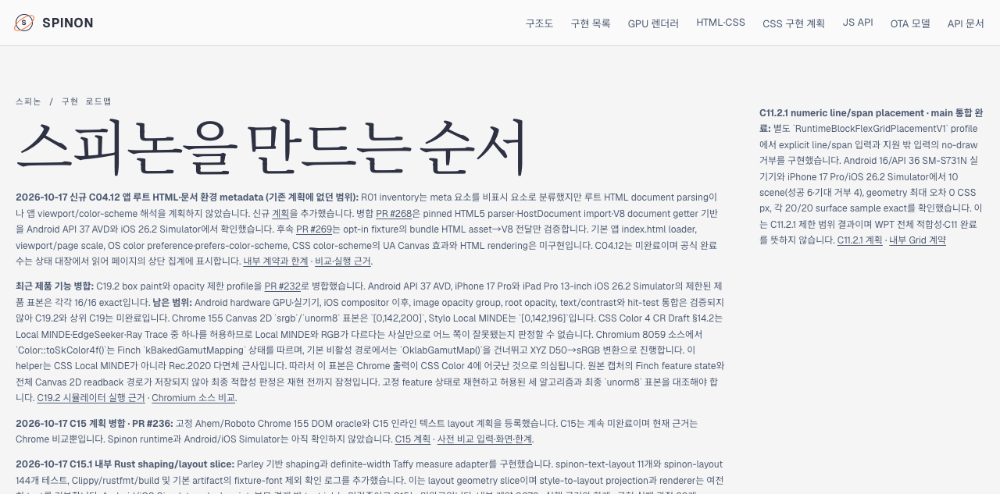
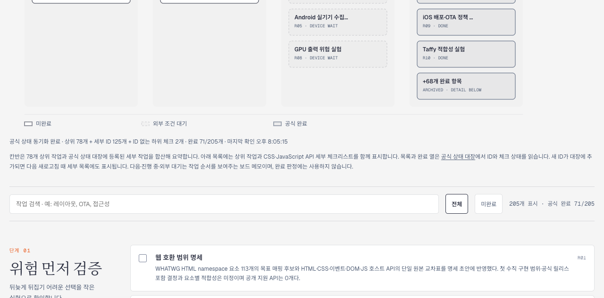

# C04.12 Tailnet 로드맵 동기화 및 화면 검증

## 변경 출처

- [PR #269](https://github.com/ohah/spinon/pull/269) 구현 fixture가 2026-10-17에 병합됐다. merge commit은 `39e3ce4215a6649c976c63e3a3280acea274ec7e`다.
- [PR #270](https://github.com/ohah/spinon/pull/270)에서 오래된 고정 counter 문구를 제거하고 2026-10-17에 병합했다. merge commit은 `f43a04ff61f9148ebf16047f069dd8280353feda`다.
- C04.12는 미완료이며 STATUS 체크박스는 바꾸지 않았다.

## 동기화와 숫자 정정

첫 C04.12 preview 복사 뒤 Agent Browser에서 로드맵 문단의 고정 숫자 61/197과 GitHub STATUS를 읽는 공식 counter 71/205가 다른 것을 발견했다. 61/197은 과거 스냅샷이었다. PR #270에서 고정 숫자를 제거해 공식 counter를 원본으로 안내한 뒤, 병합된 main 기준으로 preview를 다시 갱신했다. PR #269 설명에도 현재 STATUS 기준 71/205라고 바로잡았다.

초기 복사에서 교체한 네 파일은 먼저 백업했고, 숫자 정정 뒤 다시 교체한 두 로드맵 파일도 별도 경로에 백업했다. 최종 68개 경로는 로컬 preview와 Tailnet에서 각각 HTTP 200, 바이트 길이, SHA-256이 모두 일치한다. 파일 삭제는 없었다.

| 단계 | 경로 | 복사/교체/동일 | 바이트 | 백업 |
|---|---:|---:|---:|---:|
| 첫 C04.12 게시 | 68 | 57 / 4 / 11 | 2,969,246 | 교체 4개 |
| #270 병합 뒤 최종 정정 | 68 | 2 / 66 / 0 | 2,969,346 | 교체 2개 |
| 삭제 | 0 | - | - | - |

세부 내역은 [최종 manifest](manifest.json), [사전 검사](preflight.json), [복사 검증](copy-verification.json), [HTTP 제공 검증](served-verification.json)에 있다. 초기 복사와 백업 기록도 별도 JSON으로 보존했다.

## Agent Browser 확인

Agent Browser 0.31.1에서 Tailnet 로드맵의 C04.12 미완료 상태, 계획·PR #268·PR #269, 내부 계약과 비교 근거 링크를 확인했다. 공식 counter는 `205개 표시 · 공식 완료 71/205`였고 STATUS 동기화 문구는 상위 78개, 세부 ID 125개, ID 없는 하위 2개를 표시했다. 계획, 내부 계약, evidence README도 각각 열렸으며 README의 Chrome oracle 이미지 2장이 정상 로드됐다.

PR #271 본문에 붙인 roadmap과 counter 캡처도 Agent Browser에서 열어 각각 1280×633 크기로 로드되는 것을 확인했다. PR 본문은 공식 `71/205`, C04.12 미완료, 이번 변경의 남은 범위를 표시한다. 확인이 끝난 전용 세션은 닫았고 `session info`가 `active: false`, `pid: null`을 반환했으며 브라우저 프로세스 PID 72211도 더는 존재하지 않았다.

로드맵 캡처는 C04.12 범위와 링크를 보여주고 counter 캡처는 공식 71/205 집계를 보여준다. 이들은 Tailnet 문서 화면 근거이며 앱 실행 화면이나 C04.12 기능 완료 증거가 아니다.

## 범위와 보존

- 선택 Rspress build 결과만 게시했다. 전체 docs strict build나 저장소 전체 dead-link 검사는 하지 않았다.
- Android/iOS Simulator나 실기기를 다시 실행하지 않았다. PR #269의 AVD·Simulator 캡처는 이전 fixture 실행 결과다.
- 기존 Tailnet Serve listener PID 1191의 127.0.0.1:8768 경로를 재시작하지 않았다. tmux는 변경하지 않았다.
- Agent Browser 세션은 종료하고 전용 프로세스가 남지 않았는지 확인했다.
- C04.12는 미완료다. 기본 앱 index.html loader, viewport/page scale, OS color preference와 prefers-color-scheme, CSS color-scheme의 UA Canvas 효과, 실제 HTML render는 남아 있다. 공식 count는 GitHub STATUS에서 동적으로 읽는다.

## 관련 근거

- [Rspress 선택 빌드 결과](render-build-result.md), [빌드 로그](selected-build.log), [원본 로그 gzip](selected-build.log.raw.gz)
- [브라우저 검증](browser-verification.json), [PR 변경 검토 30항목](pr-delta-review-30.md), [SHA-256 목록](SHA256SUMS)
- [최종 manifest](manifest.json), [counter 정정 백업](counter-correction-backup-verification.json)
