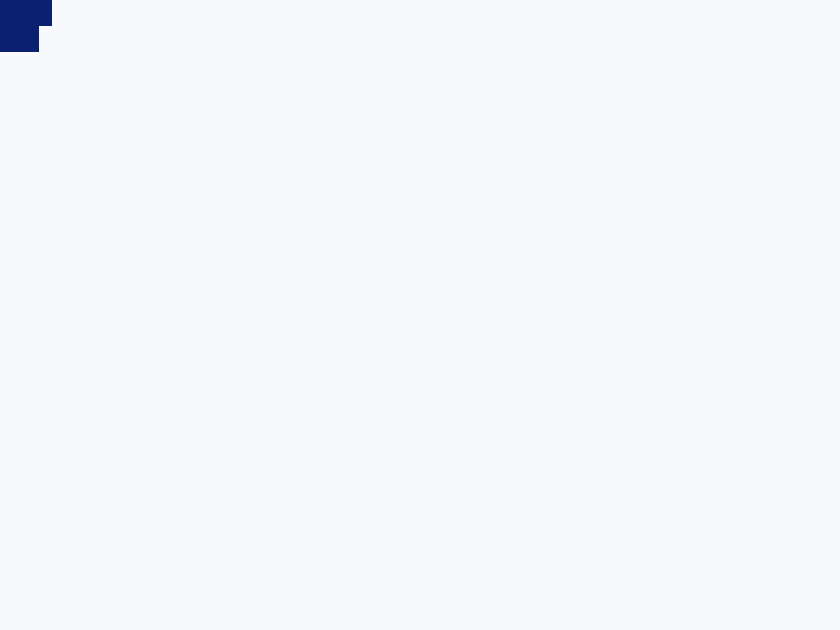
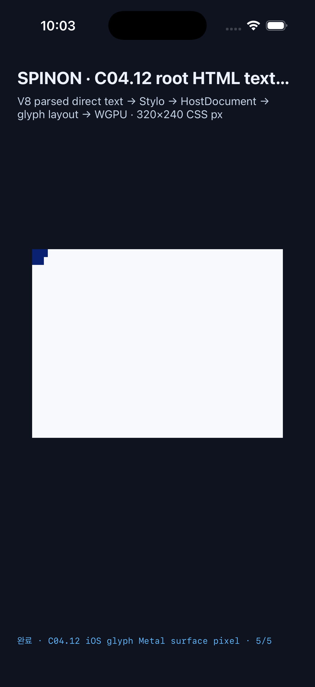

# C04.12 파싱 root HTML direct text paint 구현 근거

## 범위와 입력

이 opt-in slice는 [Chrome 155 사전 비교](../c04-12-root-html-text-paint-precomparison-2026-10-18/README.md)의 고정 `320×240 CSS px` fixture를 동일 HTML5 parser의 HostDocument에서 읽는다. runtime fixture SHA-256은 `5b0373916cfbba1bd62a47d9a363ba44cafa5f98913b21ee026b132b9d6e28a4`, Ahem font SHA-256은 `b719ecb31c5b21fc573c03f6421c74ac63c271a5a3ff841e34f9705fb94b8448`다.

두 parsed direct Text `XX`가 각각 Ahem glyph layout·raster·runtime paint scene에 들어간다. 첫 owner는 `overflow:visible`, 둘째는 `overflow:hidden`이다. 고정 CSS layout advance는 `20×10px`, 각 owner box는 `15×10px`; hidden `HIDDEN` control과 head의 text는 scene에 없다. 이 고정 입력은 일반 HTML text 지원, CSS `@font-face`, 전체 C15를 구현하지 않는다.

## Rust·feature 검사

| 실행 | 결과 |
| --- | --- |
| `mise exec -- cargo test --locked --offline --workspace` | 29 test suites, 1,084 passed, 0 failed, 4 ignored. 전체 원본은 [workspace-tests.log](./workspace-tests.log). |
| `mise exec -- cargo test --locked --offline -p spinon-runtime --features c04-12-root-html-text-paint-fixture-test c04_12_root_html_text_paint_ -- --nocapture` | 2 passed: parsed direct text/owner clip 성공, source/tree/font/color/overflow/hidden control 변조 7종 전체 거부. |
| `mise exec -- cargo test --locked --offline -p spinon-ffi --features c04-12-root-html-text-paint-fixture-test root_html_text_paint_readback_tests -- --nocapture` | 2 passed: surface-size 기반 pixel-center projection, 잘못된 표면·viewport 밖 표본 거부. |
| `mise exec -- cargo test --locked --offline -p spinon-ffi --features c04-12-root-html-text-paint-fixture-test text_eval_requires_its_fixture_host_kind -- --nocapture` | 1 passed: FFI fixture-kind gate helper의 mismatch 거부·matching 허용. FFI 테스트 프로세스에서 V8 isolate 생성은 실패해 다른 종류의 live host를 전달하는 end-to-end 호출은 미검증. |
| `mise exec -- bun test tools/css-reference/fixture-module-boundary.test.mjs` | 6 passed: 고정 fixture module 경로·feature 경계 검사. |
| `mise exec -- cargo fmt --all -- --check` | 통과. |
| `bash -n tools/build-android.sh tools/build-ios-native.sh tools/build-ios-sim.sh` | 통과. |
| `plutil -lint platforms/ios/SpinonBootstrap.xcodeproj/project.pbxproj` | 통과. |

표준 `mise exec -- cargo clippy --locked --offline --workspace --all-targets -- -D warnings`는 이 작업에서 추가하지 않은 `spinon-style`의 `compute_cascade_with_reuse` 8개 인자 lint에서 멈춘다. 해당 함수 서명은 `origin/main`과 동일하다. 원본은 [workspace-clippy.log](./workspace-clippy.log). `-A clippy::too_many_arguments`만 추가한 workspace Clippy, 그리고 같은 예외를 사용한 text fixture feature의 `spinon-runtime`/`spinon-ffi` Clippy는 통과했다. 신규 text 모듈에서 발견된 `unnecessary_map_or` 및 renderer 조건 lint는 수정 후 feature Clippy를 다시 실행했다.

기본 host FFI static archive 490,804,664 bytes에서 raw archive byte scan으로 text fixture의 exported symbol 두 개, readback marker, 정확한 Ahem payload가 모두 없음을 확인했다. 최신 opt-in archive 654,366,120 bytes에는 두 symbol, marker, Ahem bytes, runtime HTML fixture bytes가 모두 있다. [기본 archive scan](./artifact-scan-default.txt) · [opt-in positive control](./artifact-scan-fixture.txt). 이 검사는 macOS host debug archive의 feature boundary이며 Android/iOS release app 크기 측정이 아니다.

## 앱 빌드와 시뮬레이터 실행

두 앱은 `SPINON_ENABLE_C04_RUNTIME_GPU=1`, `SPINON_ENABLE_C04_12_ROOT_HTML_TEXT_PAINT_FIXTURE_TEST=1`을 켠 최신 source build다. 빌드가 사용한 기존 V8 checkout은 `7b50b62cb18f28617959e8452e2cd18195b38bcf`이며 checkout이 clean이었다.

| 플랫폼 | 대상·readback 경계 | 결과 |
| --- | --- | --- |
| Android | API 37 ARM64 AVD `emulator-5554`, `sdk_gphone16k_arm64`, physical `1080×2400`, density `420 dpi`; ANGLE Vulkan SwiftShader. SurfaceView를 PixelCopy로 읽었다. | surface `840×630`, CSS viewport `320×240`; `(3,3)`, `(43,3)`, `(3,30)`, `(43,30)`, `(263,263)`에서 RGBA exact `5/5`. 최신 rebuild app PID `23393`, run ID `5db2aba0b957`. [실행 로그](./android-api37-log.txt) · [빌드 로그](./android-build.log). |
| iOS | iPhone 17 Pro Simulator, iOS `26.2`, arm64; Metal drawable 직접 읽기. | drawable `960×720`, CSS viewport `320×240`; `(4,4)`, `(49,4)`, `(4,34)`, `(49,34)`, `(301,301)`에서 RGBA exact `5/5`. 최신 rebuild app PID `50093`. 이는 compositor 제출 전 drawable 결과다. [실행 로그](./ios-iphone17pro-log.txt) · [빌드 로그](./ios-build.log). |

두 환경의 RGBA 순서는 `(9,33,112,255)`, `(9,33,112,255)`, `(9,33,112,255)`, `(247,249,252,255)`, `(247,249,252,255)`다. 첫 세 점은 visible 첫/overflow glyph와 hidden owner 첫 glyph, 넷째는 `overflow:hidden` 바깥, 다섯째는 배경 대조다. Android AVD는 software renderer이며 어느 결과도 실기기·hardware GPU·최종 compositor/scanout 색을 증명하지 않는다.

Android PixelCopy PNG SHA-256: `0a21b226d8ea21c13d4d0c4545c116d67cfc735f05df8d7cea4204fe44e33439` (`840×630`). Latest Android debug APK SHA-256: `b2b023064c534893b95b987bba4a3edce27af4f8cb43110e0bf5dd22501d4cdd`.

iOS Simulator screenshot SHA-256: `2bd2083b4e9cbc6d2dc0b5996bd445f5e87c7dc12378ed7a090ff6ae8d297555` (`1206×2622`). Latest iOS app executable SHA-256: `7d66364206b0d2946c1697976831cb770905cbeb4a06b70609f96360a95fbf03`.

## 남은 경계

기본 app 일반 HTML text rendering, arbitrary font/color/line-break CSS, async font loading/fallback, nested inline, selection/hit geometry, scroll, C04.12/C15 전체, Android hardware GPU, 실기기, iOS compositor 이후 표본, WPT/전체 Chromium 적합성은 확인하지 않았다. 상위 C04.12와 C15는 미완료로 둔다.
