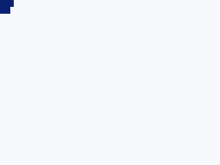

# C04.12 parsed root HTML text paint 사전 비교

## 비교 입력과 실행

- Chrome oracle HTML: [`root-html-text-paint.html`](../../../../tests/fixtures/css/c04/root-html-text-paint.html). Runtime input: [`root-html-text-paint-runtime.html`](../../../../tests/fixtures/css/c04/root-html-text-paint-runtime.html), 동일한 DOM·CSS profile에서 Chrome 전용 `@font-face` loader만 뺀다. Android/iOS opt-in harness는 고정 Ahem asset을 직접 등록한다. runtime fixture는 Chrome oracle 입력이나 CSS `@font-face` 지원 근거가 아니다.
- 폰트: 기존 고정 Ahem fixture `tests/fixtures/resources/c15/Ahem.ttf`, SHA-256 `b719ecb31c5b21fc573c03f6421c74ac63c271a5a3ff841e34f9705fb94b8448`
- 브라우저: Agent Browser가 구동한 Chrome `155.0.8059.85`, macOS `26.5.1`, ARM64, viewport `320×240 CSS px`, DPR `1`. `document.fonts.ready` 뒤 `document.fonts.check("10px Ahem")`가 true인지 확인했다.
- DOM·computed style 관찰은 [`chrome155-observation.json`](./chrome155-observation.json), 화면은 아래 screenshot이다. HTML과 font는 localhost에서 받았고 외부 네트워크 자원은 없다.

## CSS px geometry oracle

| 요소 | computed style | border box | text Range |
| --- | --- | --- | --- |
| `#visible` | `width:15px`, `height:10px`, `overflow-x:visible`, Ahem `10px/10px`, `#092170` | `(0,0) 15×10` | `(0,0) 20×10` |
| `#hidden` | `width:15px`, `height:10px`, `overflow-x:hidden`, Ahem `10px/10px`, `#092170` | `(0,10) 15×10` | `(0,10) 20×10` |
| `#not-rendered` | `display:none` | `(0,0) 0×0` | empty |

`white-space:normal`에서 분리되지 않는 단어 `XX`는 줄 안에서 쪼개지지 않아 두 경우 모두 Range 폭이 `20px`다. `overflow`는 DOM Range의 advance를 줄이지 않는다. 실제 잉크 clip은 고정 screenshot 표본으로 판정한다.

관찰 JSON의 body/main 높이 `20px`와 두 visible block의 y 좌표 `0px`, `10px`는 이 고정 fixture의 block 사이 markup whitespace가 추가 line box 높이를 만들지 않는다는 근거다. text node 목록 자체를 별도로 수집하지 않았으므로, 이 결과를 임의의 whitespace/text flow 전체로 확대하지 않는다.

## 화면 표본

| 좌표 (CSS px = pixel) | 입력 | 기대 RGBA |
| --- | --- | --- |
| `(1,1)` | visible 첫 glyph | `[9,33,112,255]` |
| `(16,1)` | visible 상자 오른쪽 밖 두 번째 glyph | `[9,33,112,255]` |
| `(1,11)` | hidden 첫 glyph | `[9,33,112,255]` |
| `(16,11)` | hidden 상자 오른쪽 밖 | `[247,249,252,255]` |
| `(100,100)` | stage 배경 대조 | `[247,249,252,255]` |

## 판정 경계

이 oracle은 **Chrome의 root HTML DOM geometry·screenshot**이다. Spinon runtime, Android/iOS, 공개 CSS 지원, WPT 적합성 결과가 아니다. `meta color-scheme`은 기존 환경 경로와의 입력 형태를 유지하지만 이 fixture는 scheme 선택이나 Canvas fallback을 다시 판정하지 않는다. CSS font/color subset은 구현 계획에서 정한 opt-in fixed-font profile만 대상으로 하며 arbitrary font loading, system fallback, 전체 CSS text cascade를 뜻하지 않는다. Runtime input은 브라우저 oracle과 같은 DOM/CSS를 유지하되 `@font-face` loader만 제거하고 테스트 harness가 고정 Ahem bytes를 직접 등록한다.

Agent Browser 전용 session과 localhost 정적 서버는 관찰 뒤 종료했고 Agent Browser session list에 active session이 남지 않은 것을 확인했다.
