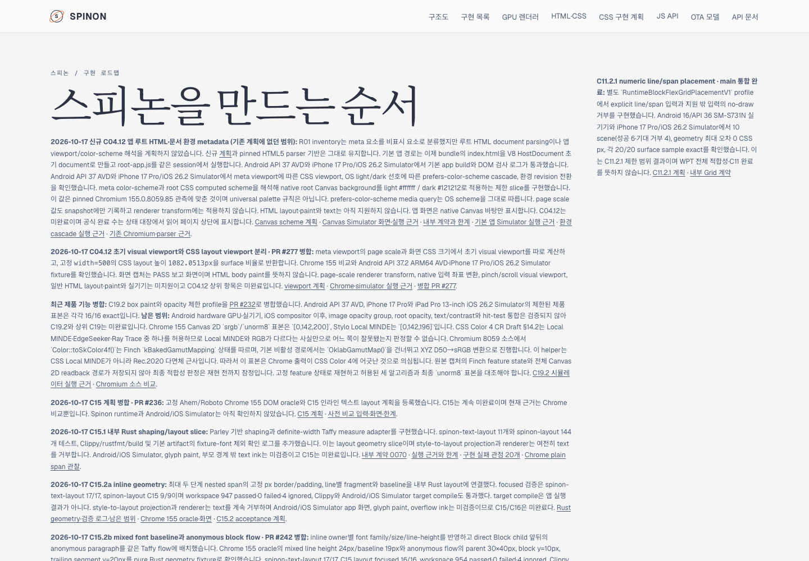
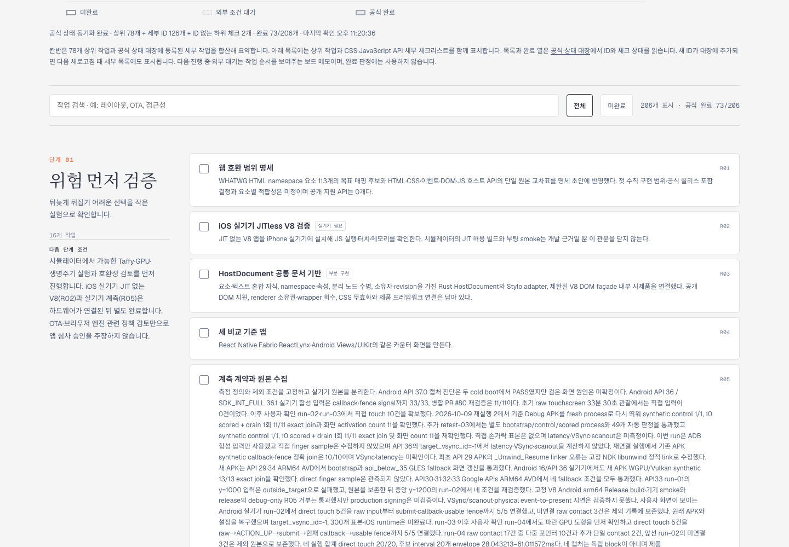
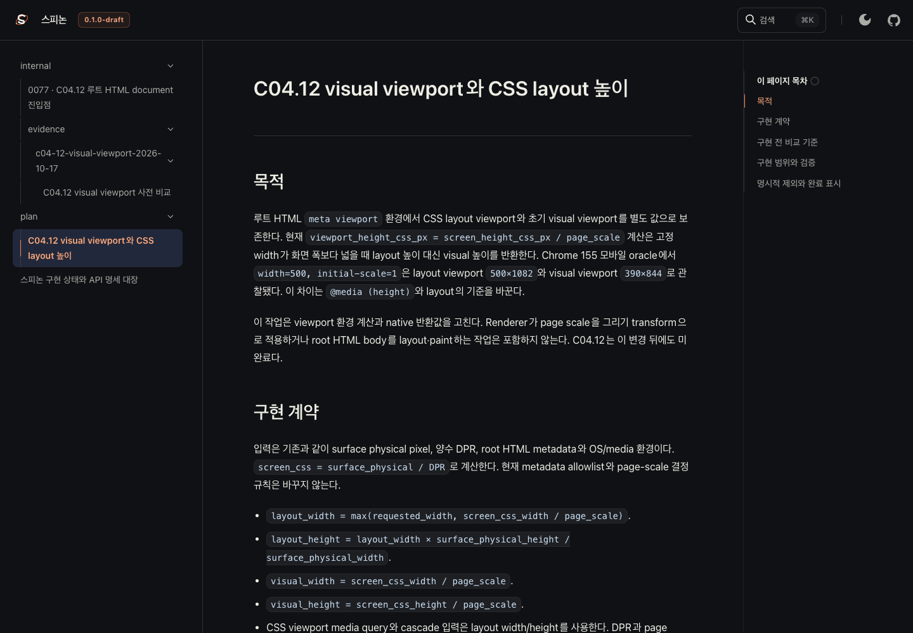

# C04.12 Tailnet 로드맵 동기화와 화면 검증

## 갱신한 내용

PR #277 병합 뒤 [Tailnet 로드맵](https://macstudio.tailed42f2.ts.net/spinon/roadmap.html)에 visual viewport 하위 단계의 요약과 계획·실행 근거 링크를 추가했다. 고정 `width=500`의 layout viewport `500×1082.0513 CSS px`와 초기 visual viewport `390×844 CSS px`, Android API 37.2 ARM64 AVD·iPhone 17 Pro/iOS 26.2 Simulator fixture 결과를 기록한다. Simulator 캡처가 PASS 보고 화면이고 HTML body paint 증거가 아니라는 제한도 함께 적었다.

기존 C15.3 문단에 남은 `61/197`은 이전 스냅샷이라고 명시했다. Agent Browser가 읽은 공식 상태 대장 집계는 `206개 표시 · 공식 완료 73/206`이다. C04.12 상위 체크는 미완료이고, PR #277에서 완료 표시한 visual viewport 하위 항목만 체크되어 있다. 완료 수는 로드맵에 고정하지 않고 상태 대장 동기화 결과를 따른다.

## Tailnet 미리보기 동기화

Rspress `2.0.22` 선택 빌드에서 `STATUS`, C04.12 계획, 내부 계약 0077, viewport 실행 근거와 이 동기화 근거를 렌더링했다. 렌더한 HTML과 원본 Markdown·증거 자산, Tailnet 로드맵 HTML을 복사 방식으로 게시했다. 전체 저장소 docs build가 성공했다고 주장하지 않는다. 선택 빌드는 임시 문서 root에서 관련 다섯 페이지를 렌더했고 `markdown.link.checkDeadLinks=false`를 적용했다. 선택 페이지의 사이드바와 검색 index도 해당 다섯 문서 범위다. 기존 Tailnet 문서 파일은 삭제하지 않았다.

저장소 전체 문서 build는 기존 evidence PNG import 누락 때문에 실패한다. 별도 전체 build attempt의 로그와 선택 build 성공 로그를 보존했다. 전체 문서의 링크·이미지가 정상이라고 판정하지 않는다.

첫 복사 뒤 에이전트 브라우저에서 viewport 근거 `README.html` 경로가 404인 것을 발견했다. 선택 빌드 결과의 해당 HTML 경로를 추가 복사한 뒤 로컬·Tailnet에서 HTTP 200과 원본 SHA-256 일치를 확인했다. 오래된 `61/197` 문구를 수정할 때 기존 로드맵 파일도 먼저 백업했다. 각 교체 파일의 백업 경로, 최종 파일 목록과 HTTP 응답 digest는 JSON 근거에 있다. 복사 중 삭제한 파일은 없다.

Tailnet Serve listener는 `127.0.0.1:8768`, PID `1191`로 유지했고 재시작하지 않았다. tmux와 기존 terminal-browser 세션은 건드리지 않았다. 이 동기화 작업에서 Simulator나 실기기를 실행하지 않았다. 아래 AVD·Simulator 화면은 PR #277 실행에서 보존한 기존 결과다.

## Agent Browser 확인

Agent Browser에서 로드맵의 공식 `73/206` 집계와 오래된 수의 과거 스냅샷 표기를 확인했다. 상태 대장에서 C04.12 상위 항목은 unchecked, visual viewport 하위 항목은 checked로 표시된다. C04.12 계획, 내부 계약 0077, viewport 근거 페이지를 열었고 근거 페이지의 Android `1080×2400` 및 iOS `1206×2622` 캡처가 모두 로드됐다.

브라우저 검증 세부값과 캡처 digest는 [browser-verification.json](./browser-verification.json), 렌더 결과는 [render-build-result.md](./render-build-result.md)에 있다.

## 범위와 한계

- C04.12 전체는 미완료다. 일반 HTML body layout·paint, renderer page-scale transform, native input 좌표 변환, pinch/scroll, 실기기 동작은 확인하지 않았다.
- Rspress 선택 빌드는 기존 전체 문서의 dead link나 빠진 evidence image를 해결하지 않는다.
- 미리보기 listener와 사용자 터미널 상태를 그대로 유지했다. Agent Browser 전용 세션은 검증 뒤 종료했고, `session info`의 inactive 상태를 기록한다.

## 보존 근거

- [최종 게시 manifest](manifest.json), [사전 검사](preflight.json), [파일 복사 검증](copy-verification.json), [HTTP 제공 검증](served-verification.json)
- [빠진 HTML 경로 수정 기록](route-fix-verification.json), [로드맵 과거 수 정정 기록](roadmap-correction.json)
- [Rspress build 결과](render-build-result.md), [선택 build 로그](selected-build.log), [전체 문서 build 실패 로그](full-docs-build-failure.log)
- [PR 변경 검토 30항목](pr-delta-review-30.md), [SHA-256 목록](SHA256SUMS)
