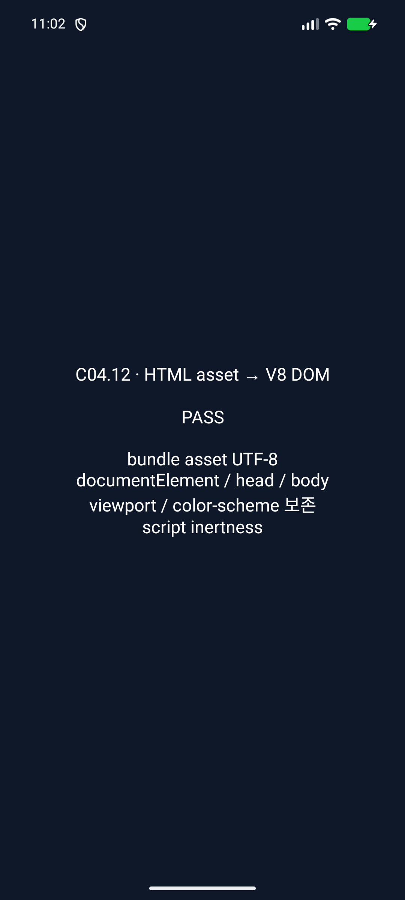
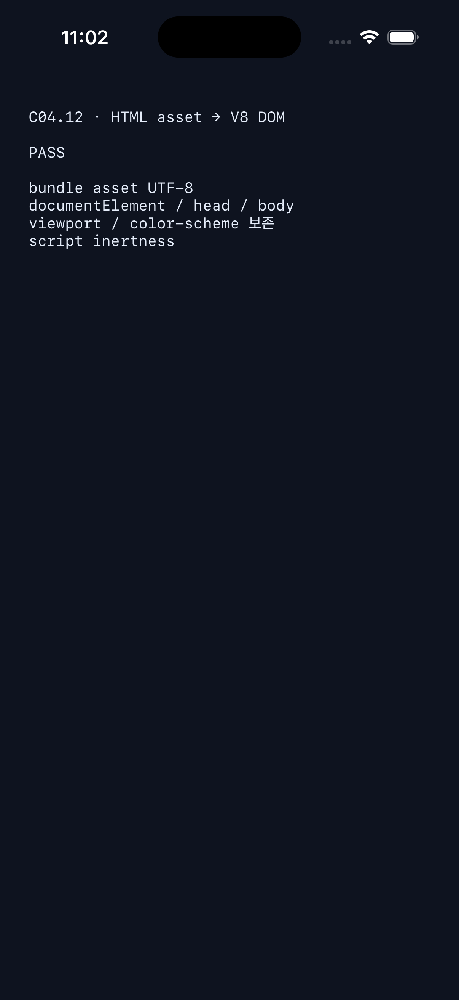

# C04.12 visual viewport 사전 비교

## 환경

- Agent Browser CLI `0.31.1`, Chrome `155.0.8059.85` arm64, headless-new.
- iPhone 12 device emulation: `screen=390×844`, DPR `3`, surface screenshot `1170×2532`.
- 입력 fixture, 관찰값, screenshot pixel bbox를 각각 보존했다. PNG는 Chrome oracle 캡처이며 Spinon app 화면이 아니다.
- layout viewport는 `document.documentElement.clientWidth/clientHeight`와 media query 결과로 판정했다. emulation 환경에서 `innerWidth/innerHeight`가 이 값과 달랐으므로 사용하지 않았다.

## 관찰

| Fixture | Layout viewport CSS px | Visual viewport CSS px | scale | probe surface pixel bbox | `DPR × scale` |
| --- | ---: | ---: | ---: | ---: | ---: |
| `width=device-width, initial-scale=0.5` | `780×1688` | `780×1688` | `0.5` | `(150,75)-(180,90)` | `1.5` |
| `width=device-width, initial-scale=2` | `390×844` | `195×422` | `2` | `(600,300)-(720,360)` | `6` |
| `width=500, initial-scale=1` | `500×1082` | `390×844` | `1` | `(300,150)-(360,180)` | `3` |

모든 fixture에서 probe는 CSS `(100,50)` 크기 `20×10`이다. 두 번째 viewport가 layout viewport와 달라지는 scale 2와 고정 width 500 cases의 캡처 bbox는 CSS probe에 `DPR × visualViewport.scale`을 곱한 정수 pixel 경계와 일치한다.

고정 width 500 case에서 `(max-height: 900px)`는 false, `(min-height: 1000px)`는 true였다. layout height는 visual height 844가 아니라 1082 CSS px다. width=device-width scale2 case는 layout height 844, visual height 422 CSS px이며 `(max-height: 900px)`는 true다.

## 한계

- 이 캡처는 브라우저 oracle이며 Spinon의 구현·렌더 결과가 아니다.
- meta viewport 없는 입력은 별도 Chrome 기준에서 layout/visual `980×2121`, scale `0.39795917`로 기록돼 있다. 이번 headless device-emulation session에서는 live metrics와 초기 스크립트·screenshot이 서로 달라 no-meta pixel bbox는 여기서 인용하지 않는다.
- browser screenshots는 텍스트 raster 품질, pinch zoom, scroll offset, native event mapping을 검증하지 않는다.

## 앱 simulator 실행

- Android: API 37.2 ARM64 AVD `emulator-5554`, `dev.spinon.bootstrap` debug APK. opt-in `spinon_c0412_root_html_asset` 경로가 실제 V8 document를 확인한 다음 3개 viewport/cascade case를 실행했다. FFI의 environment struct와 Canvas nested environment 응답도 각각 비교했다. logcat 결과: `status=0 c04_12_root_html_asset=PASS c04_12_viewport=PASS c04_12_environment_abi=PASS cases=3 fixed_width=500x1082 visual=390x844`.
- iOS: iPhone 17 Pro, iOS 26.2 Simulator, `dev.spinon.bootstrap` debug app. `--spinon-c0412-root-html-asset` 경로 결과는 `SPINON_C0412_ROOT_HTML_ASSET status=pass`다.
Android 앱 화면은 아래와 같다. 두 캡처 모두 fixture PASS 보고 화면이며 HTML 콘텐츠 화면이 아니다. 원본 logcat/unified log는 각각 `android-api37-logcat.txt`, `ios-iphone17pro-log.txt`에 보존했다. 각 앱 실행은 V8 root HTML asset import와 layout/visual viewport 값 및 CSS height media query 행렬을 함께 확인한다. body layout·paint, page-scale renderer transform, 실기기 동작은 확인하지 않았다.

## 코드 검증

- `cargo fmt --all -- --check`: 통과.
- `cargo test --locked -p spinon-runtime root_html`: 30개 통과.
- `cargo test --locked -p spinon-ffi root_html --features c04-12-root-html-fixture-test`: 5개 경계 테스트 통과. 양의 V8 앱 경로와 FFI environment 응답은 두 Simulator 캡처/log로 별도 확인한다.
- `node --test tools/css-reference/fixture-module-boundary.test.mjs`: 6개 통과.
- `cargo clippy --locked -p spinon-ffi --all-targets --features c04-12-root-html-fixture-test -- -D warnings`: 통과.
- `cargo clippy --locked --workspace --all-targets -- -D warnings`: 통과.
- `cargo build --locked -p spinon-ffi --lib` 기본 정적 라이브러리에 C04.12 fixture 심볼이 없고, opt-in iOS Simulator 정적 라이브러리에는 `spinon_c04_12_root_html_accessors_fixture`와 `spinon_c04_12_root_html_asset_fixture` 심볼이 있는 것을 `nm`으로 확인했다.
- `mise exec -- bun run docs:build`: 실패. Rspress가 기존 `spec/STATUS.md`의 계획 링크와 여러 날짜별 evidence 디렉터리의 raw log/PNG/JSON 링크를 dead link로 보고한다. 새 viewport README/plan/review 파일에서 발생한 dead link는 없음을 빌드 출력으로 확인했다.
- `SPINON_V8_DIR=... SPINON_ENABLE_C04_12_ROOT_HTML_FIXTURE_TEST=1 mise exec -- bun run build:android`: 성공, API 37 AVD 설치·실행 통과.
- `SPINON_V8_DIR=... SPINON_ENABLE_C04_12_ROOT_HTML_FIXTURE_TEST=1 mise exec -- bun run build:ios-sim`: 성공, iPhone 17 Pro Simulator 설치·실행 통과.
- [구현 실패 관점 검토 20개](./implementation-review-20.md).
- [최종 PR diff 검토 30개](./pr-delta-review-30.md).

## 파일 해시

`SHA256SUMS`에는 세 Chrome 입력 fixture, Chrome oracle 캡처와 두 Simulator의 앱 캡처·로그 digest를 기록한다.
