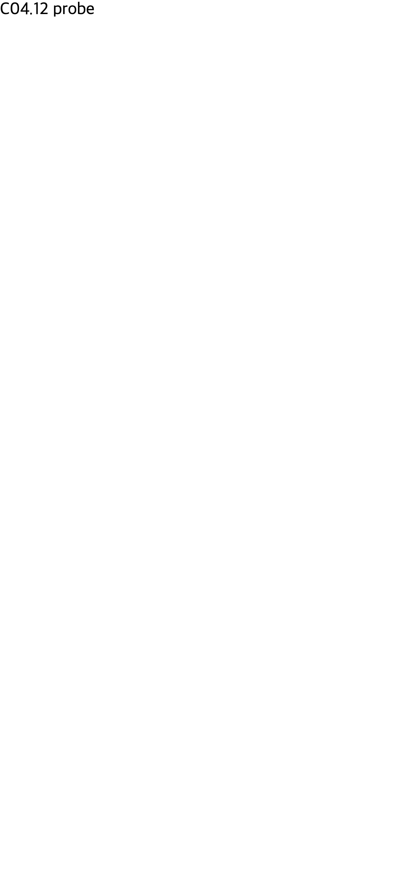
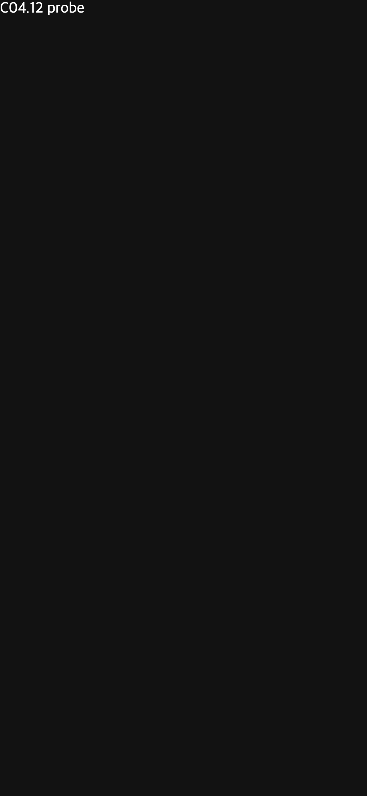

# C04.12 루트 HTML 문서 환경 사전 비교

## 목적과 범위

앱 루트 HTML 파서와 환경 metadata를 구현하기 전에 고정 Chromium 동작을 관찰했다. 이 문서는 Chromium oracle 결과만 기록한다. Spinon runtime, Android 앱, iOS 앱이 같은 동작을 한다는 근거는 아니다.

## 고정 환경

- Agent Browser CLI `0.31.1`을 사용했다. terminal-browser는 사용하지 않았다.
- Chrome `155.0.8059.85` 공식 arm64 빌드, Chromium revision `0e66b94549a8bd85f03fbdf189b752d6e7b63c32-refs/branch-heads/8059@{#1304}`.
- macOS `26.5.1` build `25F80`; Chrome은 `HeadlessChrome/155.0.0.0`, headless-new, window `1280×720`, SwiftShader 설정으로 실행했다.
- 모바일 case는 Agent Browser의 iPhone 12 device emulation을 사용했다. UA는 iOS 14.0 Safari 형태였고 `screen=390×844`, `devicePixelRatio=3`이었다.
- HTML 입력은 이 폴더의 독립 fixture다. 각 fixture와 캡처의 SHA-256은 [`SHA256SUMS`](SHA256SUMS)에 고정했다.

## Viewport 결과

| Fixture | 관찰값 |
| --- | --- |
| [`mobile-default.html`](mobile-default.html) | viewport meta가 없을 때 layout viewport `980×2121`, visual viewport `980×2120.8206`, scale `0.39795917`, DPR `3`, body scroll width `980`. |
| [`mobile-width-device.html`](mobile-width-device.html) | `width=device-width, initial-scale=1`에서 layout/visual width `390`, height `844`, scale `1`; `max-width:390px` media query가 참. |
| [`mobile-width-320.html`](mobile-width-320.html) | `width=320, initial-scale=1`이어도 layout `innerWidth=390`; Chrome이 device width까지 확장했다. |
| [`mobile-scale-half.html`](mobile-scale-half.html) | `width=device-width, initial-scale=0.5`에서 `innerWidth=780`, visual width `780`, scale `0.5`; `max-width:390px`는 거짓. |
| [`mobile-duplicate-width.html`](mobile-duplicate-width.html) | `device-width` 뒤 `width=500` 선언에서 scroll width `500`, `innerWidth=501`, visual width `390`, scale `1`. 이 fixture에서 뒤 선언이 관찰 결과를 바꿨다. |

`width=320` 및 중복 선언 값은 위 Chrome 빌드의 실제 관찰값이다. 모든 브라우저의 일반 규칙으로 확대하지 않는다. 중복 viewport 선언의 표준·호환 정책은 구현 계약에서 별도로 정한다.

## Color-scheme 결과

`matchMedia('(prefers-color-scheme: dark/light)')`, root/body computed `color-scheme`, CSS `Canvas` 색상 probe를 분리해 관찰했다.

| OS preference | 입력 | Media 결과 | 계산/Canvas 결과 |
| --- | --- | --- | --- |
| dark | metadata 없음 | dark | root `normal`; Canvas 밝은 배경 |
| dark | meta `light dark` 또는 `dark` | dark | Canvas 어두운 배경 |
| dark | root CSS `color-scheme: dark` | dark | root/body `dark`; Canvas 어두운 배경 |
| light | metadata 없음 | light | root `normal`; Canvas 밝은 배경 |
| light | meta `light dark` | light | root `normal`; Canvas 밝은 배경 |
| light | meta `dark` 또는 `only dark` | light | Canvas 어두운 배경 |
| light | root CSS `color-scheme: dark` | light | root/body `dark`; Canvas 어두운 배경 |
| light | meta `light` + root CSS `dark` | light | CSS `dark`; Canvas 어두운 배경 |
| light | 중복 meta `light dark`, 뒤에 `dark` | light | Canvas 밝은 배경; 이 중복은 표준상 유일성 요구를 어기는 입력이다. |
| light | 잘못된 meta 값 `unknown` | light | 기본 밝은 Canvas |

이 관찰에서 `prefers-color-scheme`는 OS/user preference를 반영하고, 문서의 지원 scheme과 root CSS `color-scheme`은 UA Canvas 색상 선택에 별도로 관여했다. 따라서 OS preference와 문서 지원 scheme을 한 boolean으로 합치면 안 된다. 이미지 캡처는 probe의 배경만 보이는 Chrome oracle이며 Spinon 동작 화면이 아니다.

## 구현 전 판정과 남은 한계

- layout viewport 크기, scale, DPR, OS scheme, `prefers-color-scheme` 결과는 각기 별도 입력/출력으로 유지한다. 특히 `initial-scale`은 layout viewport 결과를 바꾸므로 native surface 크기와 혼동하지 않는다.
- 문서 `meta color-scheme`은 지원 scheme 선언으로 보존한다. `prefers-color-scheme`는 native OS/user preference에서 계산하며 meta 값만으로 바꾸지 않는다. root CSS `color-scheme`은 cascade 결과로 별도 반영한다.
- Canvas 기본색은 이 구현 항목에서 다룰 좁은 UA 결과다. 일반 시스템 색상 전체, 폼 컨트롤 테마, forced-colors 지원으로 확대하지 않는다.
- iPhone 12의 portrait emulation은 확인했지만 실제 기기 회전 이벤트는 확인하지 않았다. `set viewport`로 만든 landscape 입력은 device emulation을 초기화했으므로 회전 근거로 쓰지 않는다.
- 이 Chromium 비교에서는 malformed HTML의 tree-construction 결과, CSS media viewport 입력, page-scale rendering 및 Spinon app surface hit-test를 확인하지 않았다.
- 실행 후 지정한 Agent Browser 세션을 닫았다. 종료 명령 뒤에도 남은 전용 Chrome/Agent Browser 프로세스를 profile 경로로 식별해 종료했고, 마지막 확인에서 해당 프로세스가 없었다. tmux와 사용자 브라우저는 건드리지 않았다.

## Spinon 실제 V8 DOM fixture

2026-10-17에 C04.12 opt-in fixture를 실제 V8이 포함된 앱에서 실행했다. fixture가 검사하는 항목은 `document.documentElement/head/body`, root/head/body parent 관계, root·main attribute와 text, `<meta name="viewport">`·`<meta name="color-scheme">`·`<style>` 문서 순서, style text, HTML의 `<script>`가 실행되지 않는 조건이다. 추가로 기존 `html` root를 교체한 뒤 `document.documentElement`가 첫 element를 반환하고 `head`·`body`가 `null`인지 검사한다.

| 플랫폼 | 실행 환경 | 결과 | 화면 |
| --- | --- | --- | --- |
| Android | API 37 ARM64 AVD `emulator-5554` | `SPINON_C0412_ROOT_HTML status=0 ... c04_12_root_html_accessors=PASS` | [캡처](android-api37-root-html-accessors.png) |
| iOS | iPhone 17 Pro Simulator, iOS 26.2, arm64 simulator | `SPINON_C0412_ROOT_HTML status=pass` | [캡처](ios-iphone17pro-root-html-accessors.png) |

시뮬레이터 검증 전 iOS 기본 빌드가 C15.3 fixture 비활성 상태에서 전용 상태값을 참조하던 기존 Swift 조건부 컴파일 오류에 막혔다. C15.3 평가 블록을 해당 feature 조건으로 한정해 비활성 빌드도 컴파일되도록 고쳤고, C04.12 feature만 켠 `tools/build-ios-sim.sh` 빌드가 성공했다. C15.3 feature를 켰을 때 그 검증 블록은 기존과 같이 컴파일된다.

이 결과는 루트 HTML tree를 HostDocument와 V8 document accessor에 연결한 것만 증명한다. 두 화면은 별도 fixture-test UIKit 화면이며 HTML CSS를 그린 결과가 아니다. meta viewport가 CSS layout viewport/page scale을 바꾸는지, `@media`가 viewport와 OS scheme에 반응하는지, meta/root CSS `color-scheme`이 UA Canvas 색상에 반영되는지, 기본 앱이 `index.html` asset을 전달하는지는 아직 구현·검증하지 않았다. 따라서 C04.12는 미완료다.

### 구현 경계 및 검증 기록

- `cargo test --locked -p spinon-runtime root_html`: 8/8 통과. source/node/depth/attribute 제한, HTML5 복구 및 table foster parenting, 문서 순서, HostDocument import, `<template>` contents 비노출 및 초기 snapshot을 확인했다.
- `cargo test --locked -p spinon-ffi root_html --features c04-12-root-html-fixture-test`: 2/2 통과. C ABI에서 비 UTF-8 및 허용 크기 초과 source가 세션 생성 전에 거부된다.
- 변경된 runtime·FFI crate의 `cargo clippy --all-targets -- -D warnings`, `cargo fmt --all -- --check`, `git diff --check`, Android/iOS build script 문법 검사를 통과했다.
- host release staticlib 대조에서 기본 artifact에는 `spinon_c04_12_root_html_accessors_fixture` 심볼과 고정 assertion payload가 없고, `c04-12-root-html-fixture-test` opt-in artifact에는 둘 다 있었다. 이는 host staticlib 경계 근거이며 Android/iOS 최종 app bundle 크기·심볼 검증은 아니다.
- iOS 빌드 전 C15.3 fixture 비활성 조건에서 해당 전용 변수 대입이 무조건 컴파일되던 기존 Swift 오류를 찾았다. 대입 검증 블록을 C15.3 feature로 한정한 후 C04.12 fixture만 켠 iOS build와 simulator 실행이 통과했다. C15.3 동작은 feature 활성일 때 같은 블록에서 유지된다.
- 서로 다른 20개 구현 실패 관점 검토는 [별도 기록](../c04-12-root-html-implementation-review-2026-10-17.md)에 있다. 제품 루트 HTML asset 연결 및 metadata 효과가 빠져 있다는 점도 검토 결과와 별도로 이 C04.12 진행 상태에 남겼다.
- PR 변경 검토 중 `document.documentElement`가 `html` 이름만 반환하던 제한을 발견해 DOM의 첫 element child를 반환하도록 고쳤다. 실제 V8 Android/iOS fixture는 root 교체 후 getter 동작과 `head`·`body` 부재도 검사한다.
