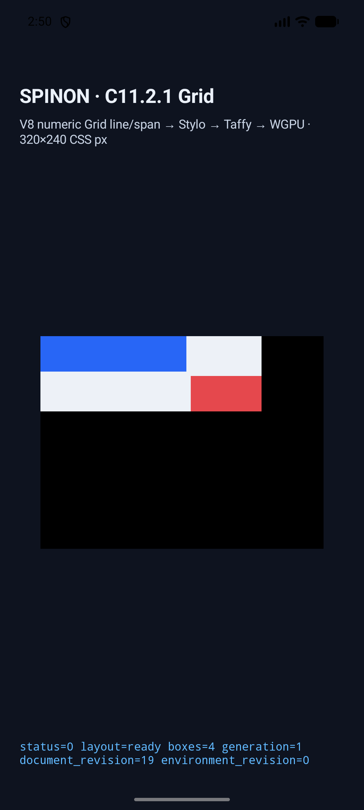
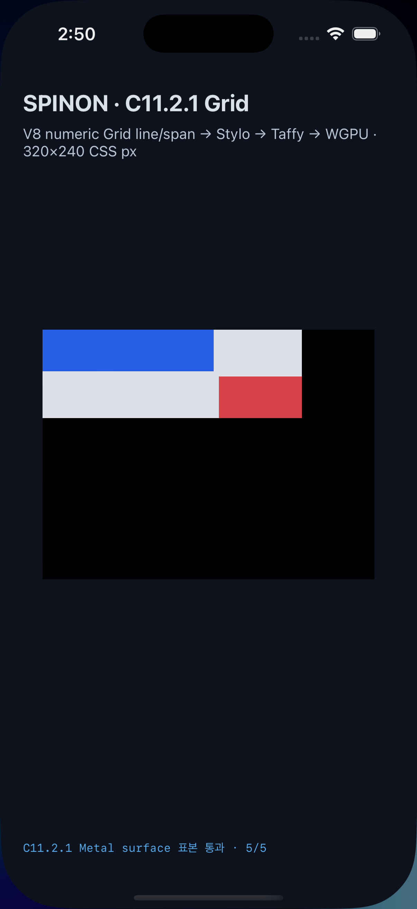

# C11.2.1 `numeric-lines` 표면 픽셀 비교

고정 Chrome 154 출력과 같은 C11.2.1 V8 fixture를 Android API 37 AVD와 iPhone 17 Pro/iOS 26.2 Simulator에서 실행했다. CSS 좌표 5개의 표면 RGBA가 두 플랫폼 모두 pinned Chrome 표본과 정확히 일치했다.

| 플랫폼 | 실제 readback 경계 | 결과 | 장치·렌더러 |
| --- | --- | --- | --- |
| Android | 앱 `SurfaceView`의 `PixelCopy` PNG와 표면 표본 로그 | 5/5 exact, 최대 채널 오차 0 | API 37 AVD, ANGLE/Vulkan/SwiftShader 소프트웨어 렌더러 |
| iOS | WGPU가 그린 Metal drawable texture, OS compositor 제출 전 | 5/5 exact, 최대 채널 오차 0 | iPhone 17 Pro, iOS 26.2 Simulator |

두 실행은 Chrome `/tests/fixtures/css/references/c11-grid-placement-precomparison-v2.json`의 320×240 CSS px `numeric-lines` scene 및 고정 screenshot을 참조한다.

| 표본 | CSS 좌표 | 기대/실측 RGBA |
| --- | ---: | --- |
| positive-lines | `(20, 20)` | `40,102,246,255` |
| negative-lines | `(185, 60)` | `229,72,77,255` |
| grid-background | `(240, 20)` | `237,241,247,255` |
| column-gap | `(167, 10)` | `237,241,247,255` |
| row-gap | `(10, 42)` | `237,241,247,255` |

## Android AVD

- [비교 결과와 기기 정보](android-avd-c1121-pixels-20261012T055042071Z-cae8d9ce/comparison.json)
- [전체 화면 캡처](android-avd-c1121-pixels-20261012T055042071Z-cae8d9ce/android-screen.png)
- [실행 로그와 빌드 기록](android-avd-c1121-pixels-20261012T055042071Z-cae8d9ce/README.md)

## iOS Simulator

- [비교 결과와 기기 정보](ios-simulator-c1121-pixels-20261012T054954356Z-a1434f59/comparison.json)
- [전체 화면 캡처](ios-simulator-c1121-pixels-20261012T054954356Z-a1434f59/ios-screen.png)
- [실행 로그와 빌드 기록](ios-simulator-c1121-pixels-20261012T054954356Z-a1434f59/README.md)

화면 제목과 완료 상태 문구가 모두 C11.2.1인지 시각 확인했다. 첫 화면 확인에서 발견한 C11.1 완료 문구는 실행 profile에 따라 label을 고치고 재캡처했다. 비교 자동화에서는 summary 필드 순서와 `fixtureId`/runtime `sceneId` 차이를 각각 처리하도록 고쳤다.

## 해석 범위

- Android 결과는 AVD의 SwiftShader 소프트웨어 렌더러에서 나온 것으로 Android 실기기나 하드웨어 GPU의 근거가 아니다.
- iOS 표본은 Metal drawable texture readback 결과다. compositor 제출 뒤 화면, scanout, 광학 표시 결과를 읽은 것은 아니다.
- 이번 실행은 `numeric-lines` 한 scene의 다섯 좌표만 비교했다. C11.2.1 전체 10-scene 모바일 행렬, Android 실기기 PixelCopy, Spinon WPT 적합성은 미완료다.
- 이 결과로 C11.2.1, C11, S02 또는 전체 CSS 지원을 완료 처리하지 않는다.

현재 소스 통합 테스트와 Clippy: [전체 로그](../c12-4-follow-up-verification-2026-10-12/current-source-rerun-20261012-04/full-test.log) · [Clippy](../c12-4-follow-up-verification-2026-10-12/current-source-rerun-20261012-04/clippy.log).
