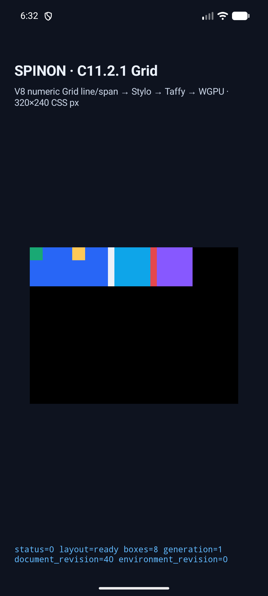
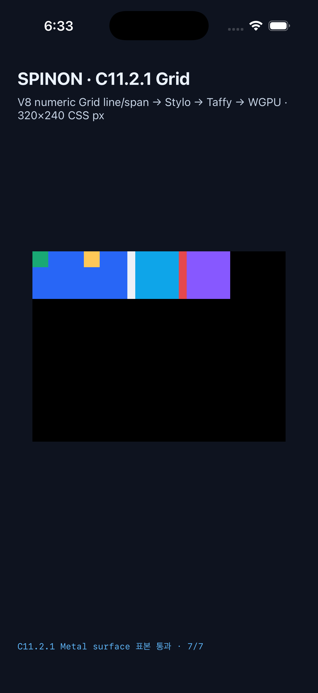

# C11.2.1 모바일 표면 픽셀 행렬

고정 Chrome 154 scene 중 Spinon 제한 profile이 지원하는 6개를 Android `SurfaceView` PixelCopy와 iOS WGPU Metal drawable에서 비교했다. 두 플랫폼에서 각각 6/6 scene, 20/20 RGBA 표본이 정확히 일치했고 최대 채널 오차는 0이다. 나머지 4개 입력은 지원 밖 입력이므로 Chrome 픽셀 일치를 주장하지 않고, 기대 오류·부분 frame 부재·non-empty WGPU 제출 부재를 같은 앱 binary의 runtime 행렬에서 확인했다.

| 대상 | 실행 ID | surface 결과 | 장치·renderer | 앱 hash |
| --- | --- | --- | --- | --- |
| Android | `c1121-android-20261012T093216817Z-43dfc994` | PixelCopy 6/6 scene · 20/20 sample exact | Android 17/API 37 AVD · ANGLE/Vulkan/SwiftShader 소프트웨어 경로 | APK `0a42647465a10c7917ce3b635b845a9813e475da37c42bb67dbe000f741457a6` |
| iOS | `c1121-iossim-20261012T093253773Z-8df46c33` | Metal drawable 6/6 scene · 20/20 sample exact | iPhone 17 Pro / iOS 26.2 Simulator · compositor 제출 전 drawable readback | executable `135cdec7fcee1d83dfc51ac443ea6ce65b162ff406649a9e6c25773c503172e8` |

두 실행은 각각 같은 앱 binary로 10개 장면을 실행했다. 각 장면은 새 process와 HostDocument를 사용했다. Chrome 기준 geometry는 21개 fixture node에서 최대 0 CSS px 차이였다. 별도 잘못된 pixel intent는 양쪽에서 거부됐고 PixelCopy/Metal readback을 시작하지 않았다.

## Android 결과

- [세부 비교 보고서](../c11-2-1-grid-placement-android-runtime-matrix-2026-10-12/c1121-android-20261012T093216817Z-43dfc994/comparison.json) · [장치·renderer 정보](../c11-2-1-grid-placement-android-runtime-matrix-2026-10-12/c1121-android-20261012T093216817Z-43dfc994/device.json)
- [build·전체 실행 로그](../c11-2-1-grid-placement-android-runtime-matrix-2026-10-12/c1121-android-20261012T093216817Z-43dfc994/README.md) · [잘못된 scene 거부 로그](../c11-2-1-grid-placement-android-runtime-matrix-2026-10-12/c1121-android-20261012T093216817Z-43dfc994/pixel-allowlist-negative-control.log)
- [중첩 Grid 화면 캡처](../c11-2-1-grid-placement-android-runtime-matrix-2026-10-12/c1121-android-20261012T093216817Z-43dfc994/nested-placement-modes-android-avd.png)

## iOS 결과

- [세부 비교 보고서](../c11-2-1-grid-placement-ios-simulator-runtime-matrix-2026-10-12/c1121-iossim-20261012T093253773Z-8df46c33/comparison.json) · [장치·renderer 정보](../c11-2-1-grid-placement-ios-simulator-runtime-matrix-2026-10-12/c1121-iossim-20261012T093253773Z-8df46c33/device.json)
- [build·전체 실행 로그](../c11-2-1-grid-placement-ios-simulator-runtime-matrix-2026-10-12/c1121-iossim-20261012T093253773Z-8df46c33/README.md) · [잘못된 scene 거부 로그](../c11-2-1-grid-placement-ios-simulator-runtime-matrix-2026-10-12/c1121-iossim-20261012T093253773Z-8df46c33/pixel-allowlist-negative-control.log)
- [중첩 Grid 화면 캡처](../c11-2-1-grid-placement-ios-simulator-runtime-matrix-2026-10-12/c1121-iossim-20261012T093253773Z-8df46c33/nested-placement-modes-ios-simulator.png)

## 전체 소스 검증

- [전체 JavaScript/CSS/Rust test 결과](full-test.log): CSS reference 336/336, Android touch tools 29/29, Rust workspace 618 passed·4 ignored, release depth test 1/1.
- [Clippy](clippy.log): `cargo clippy --workspace --all-targets --all-features -- -D warnings` 통과.
- `cargo fmt --all -- --check`, `git diff --check`, sample matrix generator `--check` 통과.
- Android build와 iOS Simulator build는 각 플랫폼 capture run에서 성공했다.
- [구현 실패 관점 검토 20개](../c11-2-1-grid-placement-pixel-matrix-implementation-review-2026-10-12.md).

## 확인 범위와 남은 경계

- 현재 ADB에는 `emulator-5554` Android API 37 AVD만 연결되어 있었다. AVD는 SwiftShader 소프트웨어 renderer이며 Android 실기기 GPU 확인이 아니다.
- iOS는 Simulator다. Metal sample은 compositor 제출 전 drawable texture 값이며 최종 화면 scanout이나 iOS 실기기 pixel을 읽지 않았다.
- Android 실기기 표면 픽셀 행렬, Spinon WPT runner·적합성, 전체 CSS Grid 지원은 미확정이다. 이 결과는 C11.2.1 제한 profile의 여섯 성공 scene만 다룬다.
