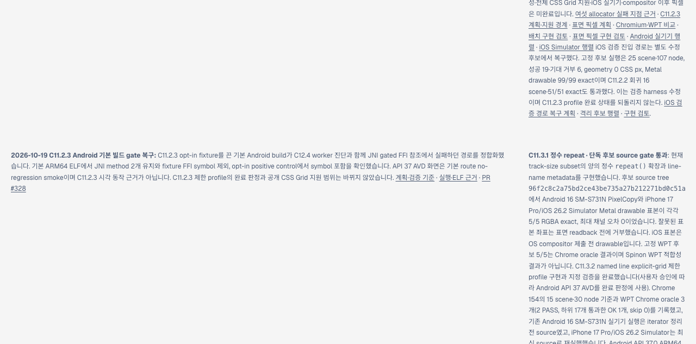

# C11.2.3 JNI gate Tailnet roadmap sync · 2026-10-19

## 변경 내용

PR [#328](https://github.com/ohah/spinon/pull/328)이 `d50c6cc73317050fe078299ce0f63618b83869bc`로 main에 병합된 뒤, 선택 문서 빌드 결과를 Tailnet 미리보기에 반영했다. 로드맵에는 Android 기본 빌드 gate 복구 내용과 PR #328 링크를 추가했다. C11.2.3 제한 profile의 완료 판정과 공개 CSS Grid 지원 범위는 바뀌지 않았다.

## Tailnet 복사 결과

- 사전 검사: 93개 경로, 78개 신규, 4개 교체, 11개 동일, 삭제 0개.
- 교체 대상 4개는 덮어쓰기 전에 별도 백업했고 모두 SHA-256으로 검증했다.
- 반영 후 Tailnet 응답 93개 모두 HTTP 200이며 원본과 byte 수 및 SHA-256이 일치한다.
- 기존 미리보기 listener는 유지했다. Pages 배포는 하지 않았다.

[사전 검사](./preflight.json) · [백업 검증](./backup-verification.json) · [복사 검증](./copy-verification.json) · [served hash 검증](./served-verification.json) · [SHA-256 목록](./SHA256SUMS)

## Agent Browser 확인

Agent Browser 0.31.1로 로드맵, 계획, 실행 근거, 공식 상태 페이지를 열었다. 로드맵에서 C11.2.3 note와 PR #328 링크를 확인했다. 계획 페이지의 fixture gate 내용, 실행 근거 페이지의 build/log 링크, 상태 페이지에서 유지된 제한 profile 판정을 확인했다. Android API 37 기본 화면 PNG 링크는 1080×2400으로 열렸다.

[Agent Browser 관찰값](./browser-verification.json) · [브라우저 종료 확인](./browser-session-shutdown.json) · [PR diff 적대 검토 30개](./pr-delta-review-30.md)

## 문서 빌드와 한계

Rspress 2.0.22 선택 빌드가 성공했다. 전체 저장소 문서 빌드는 기존 문서의 dead-link 검사에서 실패했다. 이 동기화는 전체 문서 링크 적합성을 주장하지 않는다. 자세한 범위와 결과는 [빌드 기록](./render-build-result.md), [전체 빌드 오류 요약](./full-site-build-failure-summary.json), [선택 빌드 로그](./selected-build.log)에 있다.

## 범위

- 이 변경은 미리보기 문서 동기화 근거다. 제품 코드나 공식 완료 수치를 바꾸지 않는다.
- Agent Browser로 확인한 페이지는 이 문서에 적은 네 route와 PNG 링크다. 전체 사이트의 모든 내부 링크를 브라우저에서 눌러 검증한 것은 아니다.
- 물리 Android 기기나 iOS Simulator 검증을 새로 수행하지 않았다. 기존 PR #328의 AVD 근거 범위는 [실행 근거](../c11-2-3-android-jni-gate-2026-10-19/README.md)에 기록돼 있다.
- Agent Browser를 종료했고, 종료 뒤 해당 세션 이름이나 agent-browser로 식별되는 프로세스는 남지 않았다. 기존 미리보기 listener와 `tmux spinon` 세션은 건드리지 않았다.
