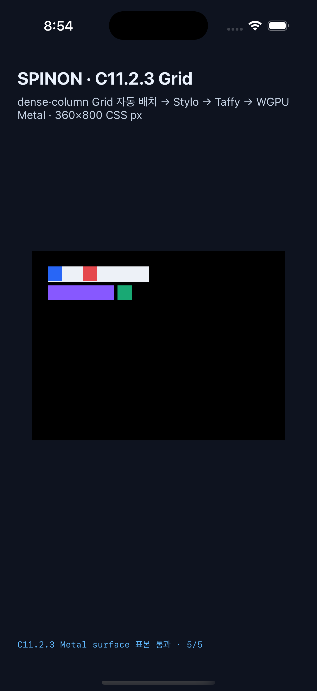

# C11.2.3 iOS 격리 수정 후보 행렬

## 실행 결과

- 실행 ID: `c1123-i-mv6mhrrq-785dbe7a`
- 대상: iPhone 17 Pro Simulator / iOS 26.2
- 고정 기준: Chrome 154, C11.2.3 25 scene·107 node
- 결과: 25/25 scene 처리. 성공 19/19, 기대 거부 6/6. Geometry 최대 오차 0 CSS px(허용 0.5).
- Metal drawable 표면 readback: 성공 scene 19개, 99/99 RGBA exact, 최대 채널 오차 0.
- 장면마다 새 앱 프로세스로 실행했다. Simulator drawable readback은 OS compositor 제출 이후의 화면 픽셀이 아니다.

## 재현 후보 변경

기준은 `origin/main` 커밋 `6aa39262a2097089fbe38ac2f406e5c2afeb50da`다. 후보는 C11.2.3 앱 진입 인수 라우팅 추가, 기존 Objective-C 구현과 맞는 헤더 선언 추가, Swift 중첩 조건식 분리로 구성했다. 정확한 변경은 [`c1123-ios-repair.patch`](./c1123-ios-repair.patch), 후보 파일 해시는 [`candidate-source-sha256.json`](./candidate-source-sha256.json)에 있다. 임시 후보이며 아직 저장소 기준이나 병합 상태는 바뀌지 않았다.

## 검증 자료

- [`route-edge-cases.log`](./route-edge-cases.log): scene-only 정상 실행과 flag-only 거부
- [C11.2.2 iOS 회귀 행렬](../c1122-ios-regression-mv6mtjb4-6dbbbe77/README.md): 16 scene·51 drawable 표본
- [`result-summary.json`](./result-summary.json): 행렬 요약
- [`build.log`](./build.log): Xcode 빌드
- [`device.json`](./device.json): Simulator 정보
- [`row-sparse-baseline-runtime.log`](./row-sparse-baseline-runtime.log): 처음 실패하던 경로의 정상 실행 로그
- [`row-sparse-baseline-ios-simulator.png`](./row-sparse-baseline-ios-simulator.png): 대표 화면
- 각 장면별 `*-runtime.log`, `*-pixel-comparison.json`, `*-launch.log`, PNG: 25 scene 원시 결과

