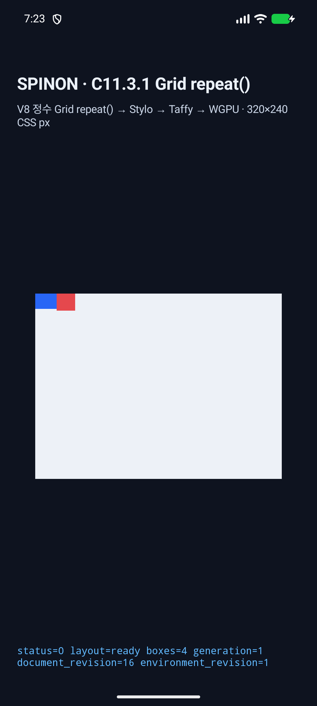
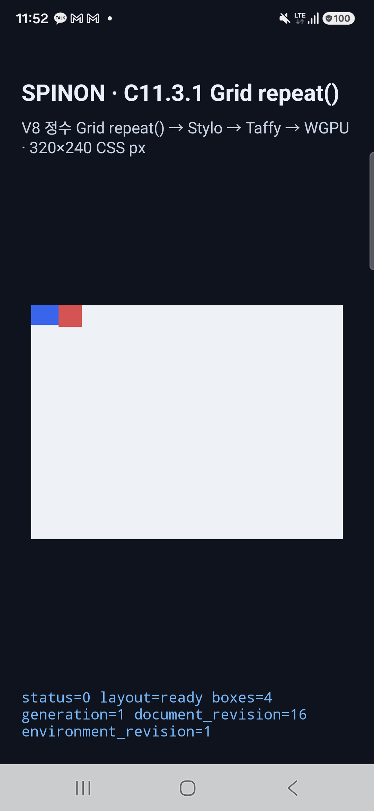
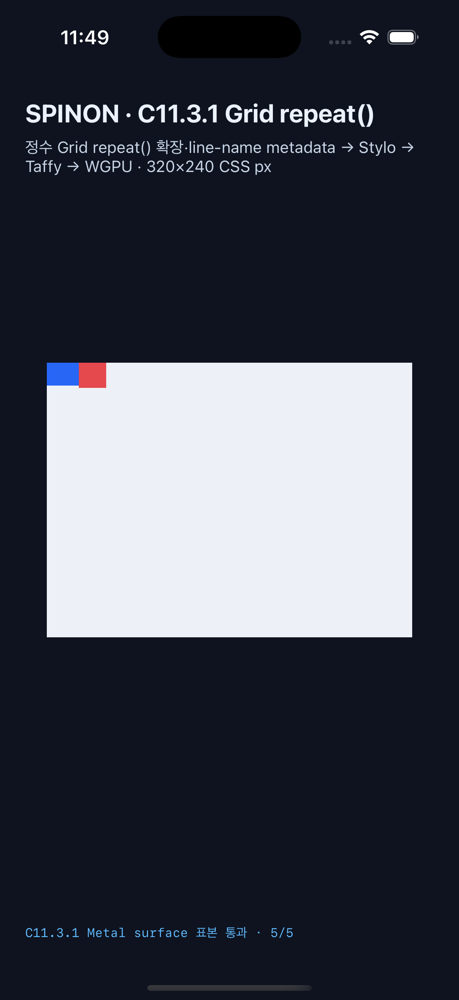

# C11.3.1 정수 `repeat()` 표면 픽셀 검증

## 고정 기준

- 기준 브라우저: Chrome for Testing `154.0.8037.92`, DPR 1, `320×240 CSS px`
- 장면: `multi-track-repeat`
- 입력·기준 RGBA: [고정 표본 fixture](../../../../tests/fixtures/css/c11/grid-template-repeat-c1131-pixel-samples-v1.json)
- 기준 screenshot SHA-256: `e14b03ff7f2302d2f245501d6888cf743b2495cd584b01f5774e1df69ca85f55`
- 비교 표본: 배경, 파란 item, 빨간 item, column gap, row gap 5개

## 플랫폼 결과

| 플랫폼 | 실행 | 결과 | 한계 |
| --- | --- | --- | --- |
| Android API 37 AVD | [`c1131-android-avd-20261013T102344630Z-a7301ccd`](./android-avd-c1131-android-avd-20261013T102344630Z-a7301ccd/README.md) | PixelCopy 5/5 RGBA exact, 최대 채널 오차 0. 변조 좌표 거부, PixelCopy 미시작 | ANGLE/Vulkan/SwiftShader 소프트웨어 렌더러. 실기기 GPU 결과가 아님 |
| Android API 37 AVD · 격리 후보 | [`c1131-android-avd-20261013T113613681Z-60d73800`](./android-avd-isolated-candidate-c1131-android-avd-20261013T113613681Z-60d73800/README.md) | 후보 Git tree `5d362b4f1d9b88f3cfa6d4ef04a28d474f89e996`에서 PixelCopy 5/5 RGBA exact. 변조 좌표 거부, PixelCopy 미시작 | ANGLE/Vulkan/SwiftShader 소프트웨어 렌더러. 실기기 GPU 결과가 아님 |
| Android 16 실기기 SM-S731N | [`android-physical-c1131-android-physical-20261013T105621846Z-6bd0e344`](./android-physical-c1131-android-physical-20261013T105621846Z-6bd0e344/README.md) | PixelCopy 5/5 RGBA exact, 최대 채널 오차 0. 변조 좌표 거부, PixelCopy 미시작 | C11.2/C12.4 변경이 함께 있는 작업 트리에서 빌드한 진단 결과. 기능 단독 소스 관문은 미완료 |
| Android 16 실기기 SM-S731N · PR #146 병합 뒤 재검증 | [`c1131-android-physical-20261013T132853244Z-6b11e468`](./android-physical-c1131-android-physical-20261013T132853244Z-6b11e468/README.md) | PixelCopy 5/5 RGBA exact, 최대 채널 오차 0. 잘못된 좌표 거부, PixelCopy 미시작 | C11.2/C12.4 변경이 함께 있는 작업 트리의 진단 결과. 단독 소스 관문은 미완료 |
| Android API 37 AVD · PR #146 병합 뒤 현재 소스 재실행 | [`c1131-android-avd-20261013T134936669Z-c00ecc48`](./android-avd-c1131-android-avd-20261013T134936669Z-c00ecc48/README.md) | PixelCopy 5/5 RGBA exact, 최대 채널 오차 0. 변조 좌표 거부, PixelCopy 미시작 | C11.2/C12.4 변경이 함께 있는 작업 트리의 진단 결과. ANGLE/Vulkan/SwiftShader software backend |
| Android API 37 AVD · fixture/module 분리 뒤 재실행 | [`c1131-android-avd-20261013T140115888Z-551001c8`](./android-avd-c1131-android-avd-20261013T140115888Z-551001c8/README.md) | PixelCopy 5/5 RGBA exact, 최대 채널 오차 0. 변조 좌표 거부, PixelCopy 미시작 | 같은 혼합 작업 트리에서 재빌드한 진단 결과. ANGLE/Vulkan/SwiftShader software backend |
| iPhone 17 Pro Simulator, iOS 26.2 | [`c1131-ios-simulator-20261013T102608520Z-86fbe8b9`](./ios-simulator-c1131-ios-simulator-20261013T102608520Z-86fbe8b9/README.md) | Metal drawable 5/5 RGBA exact, 최대 채널 오차 0. 변조 좌표 거부, Metal readback 미시작 | OS compositor 제출 전 drawable 결과. iOS 실기기·compositor 이후 pixel 미검증 |
| iPhone 17 Pro Simulator, iOS 26.2 · PR #146 병합 뒤 재검증 | [`c1131-ios-simulator-20261013T132750297Z-5c1bdeab`](./ios-simulator-c1131-ios-simulator-20261013T132750297Z-5c1bdeab/README.md) | Metal drawable 5/5 RGBA exact, 최대 채널 오차 0. 잘못된 좌표 거부, Metal readback 미시작 | C11.2/C12.4 변경이 함께 있는 작업 트리의 진단 결과. OS compositor 이후 pixel·실기기는 미검증 |
| iPhone 17 Pro Simulator, iOS 26.2 · PR #146 병합 뒤 현재 소스 재실행 | [`c1131-ios-simulator-20261013T134838689Z-99094455`](./ios-simulator-c1131-ios-simulator-20261013T134838689Z-99094455/README.md) | Metal drawable 5/5 RGBA exact, 최대 채널 오차 0. 변조 좌표 거부, Metal readback 미시작 | C11.2/C12.4 변경이 함께 있는 작업 트리의 진단 결과. OS compositor 이후 pixel·실기기는 미검증 |
| iPhone 17 Pro Simulator, iOS 26.2 · fixture/module 분리 뒤 재실행 | [`c1131-ios-simulator-20261013T140129522Z-48646be4`](./ios-simulator-c1131-ios-simulator-20261013T140129522Z-48646be4/README.md) | Metal drawable 5/5 RGBA exact, 최대 채널 오차 0. 변조 좌표 거부, Metal readback 미시작 | 같은 혼합 작업 트리에서 재빌드한 진단 결과. OS compositor 이후 pixel·실기기는 미검증 |
| Android 16 실기기 SM-S731N · 단독 후보 source gate | [`c1131-android-physical-20261013T145150083Z-412c65a2`](./android-physical-c1131-android-physical-20261013T145150083Z-412c65a2/README.md) | PixelCopy 5/5 RGBA exact, 최대 채널 오차 0. 잘못된 좌표 거부, PixelCopy 미시작 | 후보 tree `96f2c8c2a75bd2ce43be735a27b212271bd0c51a` 기준. 다른 기기·GPU로 일반화하지 않음 |
| iPhone 17 Pro Simulator, iOS 26.2 · 단독 후보 source gate | [`c1131-ios-simulator-20261013T144912595Z-43f20ba7`](./ios-simulator-c1131-ios-simulator-20261013T144912595Z-43f20ba7/README.md) | Metal drawable 5/5 RGBA exact, 최대 채널 오차 0. 잘못된 좌표 거부, Metal readback 미시작 | 같은 후보 tree. OS compositor 제출 전 drawable 표본 |

양쪽 negative control은 `item-blue.xCssPx`를 1 증가시킨 입력이다. 정해 둔 scene sample 좌표 allowlist에서 거부됐고 표면 readback은 시작하지 않았다. 실행 로그와 판정 JSON은 각 플랫폼 evidence 폴더에 저장했다.

## 화면 증거

앱 화면은 실행 장면과 상태를 보여 준다. 픽셀 비교는 별도로 SurfaceView PixelCopy 또는 Metal drawable readback에서 뽑은 다섯 표본으로 수행했다.

### Android API 37 AVD

격리 후보 실행 화면: 

### Android 16 실기기 SM-S731N

### iPhone 17 Pro Simulator

최신 fixture/module 분리 뒤 실행 화면:  · 

단독 후보 source gate 화면:  · 

## 판정 경계

- 이 검증은 한 장면의 다섯 고정 표본만 비교한다. 전체 화면 pixel parity를 뜻하지 않는다.
- C11.2/C12.4 변경이 섞인 진단 run과 단독 후보 source gate run을 분리한다. 후보 tree `96f2c8c2a75bd2ce43be735a27b212271bd0c51a`의 Android 실기기와 iOS Simulator에서 각각 5/5 RGBA exact를 확인했고 잘못된 표본 좌표는 readback 전에 거부했다. 상세한 source tree와 artifact hash는 [manifest](./source-gate.json)에 둔다.
- 기존 후보의 첫 iOS 실행에서 C11.3.1 scene 라우팅이 C11.1 validator로 빠지고 Metal comparator가 `C1131` marker를 거부하는 결함을 확인했다. iOS host/eval/pixel 경로와 comparator schema/test를 추가한 뒤 같은 단독 후보 tree에서 두 플랫폼 gate를 통과했다. 첫 실패와 수정 이력은 [iOS source gate 기록](./ios-isolated-source-gate-20261013/README.md)에 기록한다.
- Chrome에서 고정 WPT candidate 5/5를 실행한 결과는 Chrome oracle 실행이다. Spinon WPT 적합성 결과가 아니다.
- C11.3.1의 구현 실패 경계 검토는 별도 [검토 문서](../c11-3-1-grid-repeat-pixels-implementation-review-2026-10-13.md)에 기록했다. 단독 후보 source gate는 지정된 Android 실기기와 iOS Simulator에서 통과했다. named line 배치, template areas, Spinon WPT 적합성, 전체 CSS Grid 지원은 별도 미완료 경계다.

## 로그 처리

iOS 빌드 로그의 명령 인자 줄에서 줄 끝 공백만 제거했다. 빌드 인자와 결과 내용은 바꾸지 않았다.
