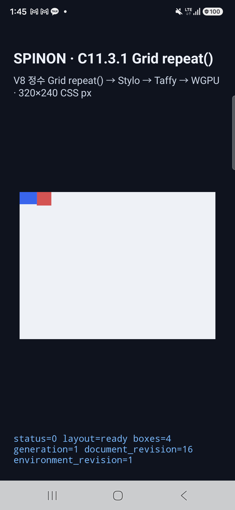
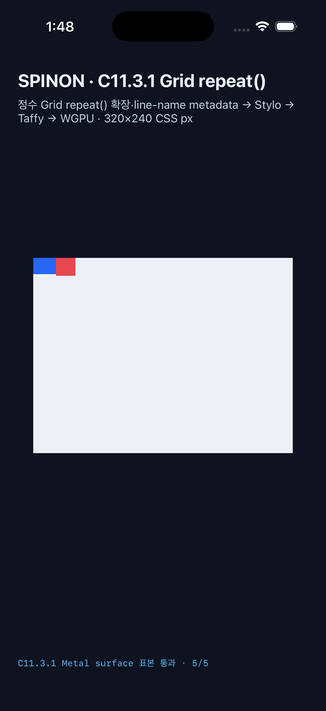

# C11.3.1 최신 후보 재검증 · 2026-10-14

## 후보 기준

- 기준: `origin/main` PR #149 리베이스 병합 commit `a567b6af27c75ed3d66af5e06c47922dee5cb613` 위의 C11.3.1 변경.
- `runtime_gpu/fixtures/c11_3_1.rs`는 고정 scene matrix adapter를 소유한다.
- `runtime_gpu/ffi/fixtures/c11_3_1.rs`는 검증 전용 C ABI를 소유한다. 두 부모 fixture 모듈 모두 `c04-runtime-gpu-fixture-test` opt-in 아래에서만 연결된다.
- fixture 경계 회귀 검사는 C11.3.1 이전 경로 두 곳의 파일 부재와 두 정식 경로의 존재를 검사한다.
- 이전의 단독 후보 앱 실행을 만든 후보와 이번 후보의 `crates/` 및 `platforms/` 소스 입력을 비교해 차이가 없음을 확인했다. 비교에서 생성물인 `platforms/android/.gradle/`, `platforms/android/app/build/`, `platforms/ios/SpinonBootstrap.xcodeproj/project.xcworkspace/`는 제외했다. PR #149의 경로 정리와 이 재검증 변경은 문서·검사 코드 변경이며 앱 실행 파일 입력은 동일하다.

## 최신 Android·iOS 앱 실행

기준 Chrome for Testing `154.0.8037.92`, DPR 1, `multi-track-repeat`, 고정 sample fixture의 5개 좌표를 비교했다.

| 대상 | 실행 | 결과 | 산출물 |
| --- | --- | --- | --- |
| Android 16 실기기 SM-S731N, Xclipse 940 / ANGLE·Vulkan | [`c1131-android-physical-20261013T164530543Z-b2aa6d9c`](./android-physical-c1131-android-physical-20261013T164530543Z-b2aa6d9c/README.md) | PixelCopy 5/5 RGBA exact, 최대 채널 오차 0. 변조 좌표는 PixelCopy 전에 거부 | APK SHA-256 `1dbe4b04b775203f8c43fb42e6294b56f4bde9262604edb7db0ebf17760642af` |
| iPhone 17 Pro / iOS 26.2 Simulator | [`c1131-ios-simulator-20261013T164758099Z-dceb7183`](./ios-simulator-c1131-ios-simulator-20261013T164758099Z-dceb7183/README.md) | Metal drawable 5/5 RGBA exact, 최대 채널 오차 0. 변조 좌표는 Metal readback 전에 거부 | 앱 executable SHA-256 `3ad46b0b6c3311e6fb89833c9f07bde8ff47802af89005347f3ea70b03ee1bbf` |

Android 결과는 지정 실기기의 PixelCopy다. iOS 결과는 OS compositor 제출 전 Metal drawable이다. 이 다섯 표본은 전체 화면 픽셀 동등성의 증거가 아니다.

## 소스·빌드 검증

| 검사 | 결과 |
| --- | --- |
| `bun run test:css-reference` | 387 passed, 0 failed, 0 skipped ([로그](./css-reference-full-test-rerun.log)) |
| `cargo test --locked --workspace --quiet` | 656 passed, 0 failed, 4 ignored ([로그](./workspace-test-rerun.log)) |
| 기본 `spinon-ffi` 테스트 | 18 passed ([로그](./ffi-test-default-rerun.log)) |
| fixture feature `spinon-ffi` 테스트 | 53 passed, 2 ignored ([로그](./ffi-test-fixtures-rerun.log)) |
| `cargo fmt --all -- --check` | 통과 |
| workspace `cargo clippy --locked --workspace --all-targets -- -D warnings` | 통과 ([로그](./workspace-clippy-rerun.log)) |
| fixture feature FFI Clippy | 통과 ([로그](./ffi-clippy-fixtures-rerun.log)) |
| 이전/정식 C11.3.1 fixture 모듈 경로 회귀 검사 | 3/3 통과; 전체 387개 실행에 포함 |

## fixture 바이너리 경계

동일한 crate 소스의 macOS Debug static library를 기본 feature와 fixture-test positive control로 대조했다. 기본 artifact에는 C11.3.1 fixture ABI symbol 및 runtime-matrix schema payload가 없고, `c04-runtime-gpu-fixture-test,c11-2-3-grid-fixture-test,c11-grid-metal-surface-pixels-test` positive control에는 둘 다 포함됐다. [빌드·심볼·payload 로그와 범위](./fixture-binary-contract/README.md).

이 검사는 Rust static library feature 경계다. Android APK/iOS IPA release bundle의 dead stripping, 설치 크기, 전체 CSS 지원을 증명하지 않는다.

## 판정 한계

저장소 내 텍스트 로그는 가독성과 공백 검사를 위해 줄 끝 공백과 마지막의 불필요한 빈 줄만 정리했다. 명령, 실행 marker, 판정 내용은 바꾸지 않았다.

- Runtime matrix는 `multi-track-repeat` 한 장면, HostDocument 4 node다.
- WPT 정수 repeat 후보 5/5 결과는 Chrome oracle 실행이다. Spinon WPT runner 적합성은 미구현이다.
- C11.3.2 named line 배치와 C11.3.3 template areas는 미구현이다. C11 및 CSS Grid 상위 상태는 미완료다.
- iOS 실기기와 OS compositor 제출 이후 픽셀은 측정하지 않았다.
- 서로 다른 구현 실패 경로 검토: [C11.3.1 2026-10-14 구현 검토](../c11-3-1-grid-repeat-implementation-review-2026-10-14.md).
