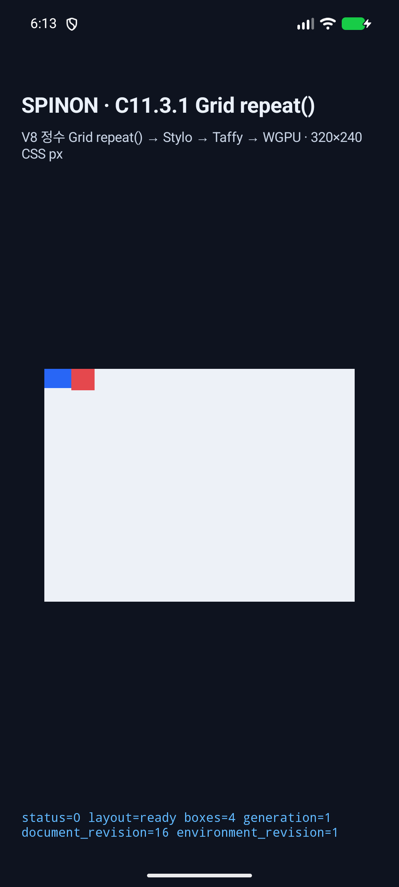
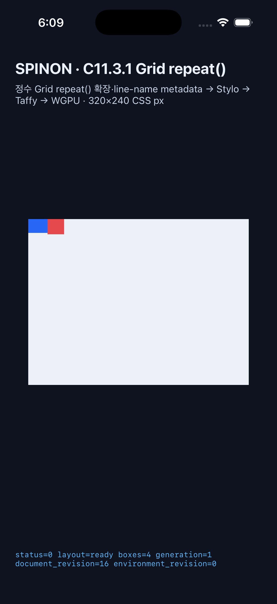

# C11.3.1 Android AVD·iOS Simulator runtime

## 실행 범위

고정 fixture의 **multi-track-repeat** 한 장면을 현재 작업 소스에서 Android와 iOS 각각 한 번 실행했다. 이는 전체 Grid 행렬이나 실기기 검증이 아니다.

| 플랫폼 | 실행 | 렌더러 | 결과 |
| --- | --- | --- | --- |
| Android | Android 17 / API 37 AVD, 실행 ID c1131-android-api37-20261013-r3 | ANGLE 위 Vulkan/SwiftShader 소프트웨어 경로 | status=0, layout=ready, boxes 4 |
| iOS | iPhone 17 Pro, iOS 26.2 Simulator, 실행 ID c1131-iossim-20261013-r3 | Metal simulator GPU | status=0, layout=ready, boxes 4 |

두 실행은 HostDocument 4개 node를 냈다. root frame은 320×240 CSS px이고 반복 track 안의 두 item은 각각 (0, 0, 30, 20) 및 (28, 0, 24, 22) CSS px였다. 저장된 원시 로그에서 초기 eval과 후속 environment 결과가 모두 성공했고 layout 결과가 준비된 것을 확인할 수 있다.

## 화면과 원시 로그

### Android API 37 AVD

[원시 실행 로그](android-avd-20261013.log)

### iOS Simulator

[원시 실행 로그](ios-simulator-20261013.log)

## 완료 경계

이 실행은 한 장면의 JS runtime·layout geometry·화면 표시 경로를 확인한다. Android AVD는 SwiftShader 소프트웨어 렌더링이므로 Android 하드웨어 GPU 결과가 아니다. Android PixelCopy와 iOS Metal drawable의 표면 pixel readback은 이 실행에 포함되지 않았고, Android 실기기도 포함되지 않았다. 따라서 표면 픽셀 일치, 기기 GPU 동작, 전체 C11.3.1 완료나 Spinon WPT 적합성을 주장하지 않는다.

[Chromium 기준 및 WPT oracle](../c11-3-1-repeat-precomparison-2026-10-13/README.md) · [세 단계 계획](../../../../plan/c11-3-template-repeat-named-lines-areas.md)
