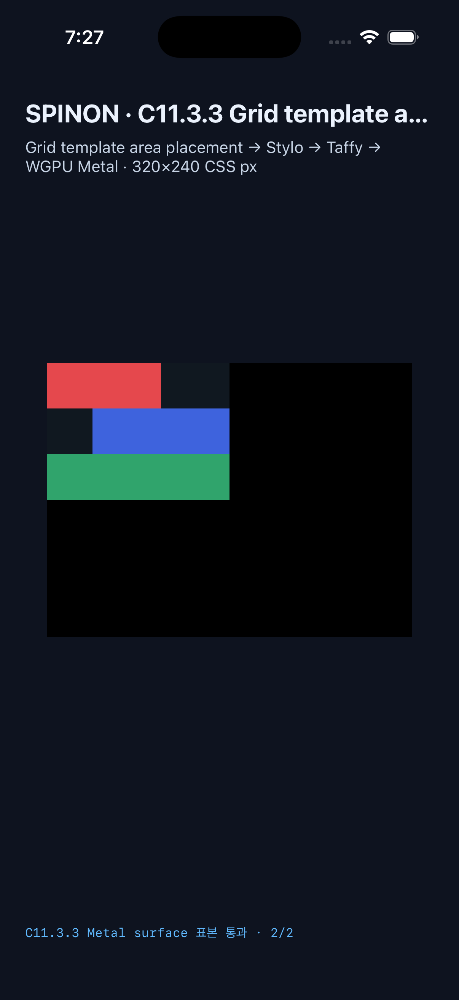

# C11.3.3 Grid template areas 시뮬레이터 후속 · 2026-10-16

## 결과

- Android API 37 ARM64 AVD의 2026-10-14 전체 행렬은 [기존 실행 근거](../c11-3-3-grid-template-areas-runtime-2026-10-14/android-avd-c1133-matrix-20261014T023829118Z-d027504f/README.md)에 보존했다. Android 결과는 ANGLE/Vulkan/SwiftShader AVD에 한정한다.
- iPhone 17 Pro / iOS 26.2 Simulator의 [최신 전체 행렬](./ios-simulator-c1133-ios-matrix-20261015T222733397Z-adc27451/README.md)은 고정 Chrome 154.0.8037.92 DPR 1 기준 26 scene·65 node에서 성공 19, cascade fallback 5, 기대 거부 2를 기록했다.
- visible node frame 61개의 최대 geometry 오차는 0 CSS px다. 이 61은 화면 frame 비교 수이며 공식 완료 항목 수가 아니다. 성공 scene은 frame, 연속한 paint ordinal, visible DOM source order, 해당 scene paint 이후 WGPU draw box 수를 확인했다. 중첩된 hidden node는 zero-size frame 1개로 보존되고 draw 순서에서는 제외됐다.
- 기대 거부는 `grid-template-areas` / `unsupported_computed_value` / node 1과 `grid-row-start` / `unsupported_named_grid_line` / node 2다. 두 장면 모두 frame·draw·Metal readback이 없었다.
- `basic-rectangles` Metal drawable 표본은 2/2 RGBA exact, 최대 channel 오차 0이다. 변조 sample 좌표는 readback 전에 거부했고, 미등록 scene은 runtime 평가·draw·readback 전에 거부했다.

## 재현과 범위

- 집중 iOS matrix 검사 10/10 (paint 뒤 draw 순서 변조 거부 포함), 기존 C11.3.3 runtime 검사 12/12, JavaScript syntax check와 `git diff --check`를 통과했다.
- 전체 `test:css-reference`는 472개 중 470개 통과, 2개 실패로 종료했다. 두 실패는 C13.3 iOS tap-probe route 검사이며, 기준 commit의 Swift source에 그 검사가 요구하는 C13 route marker가 없다. 이번 변경의 Swift hunks는 C11.3.3 matrix log와 rejection property에만 있다. 전체 suite를 통과한 것으로 해석하지 않는다.
- 전체 `docs:build`는 저장소 전반의 기존 dead link 때문에 실패했다. 변경 페이지와 필요한 근거만 임시 staging tree에 넣고 dead-link/image 검사를 끈 Rspress 2.0.22 scoped build는 통과해 `STATUS`, 내부 계약, 계획, evidence 페이지를 생성했다. 전체 문서 빌드 성공으로 확대 해석하지 않는다.
- V8 source revision은 `7b50b62cb18f28617959e8452e2cd18195b38bcf`다. `result.json`은 기준 commit, fixture·oracle·검증 코드·Swift source 및 앱 바이너리 SHA-256을 연결한다.
- Metal drawable 관찰은 OS compositor 제출 전이다. Android 실기기·hardware GPU, iOS 실기기, compositor 이후 pixel, Spinon WPT 적합성은 확인하지 않았다.
- 이 범위는 `C11.3.3`의 제한 profile 후보 검증이다. C11.3.3 전체 완료, 상위 C11 완료 또는 공개 CSS Grid 지원으로 해석하지 않는다.

## 원본 근거

- [iOS 전체 행렬 요약](./ios-simulator-c1133-ios-matrix-20261015T222733397Z-adc27451/README.md)
- `ios-simulator-c1133-ios-matrix-20261015T222733397Z-adc27451/result.json`: 집계 결과와 SHA-256
- [Android AVD 전체 행렬](../c11-3-3-grid-template-areas-runtime-2026-10-14/android-avd-c1133-matrix-20261014T023829118Z-d027504f/README.md)
- [iOS matrix 구현 실패 관점 검토 20개](../c11-3-3-ios-matrix-implementation-review-2026-10-16.md)

