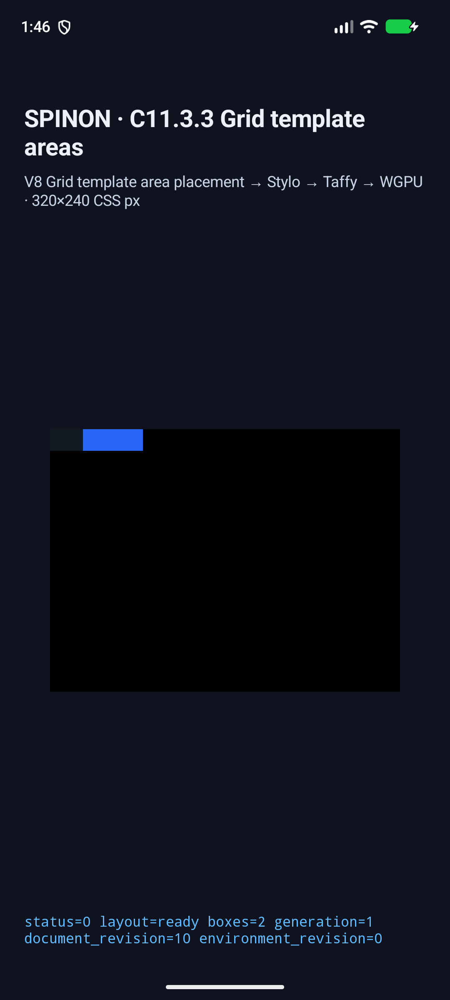
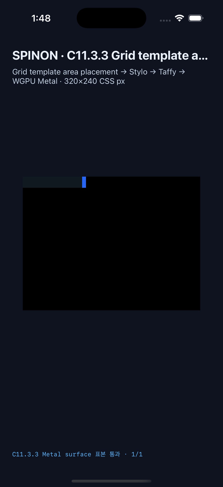

# C11.3.3 leading named implicit lines · 구현·시뮬레이터 근거 · 2026-10-29

## 범위와 기준

구현 후보는 C11.3.3 제한 fixture 경로에서만 explicit grid 앞·뒤의 named occurrence/span 부족분을 fixed-pixel implicit tracks로 채운다. CSS Grid Layout Module Level 1 2025-03-26 CRD §8.3을 규범 기준으로 사용한다. Chrome 사전 비교와 일곱 장면의 rectangle/track 목록은 [계획](../../../../plan/c11-3-3-leading-named-implicit-lines.md), [고정 precomparison](../c11-3-3-leading-named-implicit-lines-precomparison-2026-10-29/README.md)에 연결된다. Chrome 관측은 Agent Browser 0.31.1 HeadlessChrome 156으로 제한하며 실행 파일 hash는 고정되지 않았다.

검증 실행 시 base `HEAD`는 `0990aa4e9e97ae04541c53713fb568847ec62189`였고, Android/iOS 앱에는 같은 작업 트리의 최종 변경을 빌드했다. 최종 작업 소스는 이 evidence, 별도 [구현 실패 경계 20개](./implementation-review-20.md), [PR 변경 검토 30개](./pr-diff-review-30.md)에 고정한다. 실행 결과 JSON과 APK/앱 hash는 아래 원본 파일을 기준으로 한다.

## 시뮬레이터 결과

| 대상 | 기존 26장면 | 별도 unknown-area overflow | 새 leading 장면 7개 | 표면 픽셀 |
| --- | --- | --- | --- | --- |
| Android API 37 ARM64 AVD, Android 17 | 26 scene·65 node, 성공 19·cascade fallback 5·기대 거부 2, 비교 frame 61, geometry 오차 0 CSS px | 성공 1 scene, geometry 오차 0, PixelCopy 3/3 exact | 7 scene·14 node, geometry 오차 0, PixelCopy 7/7 exact | 기본 비교 2/2 exact; SwiftShader software renderer, surface 840×630, viewport 320×240 CSS px, scale 2.625 |
| iPhone 17 Pro / iOS 26.2 Simulator | 26 scene·65 node, 성공 19·cascade fallback 5·기대 거부 2, 비교 frame 61, geometry 오차 0 CSS px | 성공 1 scene, geometry 오차 0, Metal 3/3 exact | 7 scene·14 node, geometry 오차 0, Metal 7/7 exact | 기본 비교 2/2 exact; drawable 960×720, viewport 320×240 CSS px, scale 3 |

새 장면별 expected track vectors는 고정 fixture에 있고, layout unit test는 signed origin, 양쪽 pattern 확장 및 leading reversal을 실제 normalized track vector로 확인한다. 양 플랫폼 runtime은 각 장면의 scene ID, root/item identity, frame, draw/present 및 item 내부 pixel을 대조했다. track vector 자체를 simulator API에서 별도 readback한 것으로 표현하지 않는다.

### 화면 캡처

### 원본 결과와 hash

- [Android 결과 JSON](../c11-3-3-grid-template-areas-runtime-2026-10-29/android-avd-c1133-matrix-20261029T044453973Z-30ad6bc8/result.json): status `matched`; APK SHA-256은 JSON의 `platform.appSha256`.
- [iOS 결과 JSON](../c11-3-3-grid-template-areas-runtime-2026-10-29/ios-simulator-c1133-ios-matrix-20261029T044652725Z-9bc5bb6e/result.json): status `matched`; source/app SHA-256과 simulator UDID를 JSON에 기록.
- Leading-line pixel fixture SHA-256: `60717838fc88c0de02281c979aa2e3c549934d8c0aca46850d841fe453ce5871`.
- Chrome precomparison SHA-256: `e36e31c4ed658963cd9f3d5bdcd0a5c83c748950fe2f048d975b4a44191a6ec3`.
- Android 7개 item PixelCopy 캡처와 iOS 7개 화면 캡처는 각 결과 디렉터리에 보존한다.

## 코드·테스트 게이트

- `cargo fmt --all -- --check` — 통과.
- `cargo clippy --locked --workspace --all-targets -- -D warnings` — 통과.
- `cargo test --locked -p spinon-layout` — 302 passed.
- `cargo test --locked -p spinon-style-to-layout` — 252 passed.
- `cargo test --locked -p spinon-style template_profile_preserves_only_fixed_px_auto_track_lists` — 1 passed.
- `cargo test --locked -p spinon-ffi --features c04-runtime-gpu-fixture-test leading_named_implicit_scenes_are_allowlisted_and_match_pixel_fixture_contract` — 1 passed.
- `mise exec -- bun test tools/css-reference/c11-3-3-grid-template-areas.test.mjs` — 14 passed.
- `mise exec -- bun test tools/css-reference/fixture-module-boundary.test.mjs` — 21 passed.
- Android `build:android` 및 iOS `build:ios-sim` — 모두 성공.
- Static archive boundary: 기본 `spinon-ffi` archive에 C11.3.3 FFI 심벌 0개와 scene payload 없음; `c04-runtime-gpu-fixture-test` positive control에는 FFI 심벌 2개와 payload 있음. 이 검사는 앱 release bundle 제외를 증명하지 않는다.
- `git diff --check` — 현재 작업 트리 변경에 대해 통과. PR 원격 diff를 받은 뒤 최종 head에서도 다시 확인한다.

`cargo test --locked -p spinon-style` 전체는 247개 중 246개 통과, `track_sizing_profile_rejects_out_of_scope_percentage_auto_repeat_minimums` 하나가 실패했다. 해당 test는 기존 TrackSizing auto-repeat percentage 최소값 경계이며, 이번 변경이 추가한 `grid-auto-*` fixed-list flag와 다른 template-track 판정 경로를 호출한다. 이 동일 실패는 이번 변경 이전 실행에도 기록되어 있었다. 이를 전체 suite 통과로 계산하지 않는다.

## 실행 중 발견해 수정한 실패

- Android route의 scene run ID가 80자 제한을 1자 넘겨 거부됐다. scene ID를 별도 필드로 유지하고 고정 접미 길이 run ID로 줄였으며 80자 제한 구조 검사를 추가했다. [첫 실패 원본](../c11-3-3-grid-template-areas-runtime-2026-10-29/android-avd-c1133-matrix-20261029T042932363Z-ffed3a8e/failure.txt).
- root fixture의 `width:max-content`는 C11.3.3 제한 profile의 미지원 intrinsic sizing이었다. 각 scene에 expected fixed track 합계 폭을 지정했고 Chrome oracle은 그대로 유지했다. [실패 원본](../c11-3-3-grid-template-areas-runtime-2026-10-29/android-avd-c1133-matrix-20261029T043204393Z-06dee37a/failure.txt).
- Android sample ID `named-implicit-item`이 예상 RGB 표에서 배경색 fallback을 받아 PixelCopy 검사가 실패했다. 명시 blue RGB 매핑과 structural assertion을 추가하고 최종 Android matrix에서 새 scene 7/7 exact를 확인했다. [초기 캡처 원본](../c11-3-3-grid-template-areas-runtime-2026-10-29/android-avd-c1133-matrix-20261029T043945538Z-f91447fd/failure.txt).
- 수정된 색상 매핑으로 다시 실행하기 전 Android PixelCopy 비교도 불일치했다. 해당 중간 캡처를 보존한다. [중간 실패 원본](../c11-3-3-grid-template-areas-runtime-2026-10-29/android-avd-c1133-matrix-20261029T044245390Z-576e8858/failure.txt).
- 새 iOS Simulator의 표시 이름이 runner의 `iPhone 17 Pro` gate와 달랐다. 해당 검증용 Simulator 이름만 실행에 맞게 임시 변경했고, 완료 후 원래 이름으로 되돌리고 종료했다. [첫 실패 원본](../c11-3-3-grid-template-areas-runtime-2026-10-29/ios-simulator-c1133-ios-matrix-20261029T044634515Z-0ef11ea3/failure.txt).

## 검증 한계

Android는 API 37 ARM64 emulator의 ANGLE/Vulkan/SwiftShader software 경로이며 실기기나 hardware GPU 증거가 아니다. iOS는 iPhone 17 Pro/iOS 26.2 Simulator Metal drawable readback이며 OS compositor 제출 이후 화면 증거가 아니다. 고정 fixture 7개와 26-scene 회귀·unknown-area scene을 검증했지만 Spinon WPT 적합성, 일반 CSS 입력 admission, 전체 CSS Grid 또는 C11 완료를 뜻하지 않는다. C11 checkbox와 공식 완료 수 `72/213`은 변경하지 않는다.
