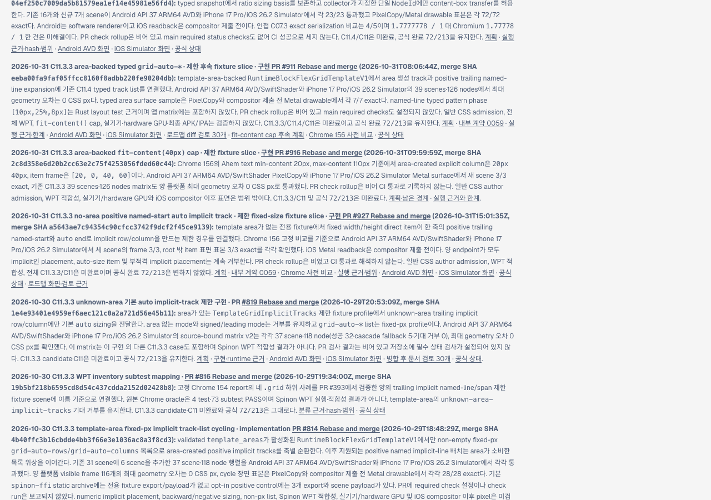
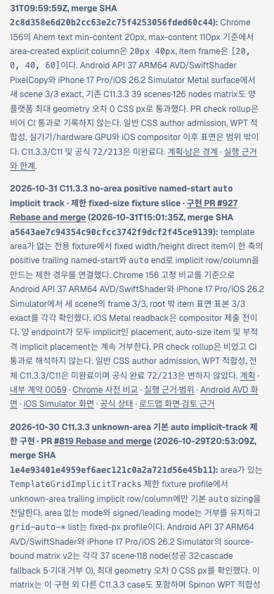

# C11.3.3 PR #927 공개 로드맵 동기화 근거

공식 구현 상태 대장에 기록된 PR #927의 제한 fixture 결과를 공개 `roadmap.html` 카드에 반영한다. C11, C11.3.3, C11.4의 완료 상태와 공식 집계 `72/213`은 바꾸지 않는다.

## 확인 내용

- 병합된 구현: [PR #927](https://github.com/ohah/spinon/pull/927), Rebase and merge, merge SHA `a5643ae7c94354c90cfcc3742f9dcf2f45ce9139`.
- RSPress `2.0.22` 선택 빌드에서 로드맵·상태·C11 계약·계획·fixture 근거 페이지를 생성했다. 전체 문서 dead-link 검사는 수행하지 않았다.
- Agent Browser `0.31.1` / Headless Chrome `156.0.0.0`에서 로컬 게시본의 PR #927 카드와 내부 링크를 확인했다. 카드 내부 링크 8개, 화면 이미지 2개, diff 검토 페이지 1개가 HTTP 200이며 게시 파일 SHA-256과 일치한다([검증 원장](./route-validation.json)). Desktop viewport `1280×900`에서 문서 폭은 `1280px`; mobile viewport `390×844`에서 문서 폭은 `390px`, 대상 카드 폭은 `362px`로 가로 넘침이 없었다. README에 포함한 desktop/mobile 화면의 원본 크기는 각각 `1280×900`, `390×844`다.
- 이 화면은 문서 로드맵 카드만 보여준다. 앱 동작·CSS 지원·WPT 적합성 근거는 아니다. 앱 실행 표본은 [구현/runtime evidence](../c11-3-3-named-line-auto-implicit-tracks-implementation-2026-10-31/README.md)에서 따로 기록한다.

## Agent Browser 화면

Desktop · 1280×900 CSS px:

Mobile · 390×844 CSS px:

[실제 도로맵 diff 실패 관점 검토 30개](./roadmap-pr-diff-review-30.md) · [내부 링크 응답 검증](./route-validation.json)
