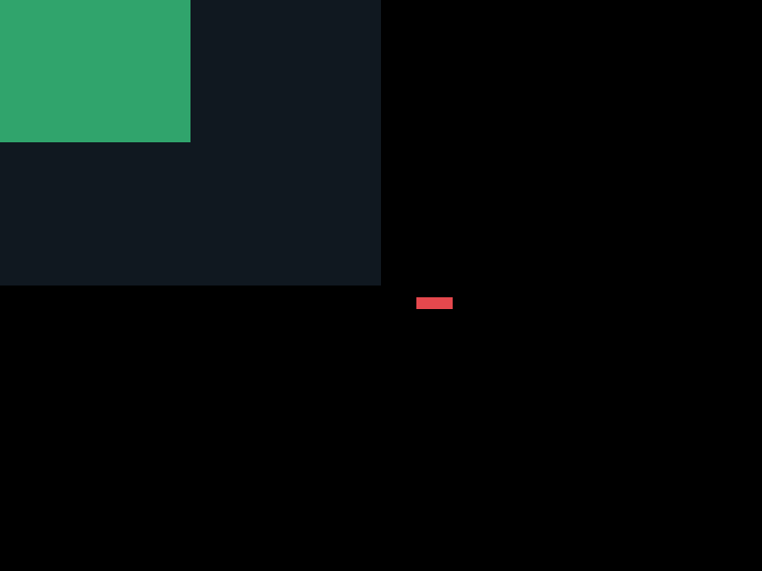
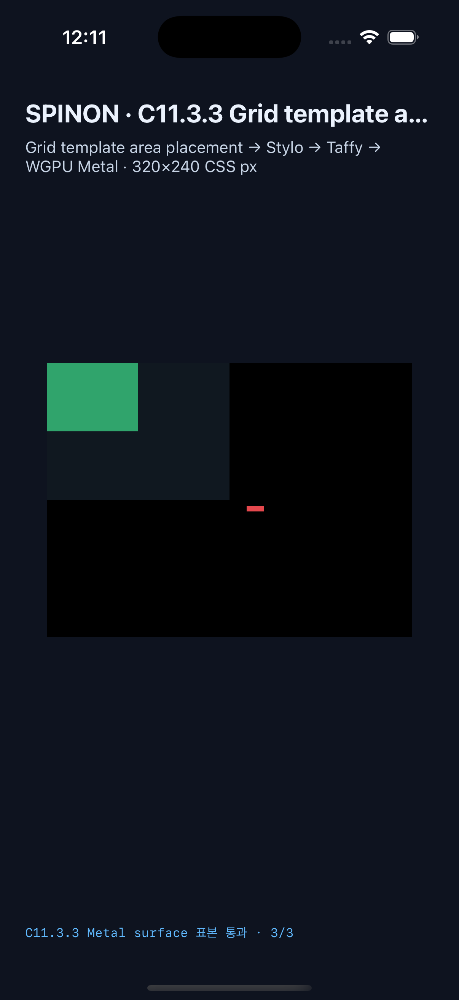

# C11.3.3 존재하지 않는 area 이름의 trailing implicit line 후속

## 구현 범위

C11.3.3 전용 opt-in runtime 경로에서 explicit template area 및 named line에 없는 `<custom-ident>`를 양의 trailing implicit named line으로 해석하고, opposite definite line에서 시작하는 named span 부족분을 trailing 방향으로 확장한다. 일반 profile과 기존 C11.3.1–3.2 경로의 지원 범위는 바꾸지 않는다.

`TemplateGridImplicitTracks`는 이 named fallback으로 생성된 implicit placement에서만 선택된다. 해당 profile에서는 두 축의 `grid-auto-rows`와 `grid-auto-columns` 모두 고정 px여야 한다. 일반 numeric line/span이 implicit extent를 만들거나, leading/negative extent를 요구하거나, `auto` track sizing을 요구하면 거부한다.

## 검증 결과

- 고정 Chrome 154 oracle 기준 26 scene·65 node; 양 플랫폼에서 26 scene·65 node, 성공 19·cascade fallback 5·기대 거부 2, visible frame 61개의 geometry 최대 오차 0 CSS px.
- Android API 37 ARM64 AVD(`emulator-5554`, ANGLE/Vulkan/SwiftShader): 실행 ID `c1133-matrix-20261020T150911869Z-7abbeeff`; 기본 Grid 표면 2/2 RGBA exact. 별도 unknown-area overflow scene에서 root 밖 item frame `(175,125,15,5)`를 포함한 3개 표면 표본이 PixelCopy 3/3 exact.
- Android 16/API 36 Samsung SM-S731N 실기기(ADB serial은 공개 evidence에서 가림), 실행 ID `c1133-matrix-20261020T152039508Z-5886c27a`; 26 scene·65 node, 성공 19·cascade fallback 5·기대 거부 2, visible frame 61개 geometry 오차 0 CSS px. 기본 PixelCopy 2/2, root 밖 item `(175,125,15,5)`을 포함한 별도 overflow PixelCopy 3/3 RGBA exact. SurfaceFlinger는 `ANGLE ((Samsung Xclipse 940) on Vulkan 1.3.279)`을 보고했다. 앱 SHA-256은 `482e5b5452b3d62f8ad20f51247d6f93622b43c0d3db3ed7fa8d79e6c3122470`이다.
- iPhone 17 Pro / iOS 26.2 Simulator: 실행 ID `c1133-ios-matrix-20261020T151033155Z-4d6bf988`; 26 scene·65 node, 성공 19·cascade fallback 5·기대 거부 2, visible frame 61개 geometry 오차 0 CSS px. 기본 Grid 표면 2/2 exact, 별도 overflow scene은 3 frame과 Metal drawable 표본 3/3 exact다. app SHA-256 `6d8872eaf39a0ad1cbdbbc75845ce2c79db455d0e9a2441c82381982555e0218`. Metal readback은 OS compositor 제출 전이다.
- Overflow comparison은 grid interior `(150,110)`, known-area sibling `(10,10)`, root 바깥 unknown-area item `(182,127)`을 비교한다. Chrome의 미커버 viewport 바탕색과 native surface backdrop 차이는 Grid 표본에서 제외하며 border stroke는 검사하지 않는다.
- Android app SHA-256 `482e5b5452b3d62f8ad20f51247d6f93622b43c0d3db3ed7fa8d79e6c3122470`. Android AVD는 소프트웨어 SwiftShader 경로다.
- 기본 `spinon-ffi` release static archive에는 C11.3.3 FFI 심벌과 payload marker가 없고, `c11-grid-metal-surface-pixels-test` opt-in archive에는 세 심벌과 positive-control marker가 있다. 크기·전체 SHA-256·명령은 [artifact boundary](./artifact-boundary.json)에 기록했다. 이 결과는 final Android APK/iOS app bundle 크기 검증이 아니다.
- 4개 color sample의 Chrome `#ffffff` viewport backdrop은 native host-owned surface backdrop과 달라 exact sample set에서 제외했다. root 밖 item geometry와 색은 각 플랫폼에서 별도로 검사했다.
- 최종 전체 로컬 검사: Rust workspace 1,193 passed·4 ignored·0 failed; C11.3.3 집중 Rust/FFI와 CSS reference matrix tests 통과; workspace Clippy와 rustfmt 통과. `mise exec -- bun run test`는 이 diff가 건드리지 않은 C04 runtime viewport tuple, C11.3.2 iOS route regex, C13.3 iOS tap guard regex, C13.3 iOS route diagnostic text assertion에서 실패했다. `test:css-reference` 뒤의 benchmark 단계는 실행되지 않았으며 전체 suite 통과로 보고하지 않는다.

이 근거는 제한된 고정 fixture와 단일 Android 실기기, Android AVD, iOS Simulator 결과다. SM-S731N에서 기록한 renderer 이외의 기기·driver 호환성, Spinon WPT 적합성, C11.3.3 전체, 전체 CSS Grid 지원, iOS 실기기 및 compositor 이후 픽셀을 입증하지 않는다. 공식 C11.3.3 check와 완료 집계는 변경하지 않는다.

보존된 텍스트 실행 로그는 줄 끝 공백만 제거했으며 marker와 관찰값은 바꾸지 않았다. 실기기 전체 화면은 저장하지 않고 앱 SurfaceView PixelCopy만 남긴다.

## 원본

- 후보 PR: [#393](https://github.com/ohah/spinon/pull/393)
- 계획: [`plan/c11-3-3-unknown-named-area-implicit-lines.md`](../../../../plan/c11-3-3-unknown-named-area-implicit-lines.md)
- Android 실행: [`android-avd-c1133-matrix-20261020T150911869Z-7abbeeff`](../c11-3-3-grid-template-areas-runtime-2026-10-21/android-avd-c1133-matrix-20261020T150911869Z-7abbeeff/README.md)
- Android 실기기 실행: [`android-physical-c1133-matrix-20261020T152039508Z-5886c27a`](../c11-3-3-grid-template-areas-runtime-2026-10-21/android-physical-c1133-matrix-20261020T152039508Z-5886c27a/README.md)
- iOS 실행: [`ios-simulator-c1133-ios-matrix-20261020T151033155Z-4d6bf988`](../c11-3-3-grid-template-areas-runtime-2026-10-21/ios-simulator-c1133-ios-matrix-20261020T151033155Z-4d6bf988/README.md)
- 기본/opt-in fixture archive 경계: [`artifact-boundary.json`](./artifact-boundary.json)
- 최종 PR diff 실패 관점 30개: [`pr-diff-review-30.md`](./pr-diff-review-30.md)
- PR diff 사전 검토 기록 20개: [`pr-diff-review-20.md`](./pr-diff-review-20.md)

## 화면 캡처

