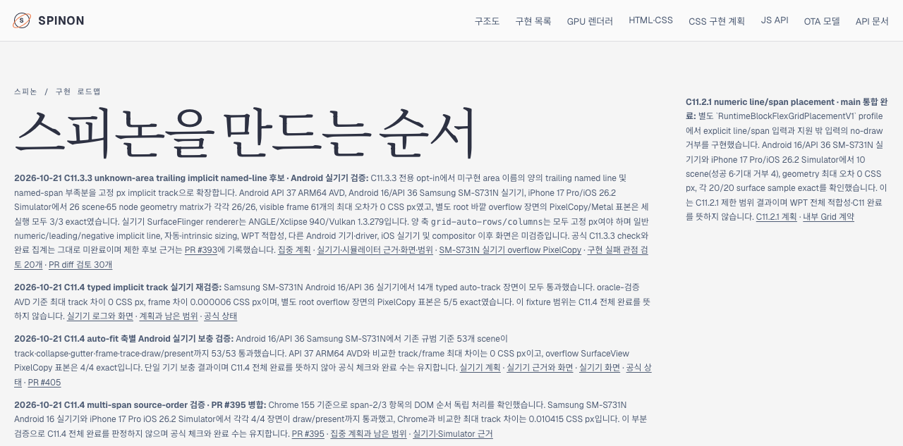
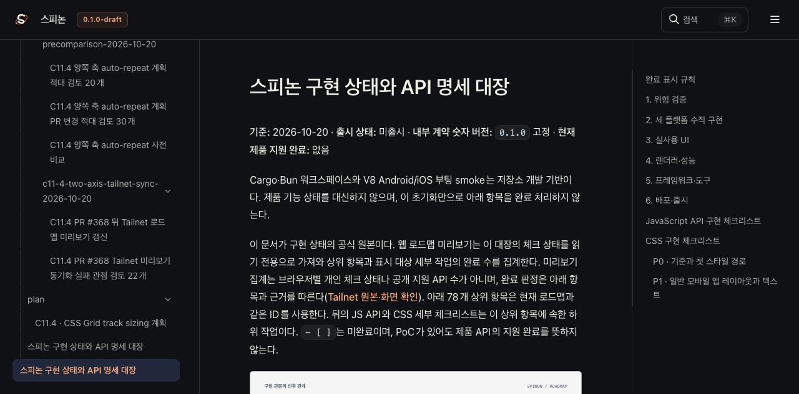
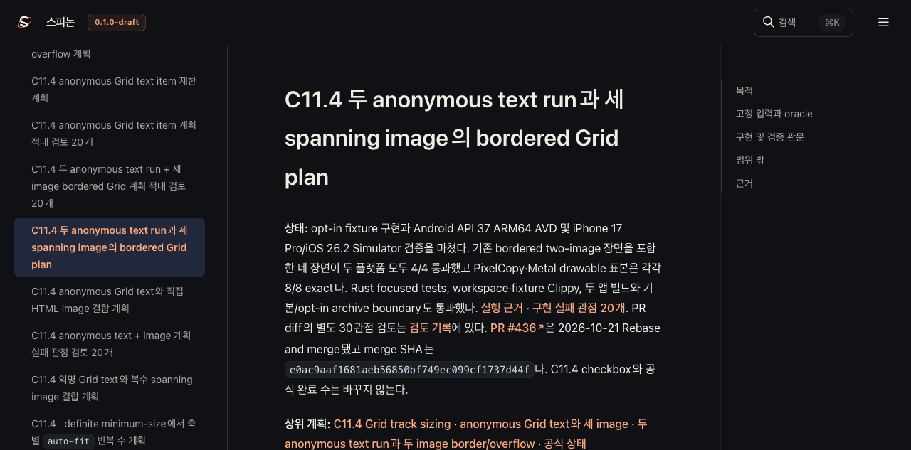
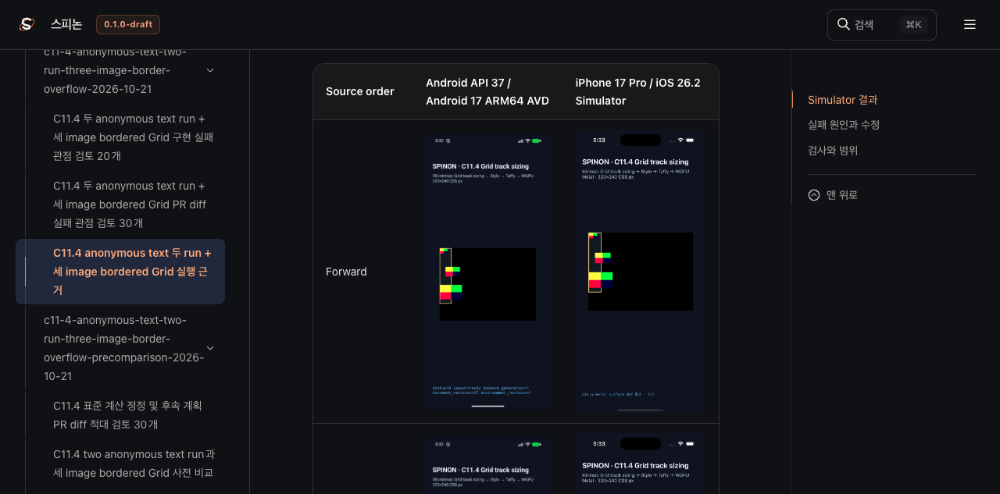

# C11.4 Tailnet 로드맵 미리보기 재동기화 — pass04

## 원본과 선택 RSPress 빌드

- 빌드 source commit은 `4592bd77c58c59547fc3c6740f6a8afa1e4ea7e2`이며 tree는 `02c6ae0778b23ca7934ec3c174d8830021926cef`다. 여기에는 PR #436 병합 이후 갱신한 공식 상태, C11.4 계획, roadmap HTML과 forward/reversed simulator 이미지 네 장이 들어 있다.
- RSPress `2.0.22`의 선택 경로 빌드만 실행하고 dead-link/dead-image 전체 검사는 끈 상태로 기록했다. 산출물은 3,164개 파일, 141,470,808 bytes, 파일 tree SHA-256 `1e0ed86eaa4781c07eaa6195e62d46dc11816526091623db739d9f06fbf031f3`다.
- 저장소 diff 검사를 위해 RSPress table 출력 끝의 공백만 제거했고 로그의 표 행·값은 유지했다.
- 선택 route에 `roadmap.html`, root/spec `STATUS`, 새 계획, simulator 실행 README와 두 플랫폼의 forward/reversed 캡처 네 장이 포함됐는지 검사했다. 일반 문서 전체 빌드나 전체 link/image conformance로 확대하지 않는다.

## Tailnet 동기화

- 미리보기는 [스피논 로드맵](https://macstudio.tailed42f2.ts.net/spinon/roadmap.html)이며 파일을 제공하는 기존 server PID 1191의 `127.0.0.1:8768` listener를 유지했다.
- 사전 비교는 신규 311, 교체 179, 동일 2,674, 삭제 0이었다. 교체 파일 179개와 이전 24,445,799 bytes를 별도 pass04 백업 경로에 저장했다.
- 복사 뒤 preview 파일 3,164/3,164와 백업 179/179의 byte 수·SHA-256이 일치했다. 기존 파일을 열고 있던 process는 검증된 idle preview listener 하나였고 교체는 원자적 rename으로 했다.
- Tailnet 원격 HTTP 확인에서 3,164/3,164 경로가 HTTP 200, 3,164/3,164 body SHA-256 일치, 실패 0건이었다. 상세 manifest는 `preflight-pass04.json`, `copy-and-backup-pass04.json`, `local-verification-pass04.json`, `served-verification-pass04.json`에 있다.

## Agent Browser 확인

- roadmap, 공식 STATUS, C11.4 계획 페이지가 PR #436과 merge SHA `e0ac9aaf1681aeb56850bf749ec099cf1737d44f`를 표시했다. 공식 완료 집계는 계속 72/213이며 C11 parent checkbox는 unchecked다.
- simulator 실행 README의 Android API 37 AVD forward/reversed 화면은 각 1080×2400, iOS 26.2 Simulator forward/reversed 화면은 각 1206×2622로 모두 `complete=true`였다. [DOM 결과](./agent-browser-final-pass04.json)에 기록했다.
- 확인 뒤 Agent Browser 세션을 닫았고 Agent Browser/HeadlessChrome process가 남지 않은 것을 확인했다. [종료 결과](./browser-close-pass04.json).
- 다섯 Agent Browser page screenshot의 SHA-256은 [hash 목록](./agent-browser-screenshot-sha256-pass04.txt)에 있다.
- GitHub Pages workflow와 `gh-pages`는 실행하거나 변경하지 않았다. tmux 세션도 변경하지 않았다.

Tailnet site hash, 파일별 HTTP·SHA 결과와 preflight backup 상세는 이름에 `pass04`가 붙은 JSON/log 파일에 기록했다. 이 동기화는 문서 미리보기 상태를 검증하며 WPT, physical device 또는 전체 C11.4 지원을 주장하지 않는다.
