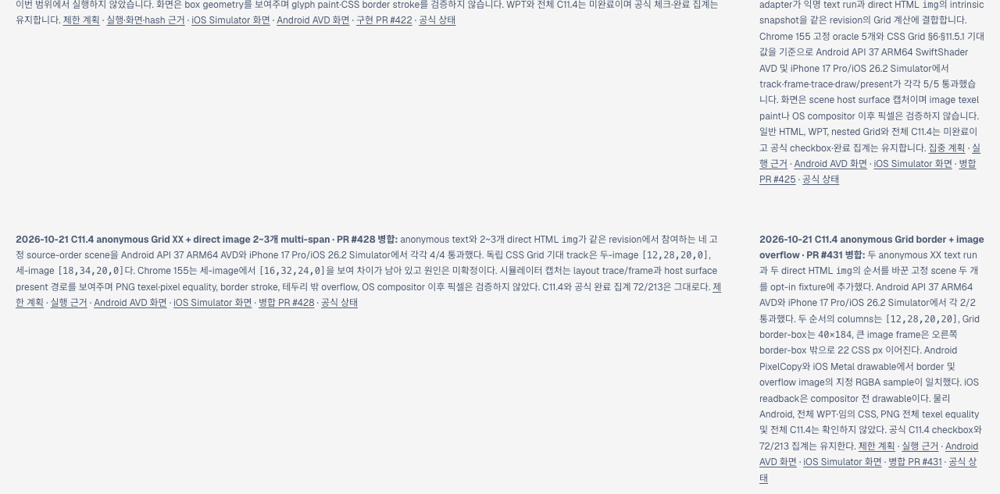
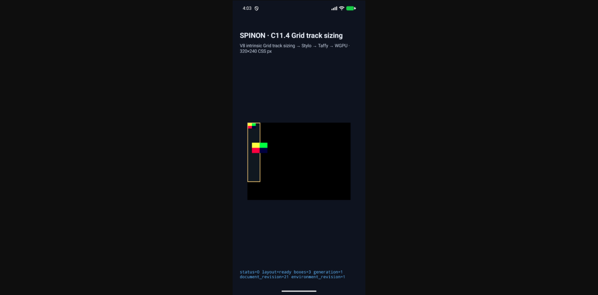
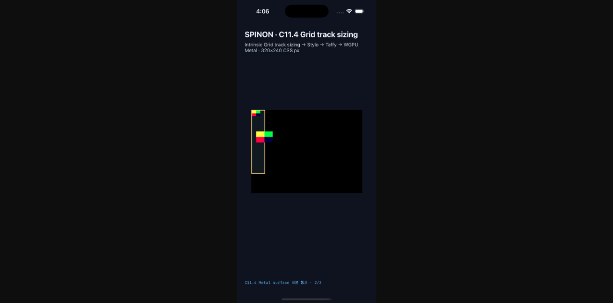

# C11.4 bordered Grid overflow Tailnet 미리보기 검증 — pass01

2026-10-21에 병합된 PR #431과 PR #432의 문서 사이트를 Tailnet 미리보기에 동기화했다. 이 기록은 당시 `origin/main`의 SHA-256 콘텐츠를 확인한 pass01 실행과 Agent Browser의 실제 페이지·이미지 표시 결과를 보존한다.

## 빌드 원본과 산출물

- 원본 commit: `135b241e05fbf4f4e6e41e9f29c4f145a160f11d`
- 원본 tree: `c92d41f8da22f5f42c83637a92dddf7ae711252e`
- RSPress: `2.0.22` (프로젝트에서 고정한 버전)
- 기존 pass40의 선택 source root를 바탕으로 main의 변경 82개 파일을 대조해 237개 경로를 복사했다. 각 복사 파일은 `git show origin/main:<path>` 원본과 비교했다.
- 선택 RSPress 빌드가 성공했다. 전체 문서 빌드에서 알려진 무관한 링크·이미지 문제 때문에 이 빌드는 dead-link/dead-image 검사를 끈 범위 빌드다. 따라서 전체 문서 사이트 검증을 뜻하지 않는다.
- 저장소 diff 검사를 위해 빌드 표의 행 끝 공백과 마지막 빈 줄만 제거해 로그를 저장했다. 명령 출력의 표 내용은 보존했다.
- 빌드 산출물은 2,992개 파일, 126,729,690 bytes이며 전체 파일 트리 SHA-256은 `c923aa1a7f028590a53bea4ef905b40a0212af8ce229194ca4087c499f931304`다.
- 빌드에서 roadmap, root/spec `STATUS`, 계획, 두 20항목 검토, 실행 README와 Android/iOS forward 캡처 경로를 확인했다.

## Tailnet 동기화와 검증

미리보기 주소는 [스피논 로드맵](https://macstudio.tailed42f2.ts.net/spinon/roadmap.html)이고 서버 root는 `/Users/yoonhb/Library/Application Support/SpinonPreview`다.

- 사전 비교: 생성 264, 교체 165, 동일 2,563, 삭제 0. 교체 대상 165개는 총 21,246,919 bytes로 백업했다.
- 파일 교체는 각 백업의 SHA-256을 확인한 뒤 임시 파일을 원자적으로 rename하는 기존 Tailnet 절차를 사용했다.
- 로컬 사후 검사에서 2,992개 대상과 165개 백업의 byte 수·SHA-256이 모두 일치했고 삭제는 없었다.
- 공개 HTTP 검증에서 2,992/2,992 경로가 HTTP 200을 반환했고, 응답 body SHA-256도 2,992/2,992 일치했다. 실패는 0건이다.
- HTTP 서버 PID 1191은 `127.0.0.1:8768` listener로 유지했다. 열린 파일을 쓰는 활성 요청은 없었으며, 브라우저 검증 뒤 Agent Browser 세션과 Chrome 프로세스는 모두 종료했다. tmux 세션은 변경하지 않았다.
- GitHub Pages workflow와 `gh-pages`는 실행하거나 변경하지 않았다.

## Agent Browser 화면 확인

- roadmap에 PR #431 병합 기록, 고정 track `[12, 28, 20, 20]`, 40×184 border box와 22 CSS px overflow 결과가 표시됐다.
- 공식 상태에서 C11.4 checkbox는 미완료이고 완료 집계는 `72/213` 그대로였다. roadmap과 상태 페이지에서 PR #431 merge SHA `420be2c40cb0a9f68023121f66ff122158494ffa`도 확인했다.
- 계획 문서와 실행 근거 README가 Tailnet UI에서 렌더됐다.
- Android forward PNG가 `complete=true`, `1080×2400`; iOS forward PNG가 `complete=true`, `1206×2622`로 브라우저에 표시됐다.
- PR #433 본문을 GitHub Agent Browser에서도 확인했다. 본문에 올린 roadmap/Android/iOS 이미지 3개가 모두 `complete=true`, `1280×633`이었다. [PR 전체 화면 캡처](pr433-agent-browser-full-pass01.png)와 [DOM 결과](pr433-agent-browser-pass01.json)를 보존했다.

다른 Agent Browser 페이지 캡처는 [계획](tailnet-plan-agent-browser-pass01.png)과 [실행 근거](tailnet-evidence-readme-agent-browser-pass01.png)에 있다. 기계 판독 결과는 `*-pass01.json`, 빌드·동기화 로그는 이름에 `pass01`이 포함된 로그 파일에 둔다.

## 실행 한계

이 pass는 문서 정적 산출물과 Tailnet HTTP 응답을 확인한다. 앱의 physical Android 검증, WPT, 전체 C11.4 완료 또는 iOS compositor 이후 픽셀을 주장하지 않는다. 관련 앱 동작은 별도 [Android API 37 ARM64 AVD/iPhone 17 Pro iOS 26.2 Simulator 근거](../c11-4-anonymous-grid-border-overflow-2026-10-21/README.md)에 기록했다.
