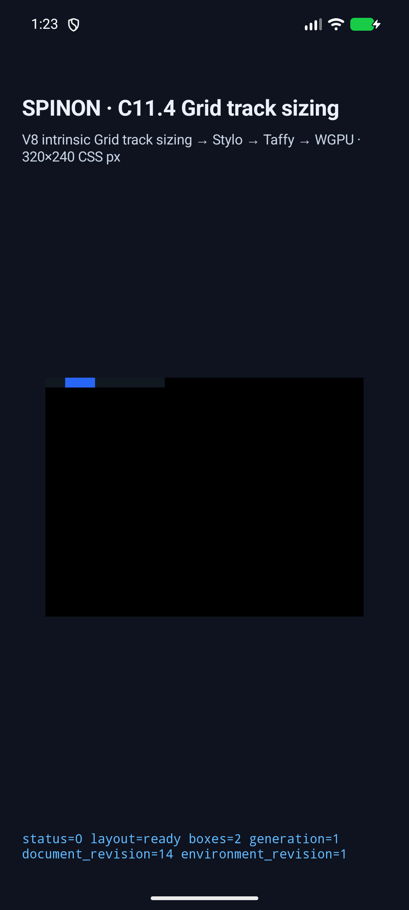

# C11.4 익명 Grid 순회 소스 누락 수정

## 발견과 수정

`origin/main`의 `text_paragraphs.rs`는 `text_paragraphs/dom_traversal.rs`를 모듈로 선언하고 세 순회 함수를 사용하지만, 깨끗한 저장소 스냅샷에는 그 파일이 없었다. `origin/main`을 Git archive로 내보낸 뒤 `cargo check --locked -p spinon-layout`을 실행해 다음 오류를 재현했다.

```text
error: couldn't read `crates/spinon-layout/src/host_document/text_paragraphs/dom_traversal.rs`: No such file or directory
```

누락된 내부 모듈을 추가했다. 이 수정은 기존 순회 로직을 정식 Rust 소스로 복구하며 공개 API나 C11.4 지원 범위를 바꾸지 않는다. 같은 깨끗한 스냅샷에 해당 파일만 추가한 뒤 동일한 `cargo check`이 통과했다.

## 검증

- `cargo fmt --all -- --check` 통과.
- `cargo test --locked -p spinon-layout`: 229 passed, 0 failed.
- `cargo clippy --locked --workspace --all-targets -- -D warnings` 통과.
- Android API 37.0 ARM64 AVD, SwiftShader, `emulator-5558`: 익명 Grid 5개 장면 모두 통과. track/frame 관찰값 일치, `drawPresented=true`.
- 빌드 APK와 설치된 `base.apk` SHA-256 일치: `7b1578cdae6ed11adcaf0c963308eaa672cf3ba210d8f3fb582dcf7a5eeb2bee`.
- Android 캡처는 실기기가 아닌 AVD에서 수행했다. 이 수정에 대해 iOS 시뮬레이터는 다시 실행하지 않았다.

## 화면과 원본 결과



- [전체 5개 scene 결과](./android-avd-c114-anfix-android-avd-20261021T042324471Z-c277525e/result.json)
- [시뮬레이터 및 APK hash](./android-avd-c114-anfix-android-avd-20261021T042324471Z-c277525e/simulator.json)
- [설치 APK 검증](./android-avd-c114-anfix-android-avd-20261021T042324471Z-c277525e/installed-apk-verification.json)
- [실행·화면·hash 산출물](./android-avd-c114-anfix-android-avd-20261021T042324471Z-c277525e/)
- [PR diff 적대 검토 20개](./pr-diff-review-20.md)
