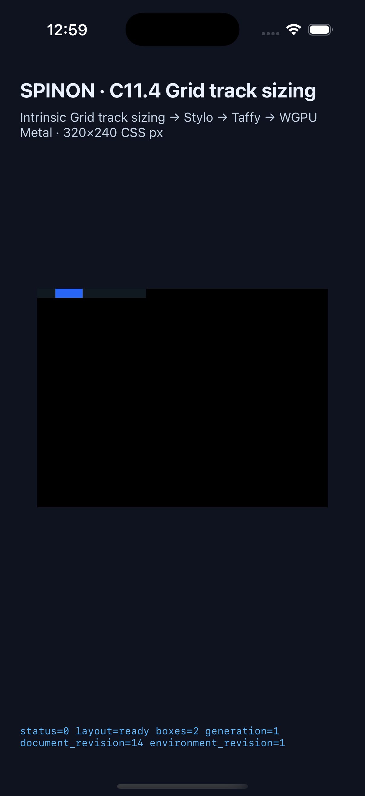
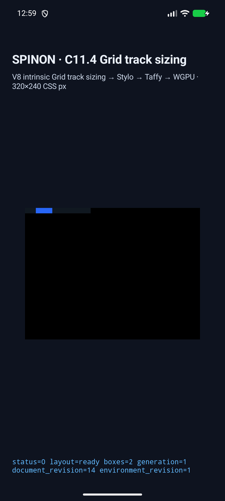

# C11.4 anonymous Grid text 제한 구현 근거

2026-10-21 opt-in `c11-4-grid-track-sizing-fixture-test`에서 직접 anonymous Grid text run 다섯 장면을 구현했다. `display:none` direct child가 text run을 끊지 않는다는 Chrome 155 관찰을 반영한 최신 source 기준으로 Android API 37.0 ARM64 AVD와 iPhone 17 Pro/iOS 26.2 Simulator에서 각각 5/5를 실행했다. 두 실행은 used tracks, DOM frame 목록, trace completeness, `layout=ready`, `drawPresented=true`를 확인했다. 사용자가 시뮬레이터 검증을 선택해 이번 범위에서는 Samsung 실기기 검증을 수행하지 않았다. 일반 CSS Grid 지원이나 C11.4 완료를 뜻하지 않는다.

[계획 범위 보강 검토 20개](./plan-display-none-amendment-review-20.md) · [구현 실패 관점 검토 20개](./implementation-review-20.md) · [구현 PR diff 적대 검토 30개](./pr-diff-review-30.md)

## iOS Simulator

- 기기: iPhone 17 Pro, iOS 26.2 Simulator (`ACA7BF91-E2D5-4CF7-909A-08D1AD95FF3D`)
- 최신 수정 source 빌드: [`ios-simulator-build-after-frame-fix.log`](./ios-simulator-build-after-frame-fix.log), `SPINON_ENABLE_C04_RUNTIME_GPU=1`, `SPINON_ENABLE_C04_RUNTIME_GPU_FIXTURE_TEST=1` (`BUILD SUCCEEDED`)
- 앱 SHA-256: `3f6af1363ff263c426216f2d74f061eaae0e22830c95a37b1a49621b12e27aec`
- 실행 결과: [`result.json`](./ios-simulator-c114-anon-frame-fix-ios-simulator-20261021T035939342Z-bdea1e72/result.json), [`simulator.json`](./ios-simulator-c114-anon-frame-fix-ios-simulator-20261021T035939342Z-bdea1e72/simulator.json)

## Android AVD

- 기기: `spinon_api37_0_applied_txn`, API 37.0 ARM64 AVD, SwiftShader, `emulator-5558` (검증 후 종료)
- 최신 수정 source 빌드: [`android-build-after-frame-fix.log`](./android-build-after-frame-fix.log), `SPINON_ENABLE_C04_RUNTIME_GPU=1`, `SPINON_ENABLE_C04_RUNTIME_GPU_FIXTURE_TEST=1` (`BUILD SUCCESSFUL`)
- APK SHA-256: `7b1578cdae6ed11adcaf0c963308eaa672cf3ba210d8f3fb582dcf7a5eeb2bee`
- 설치 검증: local APK와 설치된 `base.apk` SHA-256 일치([결과](./android-avd-c114-anon-frame-fix-android-avd-20261021T035928000Z-a623a0f4/installed-apk-verification.json))
- 실행 결과: [`result.json`](./android-avd-c114-anon-frame-fix-android-avd-20261021T035928000Z-a623a0f4/result.json), [`simulator.json`](./android-avd-c114-anon-frame-fix-android-avd-20261021T035928000Z-a623a0f4/simulator.json)

| 장면 | Columns (CSS px) | root/item frame | iOS trace chunks | Android trace chunks | 결과 |
| --- | --- | --- | ---: | ---: | --- |
| `anonymous-min-content-wrap` | 20, 100 | root 120×20; 익명 text item이 두 줄로 wrap | 12 | 6 | 양쪽 통과 |
| `anonymous-comment-continuation` | 40, 80 | root 120×10; comment 양쪽 text가 같은 item으로 연결 | 8 | 4 | 양쪽 통과 |
| `anonymous-runs-around-block` | 20, 30, 40 | root 120×10; direct block 30×10 at (20,0) | 11 | 6 | 양쪽 통과 |
| `anonymous-hidden-child-continuation` | 40, 80 | root 120×10; 숨김 span과 subtree는 frame에서 제외 | 8 | 4 | 양쪽 통과 |
| `whitespace-does-not-create-item` | 20, 30, 40 | root 120×10; blocks 10×10 at (0,0), (20,0) | 4 | 2 | 양쪽 통과 |

## 코드 검증

- `cargo fmt --all -- --check`, capture script `node --check`, `git diff --check`: 통과.
- 수정 반영 후 `spinon-layout` C11.4 anonymous text tests 7/7, 선택 filter 전체 8/8 ([로그](./layout-anonymous-tests-after-fix.log)); `spinon-runtime` fixture tests 3/3 ([로그](./runtime-anonymous-tests-after-fix.log)); hidden frame runtime regression 1/1 ([로그](./runtime-hidden-frame-regression.log)); FFI five-scene matrix 1/1 ([로그](./ffi-anonymous-fixture-tests.log)); `spinon-style-to-render` display-none regressions 2/2 ([로그](./style-to-render-display-none-tests.log)).
- fixture module boundary 검사 6/6 ([로그](./fixture-module-boundary-tests.log)).
- 수정 반영 후 기본 workspace Clippy와 C04 runtime GPU fixture-test feature Clippy 모두 `-D warnings`로 통과 ([기본](./workspace-clippy-after-frame-fix.log), [fixture-test](./fixture-clippy-after-frame-fix.log)).
- Rust 1.96.1에 포함된 LLVM 22 `llvm-nm`과 archive strings로 기본 `spinon-ffi` artifact에서 C11.4 fixture symbol·scene payload가 없는지, `c04-runtime-gpu-fixture-test` positive artifact에는 symbol 두 개와 hidden-child scene payload가 있는지 수정 반영 후 다시 확인했다 ([기본 빌드·검사](./fixture-artifact-default-after-frame-fix-build.log), [기본 결과](./fixture-artifact-default-after-frame-fix-check.log), [positive 빌드·검사](./fixture-artifact-fixture-test-after-frame-fix-build.log), [positive 결과](./fixture-artifact-fixture-test-after-frame-fix-check.log)).
- 수정 반영 후 Android API 37 AVD·iOS Simulator에서 다섯 장면을 각각 다시 실행해 5/5 통과했다. 각 결과는 layout ready, 기대 track/frame, 완전한 trace와 `drawPresented=true`를 기록한다. AVD APK local/install SHA-256은 같다. 재실행 capture log: [Android](./capture-android-avd-after-frame-fix.log) · [iOS](./capture-ios-simulator-after-frame-fix.log).

## 실기기 검증 범위와 캡처 도구 수정

사용자가 시뮬레이터로 진행하도록 지정해 Samsung 실기기 실행은 이번 검증 범위에서 수행하지 않았다. 검증에 사용한 Android API 37.0 AVD `emulator-5558`은 테스트 후 종료했고 기존 `emulator-5554`, `emulator-5556`은 그대로 두었다. 따라서 Android 결과는 AVD 근거이며 Samsung 실기기 결과가 아니다.

첫 iOS 재검증은 긴 `--run-kind`가 만들어 낸 80자 초과 run ID 때문에 앱 인수 검증에서 거부됐다. [실패 로그](./ios-simulator-c114-anonymous-grid-text-source-recheck-ios-simulator-20261021T030516430Z-7a293598/runtime-anonymous-min-content-wrap.log)를 보존하고 캡처 도구가 실행 전에 retry suffix까지 포함한 run ID 길이를 검사하도록 수정했다. 짧은 run kind로 다시 실행한 기존 네 장면과 추가 `display:none` 장면은 모두 통과했다.

캡처는 runtime geometry·trace와 앱 surface screenshot을 확인한다. screenshot은 glyph ink, CSS border stroke, Android hardware GPU, iOS compositor 이후 pixel equality를 증명하지 않는다. 일반 font/script, nested/inline Grid item, WPT 및 전체 C11.4는 미완료다. 공식 체크와 완료 집계는 변경하지 않는다.

저장소 `git diff --check`가 로그 행 끝의 공백 때문에 실패하지 않도록 텍스트 로그의 행 끝 공백과 파일 끝 빈 줄만 정규화했다. 명령 출력의 실질 내용은 바꾸지 않았다.
