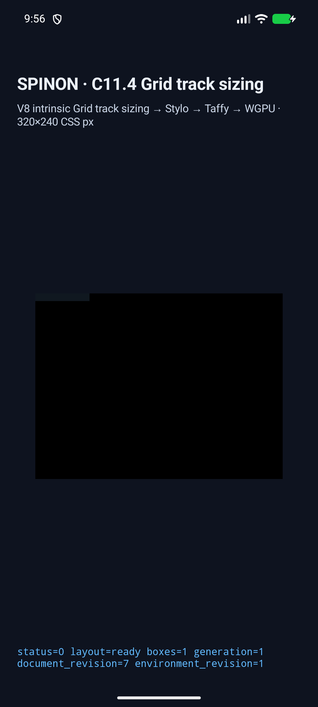
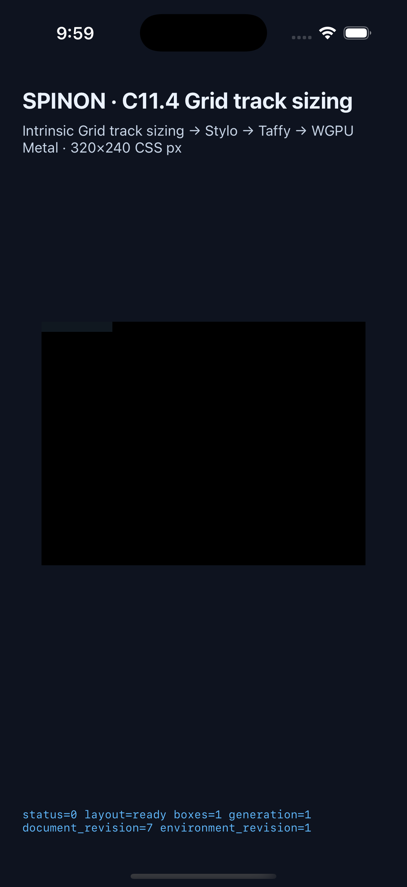

# C11.4 anonymous Grid text numeric author `tab-size`

이 근거는 고정 Ahem 10px/10px LTR, zero-spacing, 한 익명 Grid `white-space:pre` paragraph에 unitless `tab-size:1`, `2`, `4`를 전달하는 opt-in slice다. 기존 initial `8`도 회귀 장면으로 유지한다. 일반 CSS cascade, 전체 C11.4/C11 구현 또는 실기기 동작을 주장하지 않는다.

## 사전 판정과 시뮬레이터 결과

독립 판정값은 [CSS Text precomparison](../c11-4-anonymous-pre-author-tab-size-precomparison-2026-10-31/README.md)의 Chrome 156 관찰과 [expected-values.json](../c11-4-anonymous-pre-author-tab-size-precomparison-2026-10-31/expected-values.json)에 고정했다. Ahem 10px space advance에서 numeric `N`은 `10N` CSS px 정지 간격이고, 현재 inline advance보다 엄격히 다음 정지점으로 이동한다. 기존 anonymous-text 40 scenes(기본 initial 8 회귀 포함)에 Chrome expected positive 12 scenes와 잘못된 값 negative 3 scenes를 더한 총 55-scene 행렬을 Android와 iOS에서 실행했다.

| 대상 | 판정 | 앱 산출물 |
| --- | --- | --- |
| Android API 37 ARM64 AVD (`emulator-5554`, `sdk_gphone64_arm64`) | 55/55 scene, positive 52/52 draw/present, 잘못된 값 기대 거부 3/3, retry 0. PNG 52장과 원본 runtime log 55개. | APK 및 설치 APK SHA-256 `eff8873afb3199fe702463fab443ce43f943d771e6a0792bcdc811d2234e56d3` 일치. [시뮬레이터 정보](./android-avd-c114-anonymous-grid-text-android-avd-20261031T005435485Z-72d3f9e6/simulator.json) · [결과](./android-avd-c114-anonymous-grid-text-android-avd-20261031T005435485Z-72d3f9e6/result.json) |
| iPhone 17 Pro / iOS 26.2 Simulator (`iPhone18,1`) | 55/55 scene, positive 52/52 draw/present, 잘못된 값 기대 거부 3/3, retry 0. PNG 52장과 원본 runtime log 55개. | 앱 executable 및 설치 executable SHA-256 `eee937030c7d3d2e624ba446be78098f3ededc6ea572b7b9070678ed7bcb0a95` 일치. [시뮬레이터 정보](./ios-simulator-c114-anonymous-grid-text-ios-simulator-20261031T005822343Z-c7eb33a7/simulator.json) · [결과](./ios-simulator-c114-anonymous-grid-text-ios-simulator-20261031T005822343Z-c7eb33a7/result.json) |

두 실행의 전체 scene catalog, draw/present, 기대 거부, 재시도 및 screenshot 개수는 [simulator-matrix-verification.json](./simulator-matrix-verification.json)에 정리했다. 세 negative 값 `0`, `1.5`, `20px`는 `unsupported_c114_anonymous_text_style`, property `tab-size`, node 1로 거부되며 frame을 만들지 않는다.

두 최종 실행의 runtime 로그 110개와 원인 수정 때 남긴 Android 로그 4개는 [runtime-logs.tar.gz](./runtime-logs.tar.gz)에 원본 바이트 그대로 보관했다. 로그의 trailing space를 보존하기 위해 개별 log 파일은 압축 archive로 제공한다.

## 초기 실패와 수정

- 첫 Android 실행은 fixture-test flag가 꺼진 앱을 설치해 `SPINON_C0410_DISABLED fixture-test feature is off`로 끝났다(`runtime-...004158272Z.../runtime-anonymous-pre-tab-max-content.log`, [로그 archive](./runtime-logs.tar.gz)). 이후 Android와 iOS 빌드를 모두 `SPINON_ENABLE_C04_RUNTIME_GPU=1` 및 `SPINON_ENABLE_C04_RUNTIME_GPU_FIXTURE_TEST=1`로 다시 만들었다.
- fixture-enabled Android 실행은 새 `PreWithTabSize` mode가 anonymous Grid text allowlist에 빠진 것을 드러냈다(`runtime-...004503506Z.../runtime-anonymous-pre-tab-max-content.log`). `text_paragraphs.rs`와 `compute.rs`에서 이 typed mode를 허용하고 HostDocument 회귀를 추가했다.
- 그다음 플랫폼 assertion이 기존 tab scene의 `white-space` debug 값을 `Pre`로 기대해 `text_intrinsic_inputs_match=false`가 났다(`runtime-...004729933Z.../runtime-anonymous-pre-tab-max-content.log`). Android와 iOS validator를 `PreWithTabSize(Eight)` 및 numeric variant 값으로 갱신했다.
- size 4 exact-stop은 fixture가 `XXXXXXXX\tX`를 내보내 130px가 나왔다. 독립 expected case는 `XXXX\tX`와 90px였다(`runtime-...005227656Z.../runtime-anonymous-pre-tab-size-4-exact-stop.log`). 두 runtime fixture source를 oracle 입력에 맞췄고, 아래 최종 55-scene 실행에서 size 4 장면은 90px로 통과했다.
- 전체 workspace Clippy는 새 단위 테스트 바깥 `vec!` 사용을 찾아 배열로 고쳤다. default 및 C11.4 fixture-feature Clippy를 다시 실행해 통과했다.

| Android API 37 ARM64 AVD | iPhone 17 Pro / iOS 26.2 Simulator |
| --- | --- |
|  |  |

이미지는 각 앱의 C11.4 fixture surface 제출 화면이다. 현재 경로에서는 glyph painter가 텍스트 ink를 그리지 않으므로 tab 폭·정규화 문자열·source map 판정은 runtime 결과와 trace로 확인한다. 화면 이미지를 glyph pixel 비교로 해석하지 않는다.

## 검사

- Android fixture APK: `mise exec -- env SPINON_ENABLE_C04_RUNTIME_GPU=1 SPINON_ENABLE_C04_RUNTIME_GPU_FIXTURE_TEST=1 bun run build:android` — `BUILD SUCCESSFUL`.
- iOS fixture 앱: `mise exec -- env SPINON_ENABLE_C04_RUNTIME_GPU=1 SPINON_ENABLE_C04_RUNTIME_GPU_FIXTURE_TEST=1 bun run build:ios-sim` — `BUILD SUCCEEDED`.
- `mise exec -- cargo test --locked -p spinon-text-layout` — 67 passed.
- `mise exec -- cargo test --locked -p spinon-layout --features c11-4-grid-track-sizing-fixture-test c11_4_anonymous_text` — 32 passed.
- `mise exec -- cargo test --locked -p spinon-runtime --features c11-4-grid-track-sizing-fixture-test anonymous_text` — 8 passed.
- `mise exec -- cargo test --locked -p spinon-ffi --features c04-runtime-gpu-fixture-test anonymous_grid_text_sources_are_a_fixed_fifty_five_scene_matrix` — 1 passed.
- `mise exec -- node --test tools/css-reference/fixture-module-boundary.test.mjs` — 24 passed.
- Workspace Clippy와 `spinon-layout`, fixture-feature `spinon-runtime`, fixture-feature `spinon-ffi` Clippy — 모두 경고 없이 통과.
- `mise exec -- cargo fmt --all -- --check`와 `git diff --check` — 통과.
- 기본·fixture-test FFI archive 차이는 [artifact-boundary.json](./artifact-boundary.json)에 기록했다. 기본 artifact는 16개 numeric-tab 장면 ID와 C11.4 fixture ABI가 없고, `c04-runtime-gpu-fixture-test` archive에는 16개 ID와 ABI 두 개가 있다.
- 별도 [구현/runtime 검토 20개](./implementation-runtime-review-20.md)와 [PR diff 검토 30개](./pr-diff-review-30.md)는 실패 관점을 분리해 기록했다.

## 범위

실행은 Android API 37 ARM64 AVD와 iOS Simulator에서만 했다. Android 실기기, iOS 실기기, hardware GPU, compositor 이후 pixel, 임의 font·writing mode·spacing, general cascade, 전체 WPT 적합성은 포함하지 않는다. `spec/STATUS.md`의 C11.4/C11 공식 체크와 `72/213`은 그대로 둔다.
