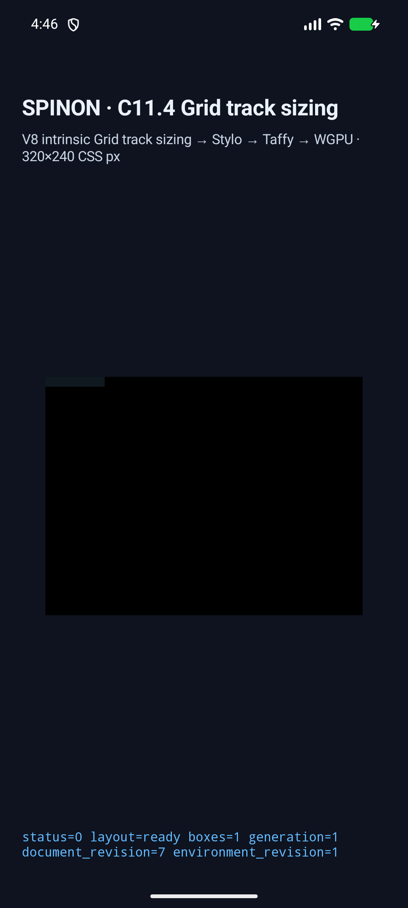
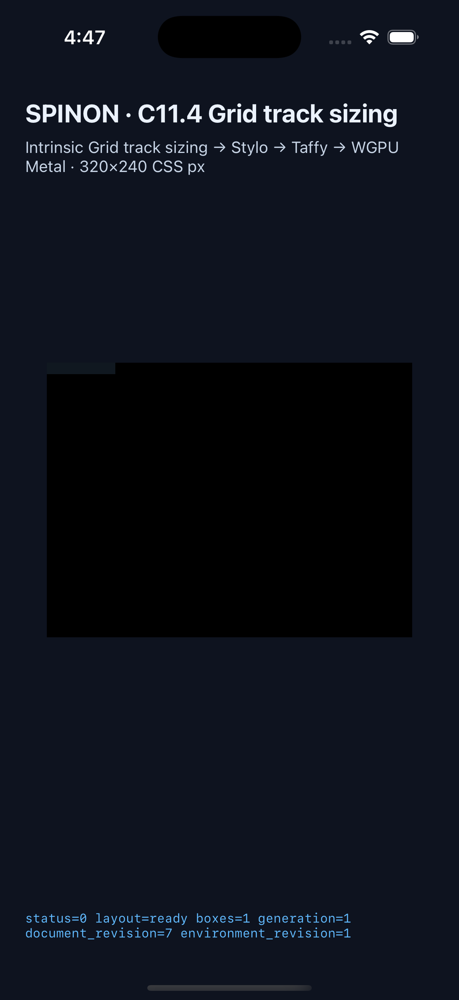

# C11.4 anonymous Grid text `white-space: break-spaces` runtime 후보

## 판정

C11.4 anonymous Grid text의 `break-spaces` 제한 fixture 후보를 추가했다. 기존 Normal, NoWrap, PreLine, PreWrap scene을 포함한 같은 26-scene matrix를 Android API 37 ARM64 AVD와 iPhone 17 Pro/iOS 26.2 Simulator에서 각각 26/26 통과했다. 각 scene은 기대 root/frame, 최종 columns/rows track, track trace와 draw/present를 검사했고, superseded retry는 0이었다. 이 결과는 C11.4 또는 C11 전체 완료가 아니며 공식 완료 수 `72/213`을 바꾸지 않는다.

Android 첫 실행은 24/26에서 멈췄다. 공백만 있는 `break-spaces` 입력은 anonymous Grid item을 만들지 않으므로 기대 box 수가 0이어야 하는데 fixture validator와 capture catalog가 1을 예상했다. 기대값을 0으로 고친 뒤 두 플랫폼에서 전체 26-scene 행렬을 다시 통과했다. 이 수정은 CSS 결과에 맞춘 fixture 기대값 변경이며 runtime geometry 구현 변경은 아니다.

## 신규 장면

고정 profile은 Ahem 10px, line-height 10px, horizontal-tb/LTR, 직접 text source와 U+0020/LF를 사용한다.

| 장면 | Columns | Rows | 확인점 |
| --- | --- | --- | --- |
| `anonymous-break-spaces-max-content` | `[60px]` | `[10px]` | `XX  XX`의 두 보존 공백 포함 max-content |
| `anonymous-break-spaces-comment-split-max-content` | `[60px]` | `[10px]` | 두 direct Text source를 한 anonymous item으로 연결하고 provenance 보존 |
| `anonymous-break-spaces-min-content` | `[30px]` | `[20px]` | 각 보존 공백의 wrap opportunity와 줄 끝 공백 비-hanging |
| `anonymous-break-spaces-soft-wrap-25` | `[25px]` | `[20px]` | 25px track 안에서 두 30px line advance를 유지 |
| `anonymous-break-spaces-forced-break-max-content` | `[40px]` | `[20px]` | forced LF 앞 보존 공백 포함 |
| `anonymous-break-spaces-forced-break-min-content` | `[30px]` | `[30px]` | min-content에서 보존 공백 두 개가 별도 line을 만듦 |
| `anonymous-break-spaces-trailing-soft-wrap-25` | `[25px]` | `[20px]` | trailing spaces가 두 line으로 감기고 hanging advance는 0 |
| `anonymous-break-spaces-trailing-max-content` | `[40px]` | `[10px]` | trailing spaces 포함 max-content |
| `anonymous-break-spaces-whitespace-only` | `[0px]` | `[0px]` | text-only whitespace는 anonymous item/box를 만들지 않음 |
| `anonymous-break-spaces-whitespace-before-block` | `[20px,20px]` | `[10px]` | whitespace text가 다음 block의 auto cell을 소비하지 않음 |

공백 보존과 forced-break normalization, CRLF 및 source 경계, unsupported tab fail-closed는 text-layout unit test에 있다. Grid host-document tests는 intrinsic sizes, frames, contribution traces, whitespace-only와 block continuation을 확인한다. 기준 관찰과 독립 기대값은 [Chrome 156 사전 비교](../c11-4-anonymous-grid-text-break-spaces-precomparison-2026-10-31/README.md)에 있다.

## 실행과 화면

- Android API 37 ARM64 AVD `emulator-5554`, `sdk_gphone64_arm64`: 26/26 scene, 26/26 draw-present, 0 retry. Renderer는 ANGLE/Vulkan/SwiftShader software 경로다. 설치 APK SHA-256은 `b0a27943f974e630f20b5d295344ee6a248f87880b77ae7b970e80bfb40c34ac`이다. [실행 결과](receipts/android-result.json) · [환경과 source receipt](receipts/android-simulator.json).
- iPhone 17 Pro / iOS 26.2 Simulator: 26/26 scene, 26/26 draw-present, 0 retry. 설치 app SHA-256은 `0d0616aa74bc78597b5358f8602a2add946aad19b8a5bf3df84650839447679a`이다. [실행 결과](receipts/ios-result.json) · [환경과 source receipt](receipts/ios-simulator.json).

선택한 앱 화면은 실행 경로와 fixture harness를 보여준다. 이 PNG는 glyph ink의 pixel oracle이 아니다.

전체 scene별 capture와 log는 원 실행 디렉터리에 보존되어 있다. 이 PR에는 축약된 result/environment receipts와 플랫폼별 대표 화면만 포함한다.

## 코드와 확인

- `WhiteSpaceMode::BreakSpaces`는 Parley의 `WhiteSpaceCollapse::BreakSpaces`와 wrapping으로 연결된다. preserved spaces와 segment breaks는 보존하고, tab 입력은 현재 fixture profile에서 명시적으로 거부한다.
- min-content inline width에서 reflow해 preserved non-hanging spaces의 block height를 산출한다. layout 재실행은 이 모드에만 min-content inline width 하한을 사용한다.
- anonymous Grid fixture validator만 이 모드를 허용한다. 일반 author CSS admission, 공개 API/ABI와 root-HTML mapping은 추가하지 않는다.
- `cargo test --locked -p spinon-text-layout break_spaces`: 5 passed.
- `cargo test --locked -p spinon-layout --features c11-4-grid-track-sizing-fixture-test break_spaces`: 7 passed.
- `cargo test --locked -p spinon-runtime --features c11-4-grid-track-sizing-fixture-test c11_4_anonymous_text`: 3 passed.
- `cargo test --locked -p spinon-ffi --features c04-runtime-gpu-fixture-test anonymous_grid_text_sources_are_a_fixed_twenty_six_scene_matrix`: 1 passed.
- `node --test tools/css-reference/fixture-module-boundary.test.mjs`: 24 passed.
- Android 및 iOS default build와 fixture-test opt-in build, `cargo fmt --all --check`, diff check, capture script syntax 및 Swift parse가 통과했다.

`cargo test --locked --workspace`도 실행했다. 변경과 무관한 `spinon-style-to-layout::c07_3_aspect_ratio_tests::comparison::aspect_ratio_computed_values_and_frames_match_pinned_chromium_at_both_dprs` 1개가 기대 computed string `1.77778 / 1`, 실제 `1.7777778 / 1`로 실패했다. 이 workspace 결과를 통과로 기록하지 않으며 위 focused tests와 분리한다.

전체 WPT·Spinon 적합성, 임의 font/script/tab profile, 일반 CSS admission, root HTML parity, glyph raster pixels, Android 실기기/hardware GPU와 iOS compositor 이후 pixels, 전체 C11.4/C11은 검증하지 않았다. C11.4와 C11 status checkbox, 공식 `72/213`은 미완료 상태로 유지한다.

[기본/fixture-test static archive 경계](artifact-boundary/README.md) · [구현 실패 관점 검토 20개](implementation-review-20.md) · [PR 변경 검토 30개](pr-diff-review-30.md).
