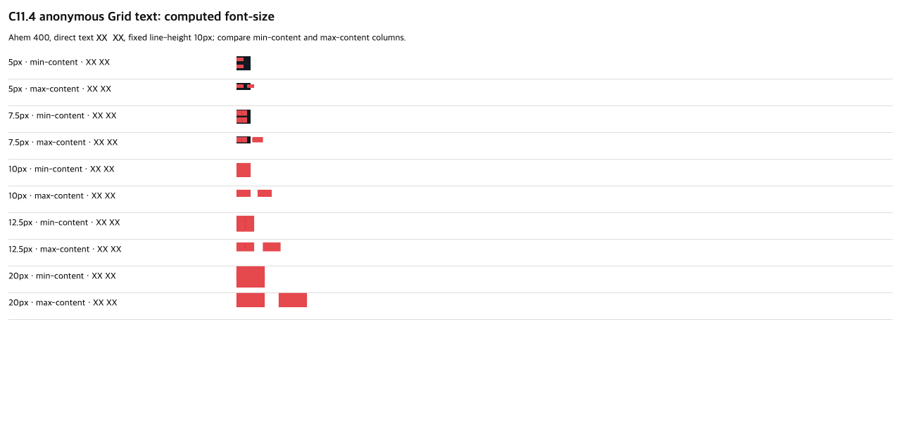

# C11.4 anonymous Grid text computed `font-size` 사전 비교

이 비교는 computed `font-size`가 anonymous direct-text Grid intrinsic sizing에 주는 효과를 구현 전에 고정한다. Chrome 결과는 브라우저 관찰이고 Spinon 결과가 아니다.

## 입력과 환경

- Agent Browser fixture: [`grid-track-sizing-c114-anonymous-text-font-size.html`](../../../../tests/fixtures/css/c11/grid-track-sizing-c114-anonymous-text-font-size.html), SHA-256 `e93485fe12c6ac59dbb5c03e417d0f586242830c632ce371ee7ae817281ad666`
- Ahem font: [`Ahem.ttf`](../../../../tests/fixtures/resources/c15/Ahem.ttf), SHA-256 `b719ecb31c5b21fc573c03f6421c74ac63c271a5a3ff841e34f9705fb94b8448`
- Browser: Agent Browser CLI 0.31.1; installed Google Chrome binary `156.0.8078.76`; headless UA reports reduced `HeadlessChrome/156.0.0.0`; language `ko-KR`; viewport `1280×633`, DPR 1
- Font loading: `document.fonts.check("10px Ahem") == true`
- Capture script: [`capture-observation.js`](./chrome/capture-observation.js); raw result: [`chrome156-observation.json`](./chrome/chrome156-observation.json)
- Screenshot: , SHA-256 `28b11941b017d2d4d4cbb760386b0cd11f7eaaf0c27e442b14f1c3e9f09fa402`
- Agent Browser session을 캡처 뒤 닫았다. 사전 실행 전후 `agent-browser doctor --offline --quick`에서 재사용 기본 세션 PID 66343만 남았다.

## 규범 규칙과 독립 기대값

고정 HTML은 root 폭 20px, `grid-template-rows:auto`, `line-height:10px`, `white-space-collapse:collapse`, `text-wrap-mode:wrap`, Ahem 400와 direct text `XX XX`를 사용한다. 각 case는 `min-content` 또는 `max-content` 하나의 column만 다르게 둔다. root의 width/height와 track 크기는 따로 기록한다.

독립 계산은 pinned TTF를 직접 읽어 수행했다. `head.unitsPerEm=1000`, `hmtx`의 `X` advance와 space advance가 각각 1000 units이므로 둘 다 1em이다. 따라서 `XX XX`의 min-content inline contribution은 가장 긴 word `2 × font-size`, max-content는 두 글자·공백·두 글자 `5 × font-size`다. min-content column 폭은 이 두 글자 기여가 되고 두 word가 별도 line에 놓여 auto row가 `2 × 10px`; max-content column은 전체 한 줄을 담아 auto row가 `10px`이다. 이 산식은 Chrome 결과를 복사하지 않고 font metrics와 고정 line-height에서 계산했다.

[CSS Grid Layout Level 1 §11.5](https://www.w3.org/TR/2025/CRD-css-grid-1-20250326/#algo-content)의 intrinsic track sizing 단계에서 min/max-content contribution이 track을 결정한다. [CSS Sizing Level 3 §5.1](https://www.w3.org/TR/css-sizing-3/#intrinsic-sizes)는 min-content와 max-content size를 정의한다. [CSS Fonts Level 4 §2.5](https://www.w3.org/TR/css-fonts-4/#font-size-prop)는 computed `font-size`를 absolute length로 정의한다. browser `gridTemplateColumns`와 `gridTemplateRows`가 track 관찰값이고 root frame은 별도 값이다. Range rectangles와 glyph pixels는 수집하지 않았다.

| computed `font-size` | 독립 min-content / auto row | Chrome min-content / auto row | 독립 max-content / auto row | Chrome max-content / auto row |
| ---: | ---: | ---: | ---: | ---: |
| 5px | 10px / 20px | 10px / 20px | 25px / 10px | 25px / 10px |
| 7.5px | 15px / 20px | 15px / 20px | 37.5px / 10px | 37.5px / 10px |
| 10px | 20px / 20px | 20px / 20px | 50px / 10px | 50px / 10px |
| 12.5px | 25px / 20px | 25px / 20px | 62.5px / 10px | 62.5px / 10px |
| 20px | 40px / 20px | 40px / 20px | 100px / 10px | 100px / 10px |

총 10개의 computed style·track scene이 독립 산식과 일치한다. 5px와 10px은 기존 sizing scale controls이며 decimal 7.5px/12.5px는 subpixel track, 20px은 grid root보다 큰 min-content contribution과 max-content overflow를 확인한다.

## 범위와 한계

이 사전 비교는 Chrome oracle 및 Ahem font-table 기대값만 검증한다. Spinon 코드, Android/iOS runtime, paint pixels, public CSS admission, WPT, hardware GPU, 실기기 또는 전체 C11.4/C11을 검증하지 않는다. 0px `font-size`는 CSS 일반 invalid로 간주한 것이 아니라 기존 text model이 양수 font size를 요구해 계획 범위에서 거부한다.
