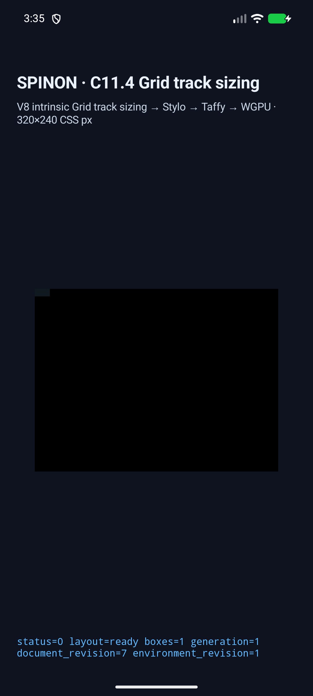
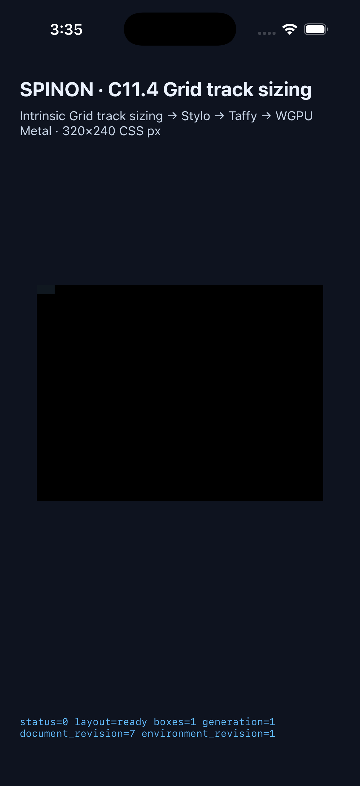

# C11.4 anonymous Grid text computed `font-size` runtime evidence

## Scope

이 기록은 [제한 계획](../../../../plan/c11-4-anonymous-grid-text-computed-font-size.md)의 opt-in anonymous direct-text Grid fixture 10개만 다룬다. 입력은 pinned Ahem 400의 `XX XX`, `font-size` 5/7.5/10/12.5/20px, fixed 10px line-height이며 단일 column은 `min-content` 또는 `max-content`, row는 `auto`다. 계획과 [Chrome 156 사전 비교](../c11-4-anonymous-grid-text-computed-font-size-precomparison-2026-10-31/README.md)의 독립 기대값은 `min-content=2em`, `max-content=5em`, 행 높이 20px/10px이다.

Runtime validator는 computed CSS serialization과 같은 snapshot의 typed `font_size_css_px`가 10개 scene allowlist에 맞는지 확인하고 그 값을 anonymous `ParagraphStyle`에 전달한다. 일반 CSS author admission, public API, arbitrary fonts/text, glyph pixel equality, WPT, 실기기 GPU 및 전체 C11.4/C11 완료를 주장하지 않는다.

## Simulator runs

[Capture runner](../../../../tools/css-reference/capture-c11-4-computed-font-size-simulators.mjs)는 각 scene의 complete trace chunks, root/item geometry, text source, paragraph font size/line-height, intrinsic min/max dimensions, line count/advance, final Columns/Rows track과 layout input revision을 확인했다. 설치 artifact hash는 빌드 artifact와 일치했다.

| Target | Result | Captured run |
| --- | ---: | --- |
| Android API 37 ARM64 AVD `emulator-5554` | 10/10 | `android-avd/` |
| iPhone 17 Pro / iOS 26.2 Simulator `9DCCE836-7659-4914-B6C1-13F54BFFA9DB` | 10/10 | `ios-simulator/` |

두 앱 프로세스는 실행기 종료 때 force-stop/terminate했다. AVD와 Simulator는 부팅 상태로 남겨 두었다. Android 결과는 API 37 ARM64 AVD runtime trace이며 Android 실기기나 hardware GPU 결과가 아니다. iOS는 Simulator이며 compositor 이후 표면 검증이 아니다.

두 화면은 fixture route와 layout 상태만 보여준다. renderer 영역은 검게 표시되어 glyph paint 확인에 사용할 수 없으므로 PR 시각자료나 pixel 검증으로 취급하지 않는다. Android PixelCopy, iOS drawable readback 또는 compositor 이후 pixels는 검사하지 않았다. 기기·실행 환경과 설치 hash는 각 `simulator.json`, 모든 scene 입력·결과는 `matrix.tsv`와 개별 `.log`에 있다.

## Rust, build and module checks

| Check | Result |
| --- | ---: |
| `cargo fmt --all -- --check` | pass |
| `cargo test -p spinon-runtime --features c11-4-grid-track-sizing-fixture-test anonymous_text_` | 11 passed |
| `cargo test -p spinon-runtime --features c11-4-grid-track-sizing-fixture-test c114_` | 23 passed |
| `cargo test -p spinon-ffi --features c04-runtime-gpu-fixture-test computed_font_size` | pass |
| `cargo clippy -p spinon-runtime --features c11-4-grid-track-sizing-fixture-test --all-targets -- -D warnings` | pass |
| `cargo clippy -p spinon-ffi --features c04-runtime-gpu-fixture-test --all-targets -- -D warnings` | pass |
| `fixture-module-boundary.test.mjs` computed font-size case | 1/1 pass |
| Android opt-in app build | pass |
| iOS Simulator opt-in app build | pass |

Command output is preserved under `builds/`; only trailing spaces and blank lines at the ends of log lines were normalized. Rust tests validate the independent 2em/5em inline sizes and 20px/10px auto-row heights across all five computed sizes. The platform fixture tests independently validate the full two-axis track traces and frames.

적대 검토에서 unknown scene ID가 validator의 기본 10px 분기로 흘러들 수 있어 fail-closed 처리와 negative test를 추가했다. track-negative test의 첫 컴파일은 helper-shadowing으로 실패했으며, 이름을 고친 재실행은 통과했다. 최초 실패 로그도 `builds/`에 보존했다.

별도 [구현/runtime 실패 관점 검토 20개](implementation-runtime-review-20.md)와 [local PR diff 실패 관점 검토 30개](pr-diff-review-30.md)를 마쳤다. PR을 만들면 remote head diff와 이 기록의 patch 일치를 확인한다.

## Static archive feature boundary

The default product archive built with `--no-default-features --features c04-runtime-gpu` contains 0/10 new scene IDs. Its size is 75,260,528 bytes and SHA-256 is `4661c6c46e5a23f462de8ac00c909cb48e76f3322091076527e996ae9fff35c8`. The fixture-test positive-control archive contains all 10/10 IDs (each matched twice); its size is 81,132,144 bytes and SHA-256 is `9caa2ba98a1a77a1bb5c3a1fb4ee662f688476ea2497396c50b90f0ad4e709f5`. Machine-readable scans are in `artifacts/`.

This scan checks the Rust FFI static archive only. It does not claim whole APK/IPA fixture exclusion. The change adds no new exported C ABI symbol; scene generation uses the existing opt-in fixture-test route.

## Status boundary

This remains a narrow implementation candidate. C11.4 and C11 official checkboxes remain incomplete, and the official aggregate remains `72/213`. WPT conformance, general CSS admission, hardware-device rendering, glyph ink equality and complete C11.4 behavior are outside this evidence.
