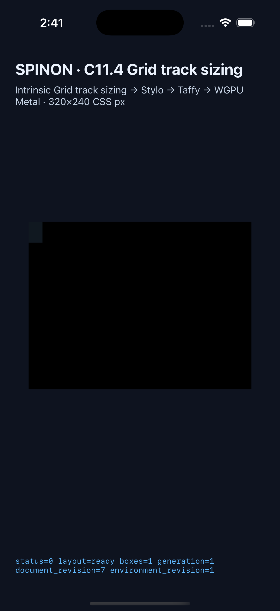

# C11.4 anonymous Grid text computed `line-height` runtime evidence

## Scope

이 근거는 [계획](https://github.com/ohah/spinon/blob/feat/c11-4-anonymous-grid-text-computed-line-height/plan/c11-4-anonymous-grid-text-computed-line-height.md)과 [Chrome 156 사전 비교](../c11-4-anonymous-grid-text-computed-line-height-precomparison-2026-10-31/README.md)에 고정한 16개 scene의 opt-in C11.4 anonymous direct-text Grid 경로만 다룬다. 독립 기대값은 `expected-values.json`을 기준으로 한다. 일반 CSS admission, C15 generic text, 공개 API, WPT 적합성, 전체 C11.4/C11 완료를 주장하지 않는다.

## Simulator runs

재현 실행기는 [capture-c11-4-computed-line-height-simulators.mjs](https://github.com/ohah/spinon/blob/feat/c11-4-anonymous-grid-text-computed-line-height/tools/css-reference/capture-c11-4-computed-line-height-simulators.mjs)다. 각 실행은 설치 산출물 hash를 빌드 결과와 대조하고 summary, 중복 없는 완전한 trace chunk, computed text line-height, 줄 수, intrinsic min/max contribution, 최종 Rows auto track, item/root frame 및 layout input revision을 검사했다. scene log는 `android-avd/` 및 `ios-simulator/`에 있다.

| 대상 | 결과 | 주요 판정 |
| --- | ---: | --- |
| Android API 37 ARM64 AVD `emulator-5554` | 16/16 | computed layout, intrinsic min/max, Rows track, frames, revisions |
| iPhone 17 Pro / iOS 26.2 Simulator `9DCCE836-7659-4914-B6C1-13F54BFFA9DB` | 16/16 | 같은 16개 입력·geometry 판정 |

Android는 AVD만 사용했으며 실기기는 연결하거나 검증하지 않았다. iOS Simulator도 실기기 결과가 아니다. 실행 종료 뒤 Spinon 앱 프로세스는 양쪽에서 종료했고 Simulator/AVD는 켜 둔 상태다.

0 line-height scene에서는 두 line box의 줄 수가 trace에 남고 baseline 값이 유한하며 최종 row/frame 높이는 0px이다. 이 fixture는 0 높이에서 glyph range가 겹칠 수 있음을 인정하며 glyph ink를 비교하지 않는다. Soft-wrap `1.5` control은 min-content block contribution 30px, max-content 15px, final row 30px을 기록한다.

iOS 화면은 fixture app route와 layout 상태만 보여준다. Glyph paint는 꺼져 있어 screenshot은 line-height별 glyph pixel 증거가 아니다. Android의 대표 screenshot 재캡처는 화면이 검게 나와 첨부 증거로 사용하지 않았으며, Android 판정은 원본 runtime log와 trace를 근거로 한다. Android PixelCopy, iOS drawable sample 또는 compositor 이후 표면은 확인하지 않았다.

## Build and Rust checks

최종 소스 상태에서 Android/iOS opt-in 앱 빌드가 통과했다. 설치 APK와 Simulator executable hash는 각 플랫폼 `simulator.json`에 기록했다. 복사한 빌드 로그는 `builds/`에 있다.

| Check | Result |
| --- | ---: |
| `cargo fmt --all -- --check` | pass |
| `cargo test -p spinon-text-layout paragraph_style` | 4/4 pass |
| `cargo test -p spinon-runtime --features c11-4-grid-track-sizing-fixture-test computed_line_height` | 5/5 pass |
| `cargo test -p spinon-runtime --features c11-4-grid-track-sizing-fixture-test c114_` | 23/23 pass |
| `cargo test -p spinon-ffi --features c04-runtime-gpu-fixture-test computed_line_height_matrix` | 1/1 pass |
| `cargo clippy --locked --workspace --all-targets -- -D warnings` | pass |
| runtime fixture Clippy / FFI fixture Clippy | pass / pass |
| `fixture-module-boundary.test.mjs` | 24/24 pass |
| `bun run docs:build` | fail: 저장소 전체 1,131개 문서에서 dead link가 보고됐다. 이번 line-height plan/fixture/runtime evidence 링크는 보고되지 않았다. [결과 요약](https://github.com/ohah/spinon/blob/feat/c11-4-anonymous-grid-text-computed-line-height/spec/internal/evidence/c11-4-anonymous-grid-text-computed-line-height-runtime-2026-10-31/builds/docs-build-summary.md)에 기록했다. |

Rust 검사 로그와 최종 Android/iOS 앱 빌드 로그는 `builds/`에 있다. 별도 [구현/runtime 실패 관점 20개](implementation-runtime-review-20.md) 및 [PR diff 실패 관점 30개](pr-diff-review-30.md) 검토는 계획 검토와 분리했다. 구현 검토에서는 scene에 맞지 않는 computed serialization을 받아들이는 validator 결함을 찾아 수정했다. PR diff 검토에서는 trace 중복 조각 거부와 전체 intrinsic/frame 검사 누락을 찾아 capture runner를 보강한 뒤 최신 Android/iOS 행렬을 다시 실행했다.

## Static archive feature boundary

`artifacts/default-product.json` binds the release static archive built with `--no-default-features --features c04-runtime-gpu`: all 16 scene ID markers are absent (75,260,528 bytes, SHA-256 `4661c6c46e5a23f462de8ac00c909cb48e76f3322091076527e996ae9fff35c8`). `artifacts/fixture-test.json` binds the positive-control archive built with `--no-default-features --features c04-runtime-gpu-fixture-test`: all 16 markers are present (81,081,232 bytes, SHA-256 `519698d78c222b4afeb84ef0222c872154b296f4a6ba74140fd106ca53051269`). The archive hashes and byte sizes are recorded in both files. This checks the host static library only; it does not establish that the opt-in APK or iOS app bundle excludes fixtures.

## Status boundary

이 작업은 내부 fixture 구현 후보이며 공식 C11.4 완료 항목이 아니다. C11.4 checkbox와 공식 집계 `72/213`은 그대로 유지한다. Android AVD의 draw/present pixel 표본, 실기기·hardware GPU, iOS compositor 이후 화면, general CSS cascade, WPT 및 전체 Grid 적합성은 미검증이다.
