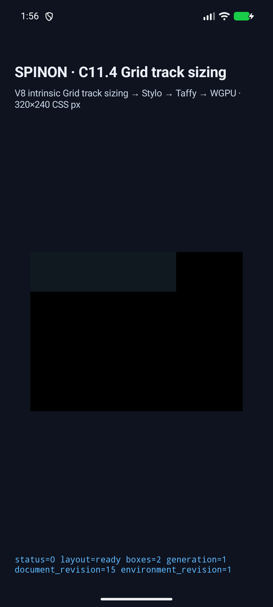
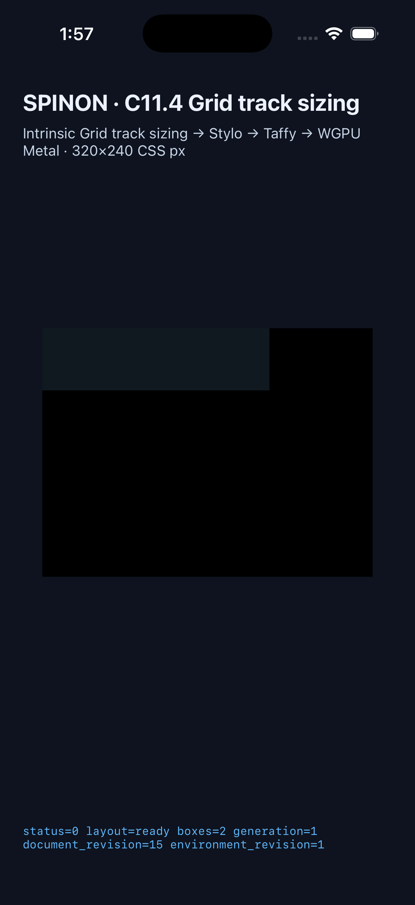

# C11.4 anonymous Grid text + image runtime evidence

이 기록은 다섯 개 고정 fixture에서 익명 Grid text item과 기본 inline HTML `img`의 intrinsic input을 같은 layout revision으로 계산한 결과다. 제품 지원 범위, 전체 C11.4 완료, WPT 적합성 또는 이미지 texel paint를 선언하지 않는다.

## 실제 앱 실행

| 대상 | 결과 자료 | 조건과 판정 |
| --- | --- | --- |
| Android API 37 ARM64 AVD | [scene 결과](../c11-4-anon-text-img-avd-retry-20261021-2026-10-21/android-avd-c114-anonymous-grid-text-image-android-avd-20261021T045601413Z-43f1925f/result.json) · [원본 runtime logs](../c11-4-anon-text-img-avd-retry-20261021-2026-10-21/android-avd-c114-anonymous-grid-text-image-android-avd-20261021T045601413Z-43f1925f/) · [APK/AVD 정보](../c11-4-anon-text-img-avd-retry-20261021-2026-10-21/android-avd-c114-anonymous-grid-text-image-android-avd-20261021T045601413Z-43f1925f/simulator.json) | `emulator-5558`, `sdk_gphone64_arm64`, API 37, `arm64-v8a`, SwiftShader. 5/5 scene에서 track·frame·intrinsic trace가 예상값과 일치하고 `drawPresented=true`. 설치 APK와 로컬 APK SHA-256이 일치한다. |
| iPhone 17 Pro / iOS 26.2 Simulator | [scene 결과](../c11-4-anon-text-img-ios-sim-20261021-2026-10-21/ios-simulator-c114-anonymous-grid-text-image-ios-simulator-20261021T045706949Z-72fa651f/result.json) · [원본 runtime logs](../c11-4-anon-text-img-ios-sim-20261021-2026-10-21/ios-simulator-c114-anonymous-grid-text-image-ios-simulator-20261021T045706949Z-72fa651f/) · [app/Simulator 정보](../c11-4-anon-text-img-ios-sim-20261021-2026-10-21/ios-simulator-c114-anonymous-grid-text-image-ios-simulator-20261021T045706949Z-72fa651f/simulator.json) | iOS 26.2, 지정 iPhone 17 Pro UDID. 5/5 scene에서 같은 track·frame·revision을 확인하고 `drawPresented=true`. |

| Android API 37 ARM64 AVD | iPhone 17 Pro / iOS 26.2 Simulator |
| --- | --- |
|  |  |

다섯 scene 모두 같은 기준 열 크기를 냈다.

| Scene | Column tracks | Image x | Text grouping |
| --- | --- | ---: | --- |
| `anonymous-text-image-text` | `[20,36,36,20]` | 20 | image 양쪽에 독립 text item |
| `image-before-comment-group` | `[36,36,40,0]` | 0 | image 뒤 연속 Text 두 개가 `XXXX` 한 item |
| `comment-group-before-image` | `[40,36,36,0]` | 40 | image 앞 연속 Text 두 개가 `XXXX` 한 item |
| `whitespace-around-image` | `[36,36,20,0]` | 0 | whitespace-only run 생략, 뒤 `XX`는 한 item |
| `hidden-child-around-image` | `[20,36,36,20]` | 20 | `display:none` subtree가 text run을 끊지 않음 |

각 로그의 `grid_track_sizing_diagnostics`에는 image natural size `24×16`, intrinsic-size revision `1`, text source node 집합, source order, Columns/Rows pass와 track frames가 들어 있다. AVD 첫 요청은 runtime의 `superseded` 응답으로 끝나 캡처 도구가 새 run ID로 한 번 재시도했다. 최종 retry 로그와 결과만 pass로 집계했다.

## 빌드와 검사

- `mise exec -- cargo test -p spinon-runtime --features c11-4-grid-track-sizing-fixture-test c114_anonymous_text_and_default_inline_image_share_one_revision_and_track_pass -- --nocapture` — 통과, 1/1.
- `mise exec -- cargo test -p spinon-ffi --features c04-runtime-gpu-fixture-test anonymous_text_and_inline_image_sources_form_a_fixed_five_scene_matrix -- --nocapture` — 통과, 1/1.
- `mise exec -- cargo fmt --all -- --check`, `git diff --check`, JS syntax check — 통과.
- `mise exec -- node tools/css-reference/fixture-module-boundary.test.mjs` — 통과, 6/6.
- `mise exec -- cargo clippy --locked --workspace --all-targets -- -D warnings` — 통과.
- Android: `mise exec -- env SPINON_ENABLE_C04_RUNTIME_GPU=1 SPINON_ENABLE_C04_RUNTIME_GPU_FIXTURE_TEST=1 bun run build:android` — `BUILD SUCCESSFUL`.
- iOS: `mise exec -- env SPINON_ENABLE_C04_RUNTIME_GPU=1 SPINON_ENABLE_C04_RUNTIME_GPU_FIXTURE_TEST=1 bun run build:ios-sim` — `BUILD SUCCEEDED`.
- [기본/opt-in 정적 라이브러리 대조](./ffi-artifact-boundary.md) — 새 scene string과 fixture ABI는 opt-in 결과에서만 확인했다.
- [구현 PR diff 실패 관점 30개](./pr-diff-review-30.md) — 구현/runtime 20개 검토와 분리했다.

캡처 도구의 첫 실행에서 발견한 두 검증기 결함도 수정했다. 장면별 Android intent run ID가 80자 제한을 넘지 않도록 run ID prefix를 evidence 폴더 이름에서 분리했고, trace 판정은 실제 Rust trace가 생략하는 0 값 text `Minimum`과 text `MinContent` 두 항목을 반영하도록 고쳤다. 수정된 도구로 Android와 iOS 다섯 scene 전체를 다시 실행했다.

## 한계

- Android 근거는 API 37 SwiftShader AVD이며 실기기나 hardware GPU 실행이 아니다.
- iOS 근거는 iOS Simulator다. 둘 다 OS compositor 이후 최종 표면이나 물리 기기 표시를 증명하지 않는다.
- `drawPresented=true`와 screenshot은 scene host surface의 표시 완료를 뜻한다. 실제 PNG texel paint, full image decoding/rendering conformance, 일반 HTML 조합, nested Grid, WPT 통과를 주장하지 않는다.
- `spec/STATUS.md`의 완료 checkbox나 집계 수는 변경하지 않았다.
