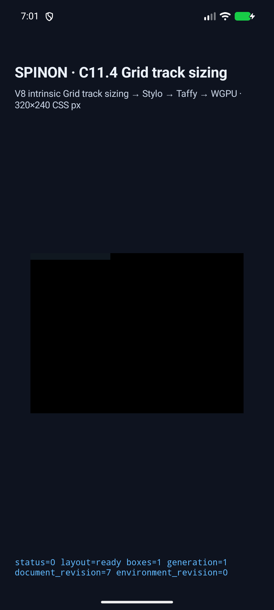
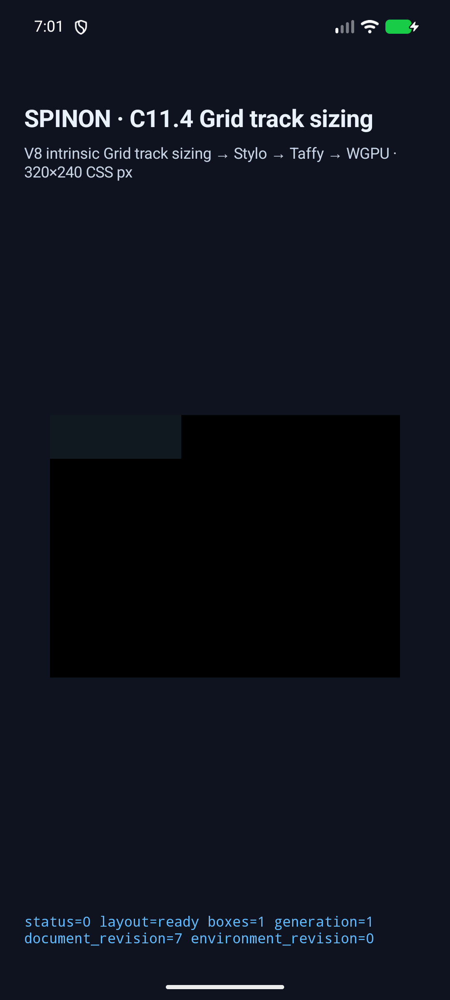
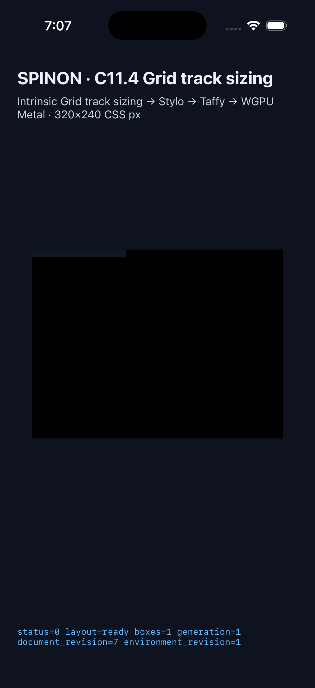
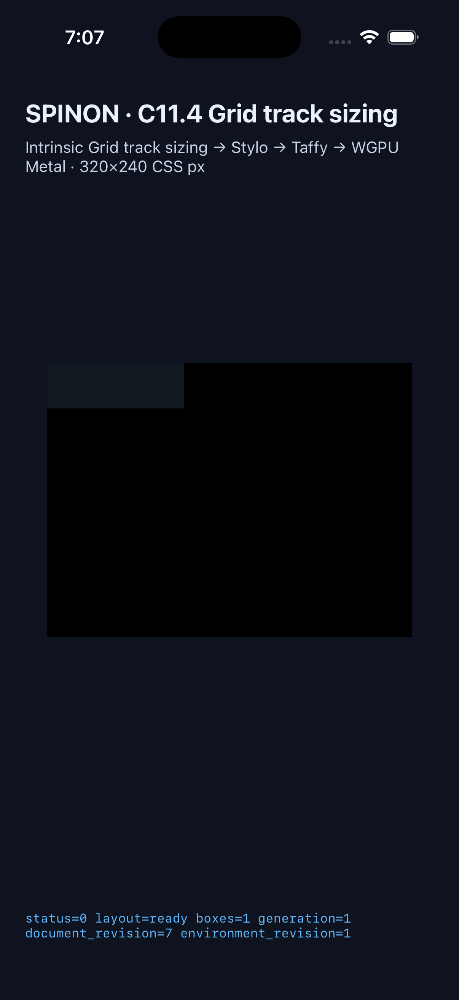

# C11.4 anonymous Grid text `overflow-wrap` runtime

2026-11-01의 이 evidence는 고정 Ahem `XXXX` anonymous Grid direct-text `overflow-wrap` 9-scene slice를 Android API 37 ARM64 AVD와 iPhone 17 Pro/iOS 26.2 Simulator에서 실행한 결과다. 독립 기대값·Chrome 156 Agent Browser 관찰·고정 HTML 입력은 [사전 비교](../c11-4-anonymous-grid-text-overflow-wrap-precomparison-2026-11-01/README.md)에 있다.

이 구현은 기존 `c11-4-grid-track-sizing-fixture-test` / `c04-runtime-gpu-fixture-test` opt-in 경로에 한정된다. 일반 author CSS admission, 전체 C11.4/C11, WPT 적합성, 임의 font·script, glyph rasterization 또는 compositor 이후 픽셀을 주장하지 않는다.

## 판정 행렬

세 값은 각각 `min-content`, `max-content`, 고정 `10px` 열과 조합된다. 두 플랫폼에서 아홉 장면 모두 `PASS`했다. 전체 raw log와 trace part 개수는 [Android matrix](./android-avd/matrix.tsv)와 [iOS matrix](./ios-simulator/matrix.tsv)에 있다.

| `overflow-wrap` | 열 | 최종 열 폭 | 자동 행 높이 | text line 수 |
| --- | --- | ---: | ---: | ---: |
| `normal` | `min-content` | 40px | 10px | 1 |
| `normal` | `max-content` | 40px | 10px | 1 |
| `normal` | `10px` | 10px | 10px | 1 (40px line advance overflow) |
| `anywhere` | `min-content` | 10px | 40px | 4 |
| `anywhere` | `max-content` | 40px | 10px | 1 |
| `anywhere` | `10px` | 10px | 40px | 4 |
| `break-word` | `min-content` | 40px | 10px | 1 |
| `break-word` | `max-content` | 40px | 10px | 1 |
| `break-word` | `10px` | 10px | 40px | 4 |

각 scene의 log validator는 computed paragraph `overflowWrap`, nullable locale, Ahem family, line count/advance/top/height, intrinsic min/max inline/block sizes, HostDocument revision, item frame와 Columns/Rows의 최종 track을 함께 확인한다. `break-word`의 min-content는 40px로 normal과 같고, definite `10px` 열에서는 네 줄로 감싼다. `anywhere`만 min-content를 10px로 줄인다.

## Android API 37 ARM64 AVD

- 장치: `emulator-5554`, QEMU `1`, API 37, `arm64-v8a`, `sdk_gphone16k_arm64`.
- APK 및 설치된 `base.apk` SHA-256은 모두 `d6a0a20b2d14c7046163f3687ff5768debab2c436a845f040ac07aab6ffe450d`다. 세부값은 [simulator.json](./android-avd/simulator.json)에 있다.
- 앱 빌드: `SPINON_ENABLE_C04_RUNTIME_GPU=1 SPINON_ENABLE_C04_RUNTIME_GPU_FIXTURE_TEST=1 tools/build-android-app.sh` 성공.
- 실행: `node tools/css-reference/capture-c11-4-anonymous-grid-text-overflow-wrap-simulators.mjs android-avd emulator-5554` — 9/9.

## iOS Simulator

- 장치: iPhone 17 Pro (`iPhone18,1`), iOS 26.2, UDID `9DCCE836-7659-4914-B6C1-13F54BFFA9DB`.
- 앱 실행 파일과 설치 앱 SHA-256은 모두 `f5790ec56b5a93cbfcee56ae3060c81cbb317eb3f7b352e36cb17e522e1516f6`다. 세부값은 [simulator.json](./ios-simulator/simulator.json)에 있다.
- 앱 빌드: `SPINON_ENABLE_C04_RUNTIME_GPU=1 SPINON_ENABLE_C04_RUNTIME_GPU_FIXTURE_TEST=1 tools/build-ios-sim.sh` 성공.
- 실행: `node tools/css-reference/capture-c11-4-anonymous-grid-text-overflow-wrap-simulators.mjs ios-simulator 9DCCE836-7659-4914-B6C1-13F54BFFA9DB` — 9/9.

두 앱 캡처는 구현 코드가 커밋되기 전에 만들어졌다. 이후 Rust/app 구현 파일을 변경하지 않고 해당 소스를 [implementation commit](./source-revision.json)에 고정해 커밋했다. Binary hash와 source commit 연결 기록은 해당 JSON을 따른다.

## 기본/fixture FFI archive 경계

기본 static archive는 신규 9 scene marker 및 C11.4 fixture host export 0개, `c04-runtime-gpu-fixture-test` positive control은 scene marker 9/9 및 host export 2개다. [빌드 로그·hash·검사 방법](./artifact-boundary/README.md). 이 결과는 macOS FFI archive에 한정되며 APK/IPA 전체 제외를 증명하지 않는다.

## Rust와 fixture boundary 검사

| 검사 | 결과 | 원본 |
|---|---|---|
| `cargo test -p spinon-text-layout` | 83 passed | [log](./rust/spinon-text-layout.log) |
| `cargo test -p spinon-runtime --features c11-4-grid-track-sizing-fixture-test` | 372 passed, 3 ignored | [log](./rust/spinon-runtime-fixture.log) |
| `cargo test -p spinon-ffi --features c04-runtime-gpu-fixture-test` | 181 passed, 2 ignored | [log](./rust/spinon-ffi-fixture.log) |
| `cargo test -p spinon-layout` | 326 passed | [log](./rust/spinon-layout.log) |
| `node --test tools/css-reference/fixture-module-boundary.test.mjs` | 28 passed | [log](./rust/fixture-module-boundary.log) |
| `cargo fmt --all -- --check`, `git diff --check` | 통과 | 실행 결과 |

추가로 실행한 `cargo test -p spinon-style-to-layout`은 270 passed, 1 failed다. 유일한 실패는 변경하지 않은 C07 aspect-ratio 비교에서 computed string `1.7777778 / 1`과 기대 문자열 `1.77778 / 1`이 다른 assertion이다([log](./rust/spinon-style-to-layout.log), source: `crates/spinon-style-to-layout/src/c07_3_aspect_ratio_tests.rs:229`). 이 package의 파일은 이번 diff에 없다. 이 실패를 통과로 세지 않는다.

## Screenshots

고정 열에서 자동 행 높이 차이가 드러나는 scene만 플랫폼별로 캡처했다. 화면의 색 영역은 Grid item/root frame의 크기를 보여준다. text glyph는 화면에서 판정하지 않았고, line wrapping은 위 runtime trace에서 line count와 advance로 확인했다.

| 플랫폼 | `normal`, 고정 10px 열 | `break-word`, 고정 10px 열 |
| --- | --- | --- |
| Android |  |  |
| iOS |  |  |

## 실패 보존

수정 중 실패한 최초 로그는 다시 실행한 통과 로그와 섞지 않고 `*.failed-attempt-*.log`로 보존했다. 이 로그는 Android/iOS adapter 기대값이 입력의 nullable `lang`, overflowing single-line text width, fixed-track의 생략된 inline intrinsic pass와 `FixedTrackEarlyReturn`을 반영하지 못했던 문제를 찾는 데 사용했다. 최종 수정은 위 두 플랫폼의 최신 9/9 행렬에서 검증했다.

## 남은 범위

Android AVD는 software-rendered emulator 결과이며 실기기/hardware GPU 검증이 아니다. iOS 결과는 Simulator이며 실제 기기나 compositor 제출 후 픽셀을 포함하지 않는다. Screenshots는 text-glyph 검증이 아니다. 이 단일 fixed Ahem slice로 일반 CSS 조합, WPT, C11.4 또는 C11을 완료 처리하지 않는다. 공식 완료 수 `72/213`과 C11.4/C11 미완료 상태를 유지한다.
