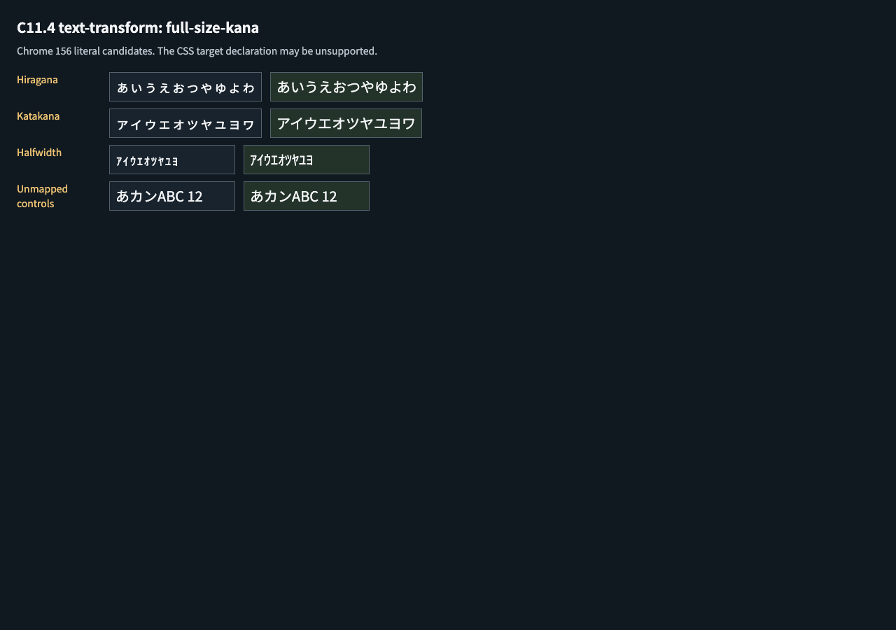

# C11.4 `full-size-kana` 사전 비교

## 기준 구현

기준은 [CSS Text Level 3 CRD 2026-08-14 §2.1](https://www.w3.org/TR/2026/CRD-css-text-3-20260814/#text-transform-property) 및 [Appendix G](https://www.w3.org/TR/2026/CRD-css-text-3-20260814/#small-kana)다. §2.1은 small Kana를 동등한 full-size Kana로 바꾸되 source content는 바꾸지 않는 presentation 변환으로 정의하고, Appendix G는 Unicode 15.0 기반 58쌍을 제공한다. 현재 CRD는 `full-size-kana`를 at-risk로 표시한다. 이는 제한 fixture 계획이지 안정된 공개 지원 선언이 아니다.

Agent Browser에서 날짜 고정 CRD 페이지를 확인했다. Browser `document.lastModified`는 `08/15/2026 00:43:35`, Appendix G는 header 포함 59 table rows(매핑 58개)였다. 추출 원본은 `css-text-appendix-g-mapping.json`, 정규화한 code point 표는 `mapping-table.json`이다.

## Chrome 관찰

Agent Browser HeadlessChrome `156.0.0.0`, viewport `1280×900`, DPR 1에서 `CSS.supports('text-transform', 'full-size-kana')`는 `false`였고 target의 computed `text-transform`은 `none`이었다. Noto Sans KR variable font가 로드된 것을 확인했다. 따라서 Chrome은 positive transform oracle로 사용할 수 없다.

고정 HTML은 작은 hiragana/katakana/halfwidth kana, full-size literal controls, unmapped control을 나란히 둔다. 10px 후보 폭은 hiragana `100/100px`, katakana `100/99.5px`, halfwidth `45/45px`였다. 소수 폭 차이까지 포함해 이 값은 글꼴/브라우저 관찰일 뿐 변환 성공 기대값이 아니다. Transform expected values는 Appendix G code point table에서 직접 얻는다.

- Fixture: `tests/fixtures/css/c11/grid-track-sizing-c114-anonymous-text-transform-full-size-kana.html`
- Chrome 156 observation: `chrome156-observation.json`
- Mapping table: `mapping-table.json`; raw table extraction: `css-text-appendix-g-mapping.json`
- 계획 실패 관점 검토 20개: `plan/c11-4-anonymous-grid-text-transform-full-size-kana-plan-review-20.md`
- [계획 PR diff 적대 검토 30개](./plan-pr-diff-review-30.md)
- 입력·관찰 파일 SHA-256: `SHA256SUMS.txt`
- Font: `NotoSansKR-VF.ttf`, SHA-256 `9e1d729e7e2b36f9ef439da102f8c134c10aabe46f1c843bf0aca5c043b86f76`

## 한계

이 비교는 Chrome의 `full-size-kana` 처리, 실제 transformed glyph raster, full WPT conformance, Spinon 구현 결과를 검증하지 않는다. Plan PR에서 고정할 mapping oracle와 browser의 unsupported-value 관찰을 분리해 둔다.
