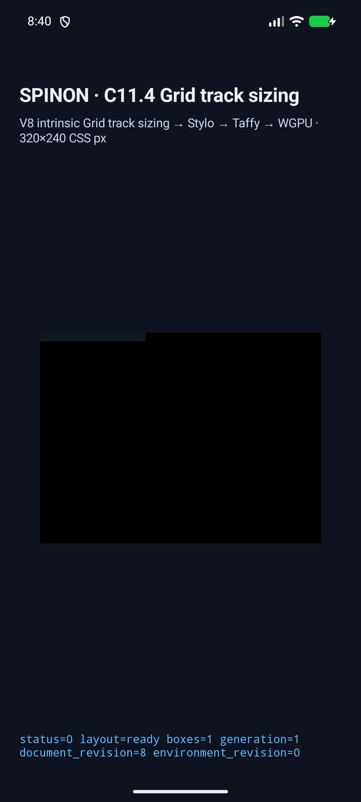
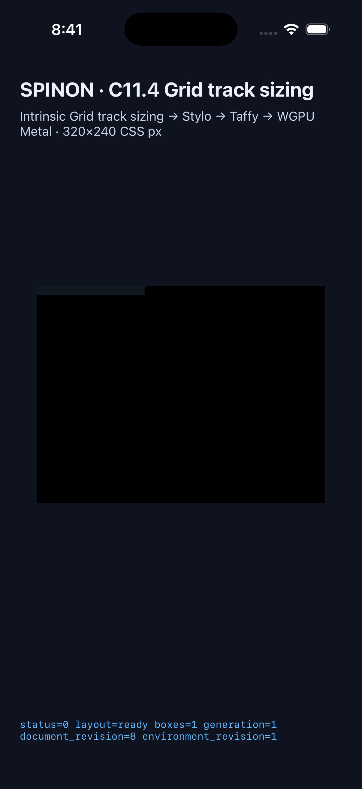

# C11.4 anonymous Grid computed text-transform runtime candidate

This feature-gated implementation candidate is based on `b77964973b40534c03a43a5e1fa86993fb6f7f42`. [Source revision manifest](./source-revision.json) binds the latest app hashes, static archive scans, and 36 source, test, tool, and plan files to these simulator runs. It does not change the official implementation count (`72/213`) or mark C11/C11.4 complete.

## Simulator results

The six fixed precomparison scenes passed after the latest Rust runtime refactor and app rebuild on both targets:

| Target | Matrix | App identity | Evidence |
| --- | ---: | --- | --- |
| Android API 37 ARM64 AVD `emulator-5554` | 6/6 | APK SHA-256 `e84c90be1499ce5b517c17a0633f4ccc407d52bba85612ec4f011570d0f8c8c7`; installed APK hash matched | [device and app hashes](./c114-computed-text-transform-android-avd-1793490026684-7e379b0a/simulator.json), [scene matrix](./c114-computed-text-transform-android-avd-1793490026684-7e379b0a/matrix.tsv) |
| iPhone 17 Pro / iOS 26.2 Simulator `9DCCE836-7659-4914-B6C1-13F54BFFA9DB` | 6/6 | executable SHA-256 `19a9f4173100f264ddfd0b27e054d8c7085fa732f2287d950e15afffca203a6d`; installed executable hash matched | [device and app hashes](./c114-computed-text-transform-ios-simulator-1793490071946-86bc2cd5/simulator.json), [scene matrix](./c114-computed-text-transform-ios-simulator-1793490071946-86bc2cd5/matrix.tsv) |

For every scene, the capture checks the HostDocument layout revision, anonymous item frame, root frame, normalized layout text, original text source, paragraph `textTransform`, Noto Sans KR font and `en` locale, min/max intrinsic inputs, line count and advances, column contribution, and final Columns/Rows tracks. The independent precomparison uses font glyph advances and a `0.03125 CSS px` allowance for browser quantization. Runtime values are attached to each scene log in the two evidence directories.

The Android representative host screen and iOS representative host screen show `layout=ready boxes=1`. The scene canvas does not paint text glyphs, so these screenshots establish app/runtime state only; they are not glyph-pixel evidence.

## Preserved rejected attempts

Earlier capture directories are retained and excluded from the passing matrix:

- `c114-computed-text-transform-android-avd-1793489039660-d6f00964` used the oracle IDs in place of runtime fixture IDs, so the app rejected the argument before evaluating a scene. The capture script now explicitly maps the six oracle IDs to the six fixed runtime IDs.
- `c114-computed-text-transform-android-avd-1793489069996-49688617` reached a successful layout at document revision 8, but an old capture assertion required revision 7. The capture now checks for a valid numeric revision instead of borrowing another slice's constant.
- `c114-computed-text-transform-ios-simulator-1793489198230-9ba4efd4` returned `status=-12` because a newer app scene request superseded the first evaluation. No trace was published. This original attempt is preserved; a fresh app launch then passed the complete six-scene matrix. The rerun is not recorded as a fix for a runtime defect.

## Build and focused test evidence

- `cargo test --locked -p spinon-text-layout`: 86 passed.
- `cargo test --locked -p spinon-runtime --features c11-4-grid-track-sizing-fixture-test`: 379 passed, 3 ignored; integration tests added 19 passes.
- `cargo test --locked -p spinon-ffi --features c04-runtime-gpu-fixture-test`: 182 passed, 2 ignored.
- `node --test tools/css-reference/fixture-module-boundary.test.mjs tools/css-reference/c11-4-computed-text-transform.test.mjs`: 30 passed. The boundary suite first exposed an old font-size assertion tied to the previous anonymous paragraph argument list; it was updated for `ValidatedAnonymousTextStyle`, then the full suite passed.
- `git diff --check`, `cargo fmt --all -- --check`, the focused text-transform case, and focused text-transform FFI scene generator passed.
- Targeted `-D warnings` Clippy passed for `spinon-text-layout`, feature-enabled `spinon-runtime`, and feature-enabled `spinon-ffi`. The runtime now also rejects a computed-style snapshot whose generation, document revision, or render-tree revision differs from the HostDocument snapshot; a focused regression covers stale document and tree revisions.
- Android app build used `SPINON_ENABLE_C04_RUNTIME_GPU=1` and `SPINON_ENABLE_C04_RUNTIME_GPU_FIXTURE_TEST=1`; Gradle completed successfully and the installed APK hash matched.
- iOS Simulator build used the same opt-in fixture settings; Xcode completed successfully and the installed executable hash matched.

## Feature boundary

The macOS debug `spinon-ffi` archive built with `c04-runtime-gpu` contains zero of the six new scene ID markers and zero of the two C11.4 fixture export-name markers. Rebuilding with `c04-runtime-gpu-fixture-test` contains all six scene ID markers and both export-name markers. Archive hashes and raw marker counts are in [source-revision.json](./source-revision.json). The archive check does not prove whole APK/IPA exclusion. Xcode `nm` could not read these Rust 1.96 / LLVM 22.1.2 objects, so the record describes raw archive marker scans and does not claim symbol-table inspection.

The Android compile SDK and Xcode/V8 debug-map diagnostics were warnings; both builds completed. The separate implementation/runtime failure review and PR diff failure review remain outstanding, so this is not the slice completion record.

## Scope boundary

The implementation is limited to `none`, `uppercase`, and `lowercase` for the six anonymous direct-text Grid scenes with exact `lang="en"`, Noto Sans KR 10px/400, and ASCII source text `IIII ii`. It preserves HostDocument text and source ranges while transforming layout text. Non-ASCII, locale-sensitive or multi-code-point casing, inline runs, general author CSS admission, WPT, glyph painting, and full C11.4 support remain outside this candidate. See the [plan](../../../../plan/c11-4-anonymous-grid-text-computed-text-transform.md), [precomparison](../c11-4-anonymous-grid-text-transform-precomparison-2026-11-01/README.md), and [internal contract 0059](../../0059-c11-grid-layout.md).
