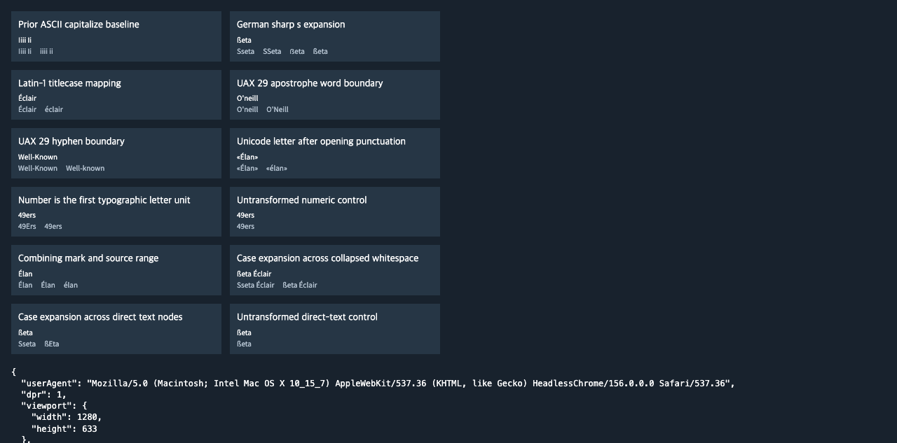

# C11.4 anonymous Grid Unicode `text-transform:capitalize` 사전 비교

Chrome 156 Agent Browser에서 고정 HTML fixture의 computed `text-transform:capitalize`, candidate text의 CSSOM 폭, 고정 글꼴 로드를 관측했다. 고정 기준 문서는 CSS Text Level 3 CRD 2026-08-14다. 이 문서는 `capitalize`의 단어 경계를 UA에 맡기고 UAX #29를 권고하며, Unicode full case mapping과 알고 있는 콘텐츠 언어에 맞는 규칙을 요구한다. 따라서 구현 기대 문자열은 Chrome 출력 복사가 아니라 CSS Text와 Unicode 17.0.0 `SpecialCasing.txt`에서 정한다. [CSS Text §2.1.1 Mapping Rules](https://www.w3.org/TR/2026/CRD-css-text-3-20260814/#text-transform-mapping) · [CSS Text §2.1.2 Order of Operations](https://www.w3.org/TR/2026/CRD-css-text-3-20260814/#text-transform-order) · [Unicode 17 `SpecialCasing.txt`](https://www.unicode.org/Public/17.0.0/ucd/SpecialCasing.txt) · [UAX #29 revision 47](https://www.unicode.org/reports/tr29/tr29-47.html).

CSS Text의 processing order는 white-space Phase I collapse 뒤 text transform을 적용하고 Phase II 전에 둔다. U+00DF `ß`의 Unicode 17 titlecase mapping은 `Ss`다. Chrome 156 `lang="en"` target은 `ßeta`를 바꾸지 않으므로 `ß`와 연속 공백이 포함된 두 scene은 규범 기대값과 Chrome 관측을 별도로 기록했다. 이 차이는 오라클 이상으로 덮지 않는다.

고정 입력은 Noto Sans KR variable font `wght=400`, 10 CSS px, LTR, `lang="en"`, `white-space:normal`, DPR 1, 1280×633 viewport다. `expected.json`은 규범적 변환 문자열과 Chrome target/candidate CSSOM 폭을 분리한다. CSSOM 폭은 1/64 CSS px 단위로 읽고 후보 폭 허용치는 0.03125 CSS px다. U+00DF case mapping 자체는 폭 대신 Unicode mapping과 UTF-16 source-range 관계로 판정한다. U+00DF가 `Ss`로 늘어나는 경우 두 output scalar가 모두 원본 `[0,1)` UTF-16 범위를 보존해야 한다.

Noto Sans KR에서 `Sseta`의 unshaped nominal `hmtx` advance 합은 25.58 CSS px다. 이는 shaping width가 아니다. `hb-shape 14.6.0`의 FreeType, `wght=400` diagnostic은 glyph substitution 후 25.17 CSS px를 반환하고 Chrome CSSOM candidate는 25.1875 CSS px다. 다만 `Iiii Ii`에서는 HarfBuzz가 space에 nominal `hmtx`의 224 대신 280-unit glyph advance를 선택해 19.66 CSS px를 반환하며 Chrome CSSOM은 19.09375 CSS px다. 이 adversarial mismatch 때문에 nominal `hmtx`나 `hb-shape`를 독립 CSS layout 폭 기대값으로 쓰지 않는다. Chrome CSSOM은 폭 관찰, CSS Text/Unicode data는 변환 문자열의 기준으로 분리한다.

재현 입력은 [`grid-track-sizing-c114-anonymous-text-transform-unicode.html`](../../../../tests/fixtures/css/c11/grid-track-sizing-c114-anonymous-text-transform-unicode.html)이며, 기계 판독 Chrome 관측은 [`chrome156-observations.json`](./chrome156-observations.json), 규범 기대값은 [`expected.json`](./expected.json)이다.

이 자료는 계획 단계의 oracle다. Spinon 구현, Android/iOS runtime, GPU glyph paint, surface pixel parity, 일반 CSS author admission 또는 WPT 적합성을 증명하지 않는다.

## SHA-256

| 입력 | SHA-256 |
| --- | --- |
| HTML fixture | `a1731b814bbf5cb85b5bbf03ddfadc0a5c0d4c125354c320ec00adbb0f1f9529` |
| Noto Sans KR variable font | `9e1d729e7e2b36f9ef439da102f8c134c10aabe46f1c843bf0aca5c043b86f76` |
| Chrome observation JSON | `767c24c838525f111f4df836ff6cbb7bfb630508d496626829b4a9051b0596ed` |
| expected JSON | `ea7f9c051cee374e74e7e36a6d6753dfdbd30498f33be616052b6e5b095d7156` |
| Chrome screenshot | `ed3e698f4d293521963a2f21a708dd16d45b4b98076564bd58b0781bf2209435` |
