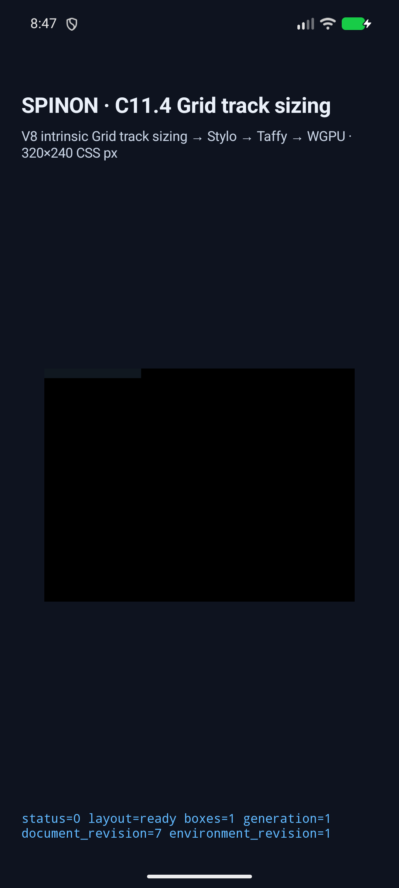
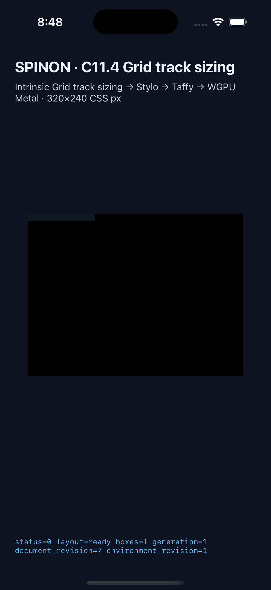

# C11.4 anonymous Grid text `white-space:pre` preserved tabs

이 근거는 기존 anonymous Grid text `white-space:pre` 제한 fixture에 기본 `tab-size:8` 탭 처리를 더한 opt-in slice다. C11.4 또는 C11 전체 완료, 일반 authored CSS 지원, WPT 적합성을 뜻하지 않는다.

## Simulator 실행

| 대상 | 실행·결과 | 결과 |
| --- | --- | --- |
| Android API 37 ARM64 AVD | [scene 결과](./android-avd-c114-anonymous-grid-text-android-avd-20261030T234628547Z-d752add6/result.json) · [AVD와 APK hash](./android-avd-c114-anonymous-grid-text-android-avd-20261030T234628547Z-d752add6/simulator.json) · [screenshots](./android-avd-c114-anonymous-grid-text-android-avd-20261030T234628547Z-d752add6/) | `emulator-5554`, `sdk_gphone64_arm64`, API 37, `arm64-v8a`; 40/40 scene 판정 통과, positive draw/present 39/39, 재시도 0. 빌드 APK와 설치 APK SHA-256이 같다. |
| iPhone 17 Pro / iOS 26.2 Simulator | [scene 결과](./ios-simulator-c114-anonymous-grid-text-ios-simulator-20261030T234748178Z-8979ca74/result.json) · [Simulator와 app hash](./ios-simulator-c114-anonymous-grid-text-ios-simulator-20261030T234748178Z-8979ca74/simulator.json) · [screenshots](./ios-simulator-c114-anonymous-grid-text-ios-simulator-20261030T234748178Z-8979ca74/) | UDID `ACA7BF91-E2D5-4CF7-909A-08D1AD95FF3D`, model `iPhone18,1`; 40/40 scene 판정 통과, positive draw/present 39/39, 재시도 0. 빌드 executable과 설치 executable SHA-256이 같다. |

원본 app launch·runtime·screenshot 로그 201개는 [runtime-logs.tar.gz](./runtime-logs.tar.gz)에 압축 그대로 보관한다. 결과 JSON·Simulator/APK metadata·PNG 및 logs archive의 84개 SHA-256 값은 [capture-files.sha256](./capture-files.sha256)에 있다.

각 matrix는 기존 31개 회귀 장면과 신규 8개 positive·1개 negative 장면으로 구성한다. 모든 positive scene의 root/item frame, intrinsic track과 text trace를 검사했다. 새 탭 장면은 normalized paragraph와 source UTF-16 → output UTF-8 범위도 검사했다. `tab-size:2` negative scene은 `unsupported_c114_anonymous_text_style`, property `tab-size`, node 1로 거부됐고 frame, trace, presentation 성공을 만들지 않았다.

| 신규 장면 | Ahem `X` 10px 기준 | Columns / root frame |
| --- | --- | ---: |
| `anonymous-pre-tab-max-content` — `XX\tXX` | 탭은 x=20에서 x=80까지 6칸 이동 | 100px / 100×10px |
| `anonymous-pre-tab-leading` — `\tX` | 선행 탭은 x=0에서 x=80으로 이동 | 90px / 90×10px |
| `anonymous-pre-tab-exact-stop` — `XXXXXXXX\tX` | x=80 정지점에서는 다음 x=160 정지점 사용 | 170px / 170×10px |
| `anonymous-pre-tab-consecutive` — `XX\t\tX` | 두 탭이 각각 다음 정지점으로 이동 | 170px / 170×10px |
| `anonymous-pre-tab-forced-break` — `XX\tXX\nX\tX` | 줄바꿈 뒤 tab cursor를 0으로 초기화 | 100px / 100×20px; line advance 100px, 90px |
| `anonymous-pre-tab-trailing` — `XX\t` | 끝의 보존 탭 advance를 유지 | 80px / 80×10px |
| `anonymous-pre-tab-min-content` — `XX\tXX` | `pre`는 soft wrap하지 않음 | 100px / 100×10px |
| `anonymous-pre-tab-fixed-width-nowrap` — `XX\tXX` | 25px track 밖으로 100px line overflow 유지 | 25px / 25×10px |
| `anonymous-pre-tab-size-2-negative` | 기본값 전용 profile 밖 입력 | 기대 거부; 결과 frame 없음 |

## 빌드와 검사

- Android: `SPINON_ENABLE_C04_RUNTIME_GPU=1 SPINON_ENABLE_C11_2_3_GRID_FIXTURE_TEST=1 tools/build-android-app.sh` — `BUILD SUCCESSFUL`; Java compile 통과.
- iOS: `SPINON_ENABLE_C04_RUNTIME_GPU=1 SPINON_ENABLE_C11_2_3_GRID_FIXTURE_TEST=1 tools/build-ios-sim.sh` — `BUILD SUCCEEDED`; Swift compile 통과.
- `mise exec -- cargo test --locked -p spinon-text-layout c11_4_pre` — 13 passed.
- `mise exec -- cargo test --locked -p spinon-style --features c11-4-grid-track-sizing-fixture-test track_sizing_profile_exposes_computed_tab_size` — 1 passed.
- `mise exec -- cargo test --locked -p spinon-runtime --features c11-4-grid-track-sizing-fixture-test anonymous_text_fixture_cases_are_unique` — 1 passed.
- `mise exec -- cargo test --locked -p spinon-runtime --features c11-4-grid-track-sizing-fixture-test anonymous_grid_fixture_rejects_typography_and_track_profile_mutations` — 1 passed.
- `mise exec -- cargo test --locked -p spinon-ffi --features c04-runtime-gpu-fixture-test anonymous_grid_text_sources_are_a_fixed_forty_scene_matrix` — 1 passed.
- `mise exec -- node --test tools/css-reference/fixture-module-boundary.test.mjs` — 24 passed.
- `mise exec -- cargo clippy --locked --workspace --all-targets -- -D warnings`와 `spinon-style`, `spinon-runtime`, `spinon-ffi` fixture-feature Clippy — 모두 통과.
- `mise exec -- cargo fmt --all -- --check`와 `git diff --check` — 통과.
- 기본·opt-in FFI archive 비교는 [별도 근거](./artifact-boundary.md)에 기록했다.
- 구현/runtime 실패 관점 20개는 [검토 문서](./implementation-review-20.md)에 기록했다.
- 별도 PR diff 실패 관점 30개는 [검토 문서](./pr-diff-review-30.md)에 기록했다.
- 캡처 PNG·JSON metadata·원본 log archive 84개 hash 값은 [capture-files.sha256](./capture-files.sha256)에 있다.

## 화면

아래 캡처는 각 앱이 Grid fixture surface를 제출한 시뮬레이터 화면이다. 이 runtime은 C15.3 glyph painter를 사용하지 않으므로 검은 surface 안의 text ink는 그리지 않는다. 탭 폭·줄바꿈·source map 판정은 위의 runtime trace와 결과 JSON에 있으며 화면 이미지를 glyph pixel 검증으로 해석하지 않는다.

| Android API 37 ARM64 AVD | iPhone 17 Pro / iOS 26.2 Simulator |
| --- | --- |
|  |  |

## 범위와 한계

- tab expansion은 등록 Ahem 10px/10px, weight 400, horizontal-tb/LTR, zero spacing, inline ancestor 없는 고정 anonymous Grid text profile과 computed `tab-size:8`에 한정한다.
- `tab-size:2`, 다른 글꼴·문자·writing mode·방향·spacing·inline hierarchy·offset content origin은 닫힌다. 사용자 지정 tab-size의 일반 cascade/layout은 추가하지 않았다.
- Android 결과는 API 37 ARM64 AVD이고 Android 실기기·hardware GPU는 검사하지 않았다. iOS는 Simulator이며 compositor 이후 화면이나 iOS 실기기를 검사하지 않았다.
- 화면은 glyph ink, pixel equality, 공개 CSS 지원, 전체 WPT 또는 전체 C11.4를 입증하지 않는다. `spec/STATUS.md`의 C11.4/C11 checkbox와 공식 `72/213`은 유지한다.
