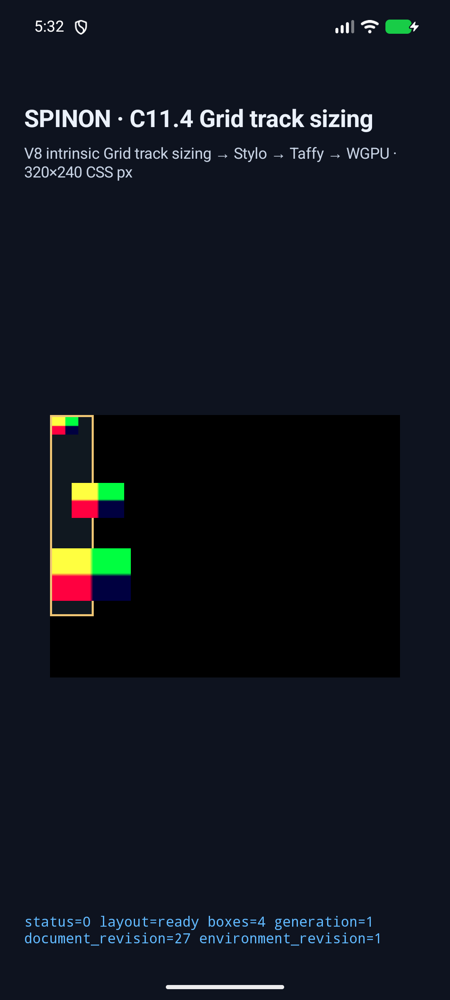
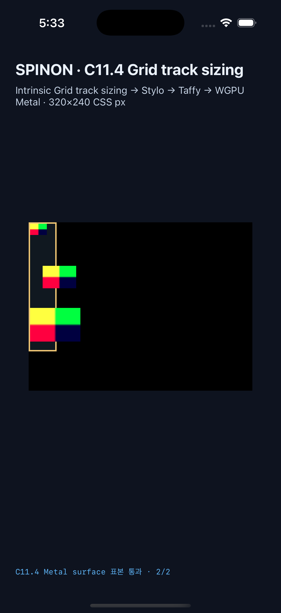

# C11.4 anonymous text 두 run + 세 image bordered Grid 실행 근거

2026-10-21 제한 fixture의 기존 두-image 장면과 새 세-image 장면을 Android AVD 및 iOS Simulator에서 각각 실행했다. 최종 빌드에서 네 장면 모두 track/frame/trace/draw와 border·overflow surface 표본을 통과했다.

## Simulator 결과

| 대상 | 환경 | 장면 | 결과 |
| --- | --- | --- | --- |
| Android | API 37 / Android 17, ARM64 AVD `emulator-5558` | 기존 두-image 2장면 + 새 세-image 2장면 | 4/4 통과, PixelCopy 표본 8/8 exact |
| iOS | iOS 26.2, iPhone 17 Pro Simulator | 기존 두-image 2장면 + 새 세-image 2장면 | 4/4 통과, Metal drawable 표본 8/8 exact |

Android APK SHA-256은 `b8f02254392a35766ff83bc50ac54479a0b54de7a857582ea7eb177b2ca6f355`이며 설치 APK SHA-256과 일치한다. [설치·AVD metadata](./android-avd-c114-anonymous-grid-border-overflow-android-avd-20261021T083242895Z-3df1ac86/simulator.json) 및 [네 장면 결과](./android-avd-c114-anonymous-grid-border-overflow-android-avd-20261021T083242895Z-3df1ac86/result.json)에 기록했다. iOS Simulator app SHA-256은 `954ac450c6d1efe2be240f2f32a7f80d6003d6c249264af4ccaec6f5a16d90ca`이며 [네 장면 결과](./ios-simulator-c114-anonymous-grid-border-overflow-ios-simulator-20261021T083256735Z-5aeaa47a/result.json)와 [Simulator metadata](./ios-simulator-c114-anonymous-grid-border-overflow-ios-simulator-20261021T083256735Z-5aeaa47a/simulator.json)에 기록했다.

새 장면 두 개의 독립 expected columns는 `[18, 34, 20, 20]`, rows는 `[60, 60, 60]`이다. 세 image frame은 `24×16` at `(2,2)`, `48×32` at `(20,62)`, `72×48` at `(2,122)`이고, 마지막 image는 root 오른쪽 border-box 끝 `x=40`을 34 CSS px 넘는다. 기존 두-image scenes의 columns `[12,28,20,20]` 및 22px overflow도 최종 빌드에서 회귀 확인했다. 두 source order에서 track과 image geometry가 일치했다.

Android surface는 `840×630` pixels / `320×240` CSS px, scale `2.625`였다. PixelCopy가 각 scene의 top border `(10,0)` `#f0c674`와 overflow image 내부 표본을 읽었다. 기존 두-image 표본은 `(51,71)`, 새 세-image 표본은 `(62,128)`이며 모두 예상 `#00ff40`과 exact하게 일치했다. 새 scene의 sample은 오른쪽 border 바깥 22px 위치다. 최종 로그는 [Android AVD run](./android-avd-c114-anonymous-grid-border-overflow-android-avd-20261021T083242895Z-3df1ac86/)에서 확인할 수 있다.

iOS drawable은 `960×720` pixels / `320×240` CSS px, scale `3.0`였다. Metal readback도 각 scene의 동일한 root-local CSS 표본을 exact하게 읽었다. 이는 compositor 제출 전 drawable 근거이며 OS compositor 이후 출력이나 scanout 근거가 아니다. [iOS Simulator run](./ios-simulator-c114-anonymous-grid-border-overflow-ios-simulator-20261021T083256735Z-5aeaa47a/)에 결과를 보존했다.

새 scene의 forward/reversed screenshot을 두 simulator에서 모두 보존했다.

| Source order | Android API 37 / Android 17 ARM64 AVD | iPhone 17 Pro / iOS 26.2 Simulator |
| --- | --- | --- |
| Forward |  |  |
| Reversed |  |  |

## 실패 원인과 수정

첫 Android 실행은 AVD 연결, APK 설치, Activity launch까지 성공했지만 `MainActivity`가 새 scene ID를 C11.4 허용 목록에서 찾지 못해 `SPINON_C114_GRID_ARGUMENT_ERROR rejected=true`를 기록했다. Android와 iOS scene allowlist 및 새 scene의 frame/track/span 검증을 확장했다. [첫 실행 로그](./android-avd-c114-anonymous-grid-border-overflow-android-avd-20261021T082600705Z-a64ac427/runtime-two-anonymous-runs-three-images-forward.log)

허용 목록을 고친 뒤 두 번째 Android 실행은 layout, track trace와 image draw는 통과했지만 새 overflow sample ID의 기대색 lookup이 누락돼 PixelCopy가 `expected=-1,-1,-1`로 판정했다. 새 sample ID의 기대색 `#00ff40`을 등록한 후 두 source order와 기존 두-image scene을 포함한 최종 네 장면 matrix가 통과했다. [중간 판정 로그](./android-avd-c114-anonymous-grid-border-overflow-android-avd-20261021T083013139Z-0a389bd4/runtime-two-anonymous-runs-three-images-forward.log)와 [최종 Android build log](./build/android-build-pixel-fix.log)를 함께 보존했다.

## 검사와 범위

- [Android fixture app build](./build/android-build-pixel-fix.log), [iOS Simulator fixture app build](./build/ios-build-fixed-allowlist.log) 성공.
- [Runtime border/overflow test](./build/runtime-overflow-test.log), [anonymous text/image runtime test](./build/runtime-anonymous-fixture-test.log), [FFI bounded-scene test](./build/ffi-bordered-scene-test.log) 통과.
- [workspace Clippy](./build/workspace-clippy.log), [opt-in FFI fixture Clippy](./build/ffi-fixture-clippy.log), [CSS fixture module boundary](./build/css-reference-boundary-test.log), `cargo fmt --all -- --check`, `git diff --check` 통과.
- [기본·opt-in archive 경계 검사](./artifact-boundary/byte-scan.json): 기본 macOS ARM64 `spinon-ffi` static archive에는 fixture ABI symbol, scene/source marker 및 PNG payload가 없고 opt-in fixture archive에는 있다.
- [Capture scene 목록](./scene-list.json)은 173개 unique scene을 기록한다. PR에 넣을 새 scene screenshot 네 장의 SHA-256은 [screenshot-sha256.txt](./screenshot-sha256.txt)에 있다.
- [Chrome 156 사전 비교](../c11-4-anonymous-text-two-run-three-image-border-overflow-precomparison-2026-10-21/README.md)는 관측 `[16,32,24,20]`과 CSS Grid 2025 CRD §11.4–§11.5.1 독립 기대값 `[18,34,20,20]`을 별도로 보존한다. Chrome 관측을 표준 expected나 전체 적합성 판정으로 승격하지 않는다.

Runtime CSS profile이 `overflow-x` 선언을 지원하지 않아 앱 fixture source는 root에 명시적 `overflow:visible`을 쓰지 않고 CSS 초기값 `visible`을 사용한다. border와 image가 실제 surface에 나타나는지의 결과는 PixelCopy/Metal 표본 및 화면으로 확인했지만 `overflow` 선언 parsing 자체를 검증한 것은 아니다. 고정 Ahem `XX`, 24×16 PNG, 네 scene, opaque solid border와 한 점의 overflow 색상 표본에 한정한다. PNG 전체 texel equality, arbitrary CSS, WPT, physical device, hardware GPU, iOS compositor-after pixels와 전체 C11.4는 검증하지 않았다. C11.4 checkbox와 공식 `72/213` 완료 수는 유지한다.

PR #436 본문에 포함한 네 screenshot URL은 Agent Browser의 실제 PR 화면에서 모두 `complete=true`로 로드됐고 원본 해상도도 일치했다. 확인 결과는 [Agent Browser JSON](./pr-image-agent-browser-verification.json)에 기록했다. 확인 뒤 브라우저 세션과 남은 Agent Browser process를 종료했다.
