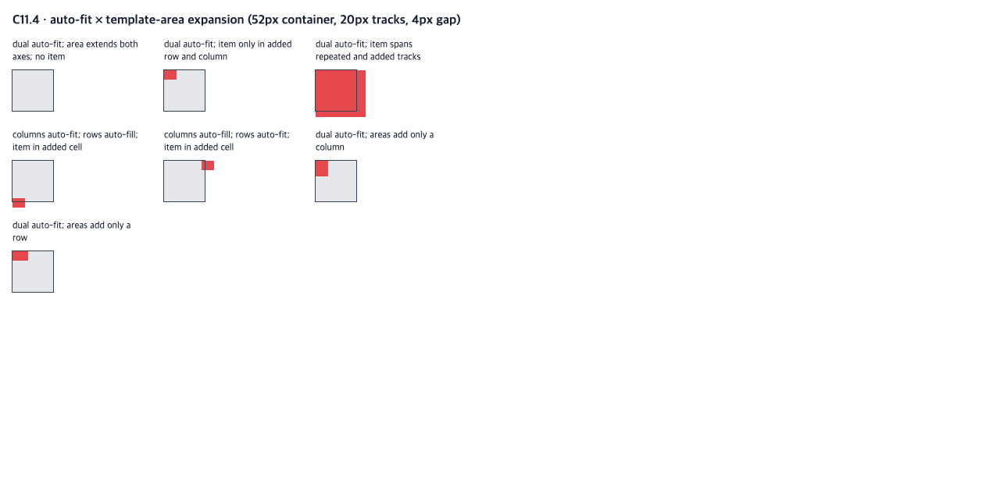

# C11.4 auto-fit + area-expanded explicit tracks 사전 비교

이 비교는 양 축 `auto-repeat`과 `grid-template-areas`를 허용한 기존 제한 경로에서, `auto-fit`의 빈 반복 track collapse와 area가 반복 개수보다 큰 explicit grid를 함께 고정한다. CSS Grid Level 1 2025-03-26 CRD [§7.1](https://www.w3.org/TR/2025/CRD-css-grid-1-20250326/#explicit-grids), [§7.2.3.2](https://www.w3.org/TR/2025/CRD-css-grid-1-20250326/#auto-repeat), [§7.5](https://www.w3.org/TR/2025/CRD-css-grid-1-20250326/#implicit-grids)를 독립 기대 기준으로 사용했다.

## 입력 및 환경

- 입력: [`grid-template-areas-auto-fit-expansion-c114.html`](../../../../tests/fixtures/css/c11/grid-template-areas-auto-fit-expansion-c114.html)
- 브라우저: Chrome for Testing `156.0.8078.48`, User-Agent `HeadlessChrome/156.0.0.0`
- 구동: Agent Browser `0.31.1`, macOS arm64, viewport `1280×633`, DPR 1
- 공통 CSS: definite content box `52×52px`, repeated fixed track `20px`, gap `4px`, area-added fixed tracks `grid-auto-columns:16px` / `grid-auto-rows:12px`
- 반복 수 계산: `(52 + 4) / (20 + 4)`에서 auto-repeat은 두 track이다. 세 track은 `3×20 + 2×4 = 68px`로 52px content box를 넘는다.
- 수집값: CSSOM `gridTemplateColumns`/`gridTemplateRows`, item `getBoundingClientRect()`를 grid origin 기준으로 환산, root `scrollWidth`/`scrollHeight`

독립 규범 기대는 영역 정의가 track을 점유시키지 않으며, 배치 후 in-flow item이 없거나 span하지 않는 auto-fit 반복 track과 그 양쪽 gutter를 접는다는 것이다. area dimensions가 반복 확장보다 크면 explicit grid는 area 크기까지 늘고, 추가 track은 `grid-auto-*` 값을 받는다. Chrome 관찰은 이 기대의 교차 확인이며 Spinon 동작 증거는 아니다.

## 규범 기대와 Chrome 관찰

Track 배열은 used CSS pixel 크기이고 item rect는 grid content origin 기준 `[x,y,width,height]`다. 정수 값은 exact 비교했다.

| Scene | Columns | Rows | Item rect | Scroll extent |
| --- | --- | --- | --- | --- |
| `fit-fit-empty` | `[0,0,16]` | `[0,0,12]` | 없음 | `[52,52]` |
| `fit-fit-item` | `[0,0,16]` | `[0,0,12]` | `[0,0,16,12]` | `[52,52]` |
| `fit-fit-span` | `[20,20,16]` | `[20,20,12]` | `[0,0,64,60]` | `[64,60]` |
| `fit-fill-item` | `[0,0,16]` | `[20,20,12]` | `[0,48,16,12]` | `[52,60]` |
| `fill-fit-item` | `[20,20,16]` | `[0,0,12]` | `[48,0,16,12]` | `[64,52]` |
| `fit-fit-column` | `[0,0,16]` | `[20,0]` | `[0,0,16,20]` | `[52,52]` |
| `fit-fit-row` | `[20,0]` | `[0,0,12]` | `[0,0,20,12]` | `[52,52]` |

Chrome의 7/7 used track list, item frame과 scroll extent가 독립 기대와 일치했다. `fit-fit-item`은 두 반복 track이 접힌 뒤 area의 마지막 cell에 놓인 item이 grid origin으로 이동하는 경계다. `fit-fill-item`과 `fill-fit-item`은 한 축에서만 빈 반복을 접으며 각각 아래 8px, 오른쪽 12px로 넘친다. `fit-fit-span`은 item span과 교차한 반복 track을 유지하고 area-added track까지 포함해 64×60px로 커진다.

## 화면과 파일 무결성

`observation.json`은 브라우저에서 수집한 원시 track list와 root/item rect를 보존한다. `sha256.txt`는 이 README, fixture, JSON 및 screenshot의 SHA-256을 기록한다.

## 한계

이 결과는 pinned Chrome의 CSS Grid 동작을 보여주는 사전 oracle뿐이다. Spinon layout output, Android/iOS Simulator, WPT, 실기기, hardware GPU 또는 OS compositor 이후 픽셀을 입증하지 않는다. 반복 count 계산과 expected collapse 판단은 CSS Grid CRD에서 도출했고 Chrome 결과는 별도로 관찰했다.
