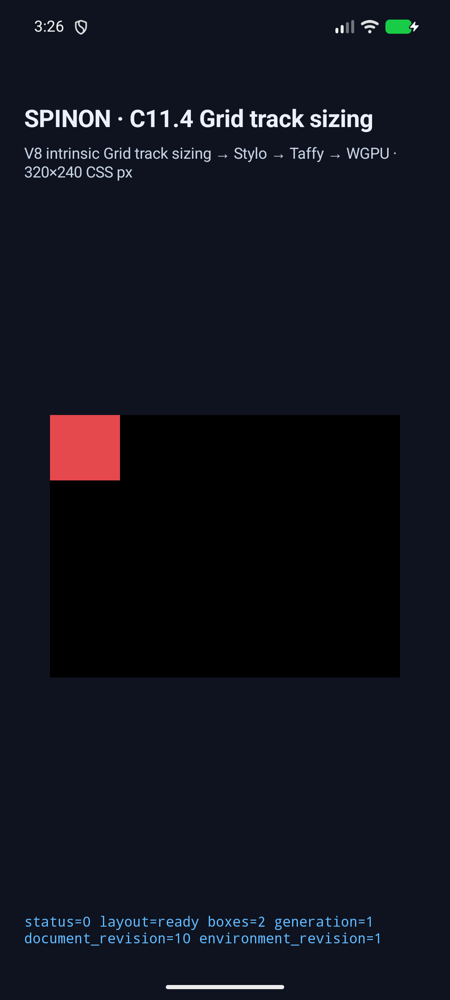
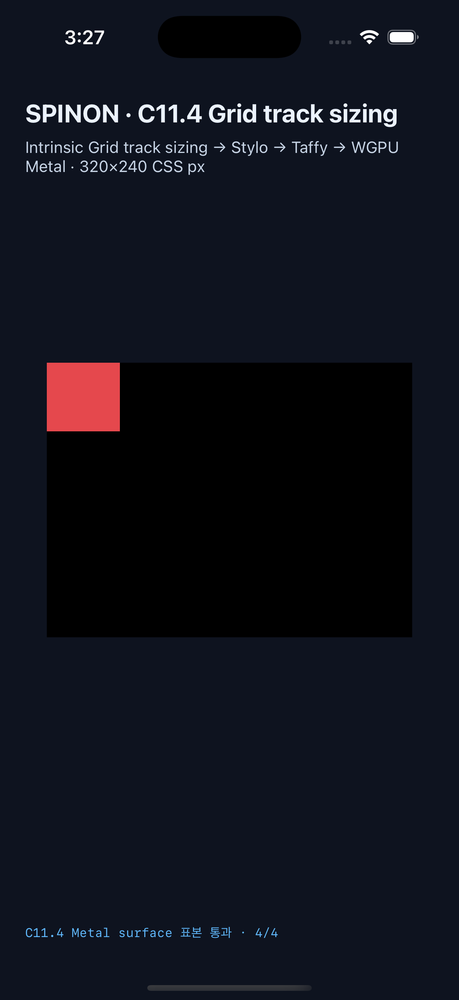

# C11.4 `auto-fit`과 area 확장 track 결합

**상태:** 구현 후보의 현재 runtime·build gate는 통과했다. 구현 PR은 적대적 diff 검토와 현재 GitHub check 상태를 확인한 뒤 만든다. 공식 C11.4 checkbox와 완료 집계 `77/213`은 병합 전까지 그대로다.

## 변경 범위와 판정

- 제한된 `RuntimeBlockFlexGridTrackSizingV1` profile의 auto-fit/area 확장을 고정하는 7개 runtime scene, layout 회귀 행렬, projection 검사와 host/capture fixture mapping을 추가했다. Taffy/layout 제품 계산 로직은 바꾸지 않았다.
- 전체 C11.4 capture route는 336개다. 기존 no-area dual-axis 12개와 area fixture 29개를 합친 exact 41개를 두 simulator에서 실행했다.
- Android API 37 ARM64 AVD `emulator-5558`: 41/41 scene 통과. iPhone 17 Pro / iOS 26.2 Simulator `ACA7BF91-E2D5-4CF7-909A-08D1AD95FF3D`: 41/41 통과.
- root/item node frame, used tracks, collapse state, trace 및 draw/present를 확인했다. 교차 비교는 frame·used tracks·draw/present 각각 41/41 exact match다.
- 29개 area scene에서 Android PixelCopy 및 iOS 제출 전 Metal drawable 표본을 각각 116/116 exact로 확인했다. 이는 emulator software GL 경로와 compositor 제출 전 drawable 결과다.

## 실행 중 발견해 수정한 결함

첫 Android full run에서 34개 scene을 지난 뒤 빈 3×3 area scene이 `invalid-c114-sample-fixture`로 거부됐다. empty scene ID는 host item-name helper에 있었지만 Android/iOS item-rect helper에 명시적 빈 목록이 빠져 있었다. 두 host에 빈 rect 목록을 추가하고, Node boundary test가 29개 area ID 각각 root-frame·item-name·item-rect helper에 존재하는지 검사하도록 보강했다. 실패 scene을 두 플랫폼에서 단독 재실행해 통과시킨 뒤 41 scene 전체를 양쪽에서 다시 실행해 통과했다.

첫 실패 원본은 [Android empty-area runtime log](./android-avd-c114-auto-fit-area-expansion-android-avd-20261023T062223313Z-1ee1ae50/runtime-template-area-repeat-two-axis-fit-fit-area-empty.log)에 남겼다. 수정된 scene 단독 재검사는 [Android](./android-avd-c114-auto-fit-area-expansion-fix-recheck-android-avd-20261023T062458225Z-34d814fd/result.json), [iOS](./ios-simulator-c114-auto-fit-area-expansion-fix-recheck-ios-simulator-20261023T062547401Z-3b95a622/result.json)에서 확인할 수 있다.

## Simulator 화면

| 대상 | `fit-fit-area-span` 실행 화면 |
| --- | --- |
| Android API 37 ARM64 AVD |  |
| iPhone 17 Pro / iOS 26.2 Simulator |  |

## 빌드, 테스트와 artifact 경계

| 확인 | 결과 |
| --- | --- |
| `area_expansion_tracks_keep_auto_fit_collapse_and_item_geometry` | 1/1 통과, 7개 layout 조건 |
| `auto_fit_projection_preserves_area_dimensions_beyond_both_repeat_axes` | 1/1 통과 |
| FFI `template_area_auto_repeat_scenes_have_fixed_runtime_frames` | fixture feature를 켜고 1/1 통과 |
| `fixture-module-boundary.test.mjs` | 7/7 통과, ID·route·host mapping·feature 경계 |
| `cargo fmt --all -- --check`, `git diff --check` | 통과 |
| workspace all-target Clippy, `-D warnings` | 통과 |
| FFI fixture feature all-target Clippy, `-D warnings` | 통과 |
| Android fixture-test app build | 성공. AGP 8.13.2와 compile SDK 37.2 조합 경고가 남지만 빌드 성공 |
| iOS Simulator fixture-test app build | 성공. Xcode가 V8 archive duplicate symbol/debug-map 경고를 출력했으나 빌드 성공 |
| FFI product archive `c04-runtime-gpu` | scene marker와 `spinon_runtime_gpu_host_new_c11_4_grid_track_sizing_fixture` symbol 부재 |
| FFI fixture archive `c04-runtime-gpu-fixture-test` | 같은 scene marker와 host symbol 존재 |

Android APK SHA-256은 `220da16026052ea72b06be48e34337d7cf3f113d6043305dfbc82edbde7d0628`이며 AVD 설치본과 일치한다. iOS Simulator executable SHA-256은 `77b5fbd57d50461a3d9a345b97baf24d61af3ce7d44cff93f49696e77c1b9900`이다. archive 검사에는 Rust LLVM 22.1.2 `llvm-nm`을 사용했다. 이는 static FFI archive 경계만 확인하며 최종 APK/IPA에서 fixture data가 빠진다는 뜻은 아니다.

사용자 요청에 따라 repo의 비어 있지 않은 Cargo 증분 캐시 `target/debug/incremental` 5.0GB를 사용 중인 process가 없는지 `lsof`로 확인한 뒤 지웠다. 직후 Data volume 여유는 136GB였고 빌드 뒤 마지막 확인은 128GB다. 다른 프로젝트도 사용하는 `/Volumes/ZTSBuild` cache와 output은 보존했다.

## 원본 근거

- [Android 최종 결과와 simulator metadata](./android-avd-c114-auto-fit-area-expansion-android-avd-20261023T062601431Z-2f9bedaa/result.json) · [simulator.json](./android-avd-c114-auto-fit-area-expansion-android-avd-20261023T062601431Z-2f9bedaa/simulator.json)
- [iOS 최종 결과와 simulator metadata](./ios-simulator-c114-auto-fit-area-expansion-ios-simulator-20261023T062653064Z-051a4e81/result.json) · [simulator.json](./ios-simulator-c114-auto-fit-area-expansion-ios-simulator-20261023T062653064Z-051a4e81/simulator.json)
- [41 scene 교차 비교](./cross-platform-comparison.json) · [82개 screenshot hash](./screenshot-manifest.json) · [exact route selection](./android-route-selection.json)
- [source input SHA-256 manifest](./source-files-manifest.json)
- [captured log whitespace normalization and before/after hashes](./log-normalization-manifest.json)
- [layout Cargo test](./layout-area-expansion-cargo-test.log) · [projection Cargo test](./style-projection-cargo-test.log) · [FFI fixture Cargo test](./ffi-fixture-cargo-test.log) · [Node boundary](./fixture-module-boundary.log)
- [Android app build](./android-build-after-empty-area-fix.log) · [iOS app build](./ios-build-after-empty-area-fix.log)
- [workspace Clippy](./cargo-clippy.log) · [FFI fixture Clippy](./ffi-fixture-clippy.log) · [format check](./cargo-fmt.log)
- [product FFI archive](./ffi-product-archive.json) · [fixture FFI archive](./ffi-fixture-archive.json)
- [구현 실패 관점 20개](./implementation-review-20.md) · [PR diff 실패 관점 30개](./pr-diff-review-30.md) · [41 scene route follow-up](./pr-diff-review-followup-41-matrix.md)
- [계획과 Chrome 156 사전 비교](../c11-4-auto-fit-area-expansion-precomparison-2026-10-23/README.md)

## 한계

Android 실기기·hardware GPU, iOS 실기기·compositor 이후 최종 surface, CSS border stroke, 일반 CSS admission, WPT 및 전체 C11.4 구현 완료는 검증하지 않았다. Chrome screenshot은 사전 CSS oracle이며 Spinon runtime 화면으로 취급하지 않는다. PR #549 본문 이미지가 Agent Browser에서 실제 로드되는 것을 확인했다. task 전용 session을 닫았고 session info는 `active=false`, `pid=null`이며 후속 process scan에서 Agent Browser/Chrome task process가 남지 않았다. [browser image rendering](./agent-browser-pr-image-rendering.json) · [session 상태](./agent-browser-sessions.json) · [cleanup](./agent-browser-cleanup.json).
