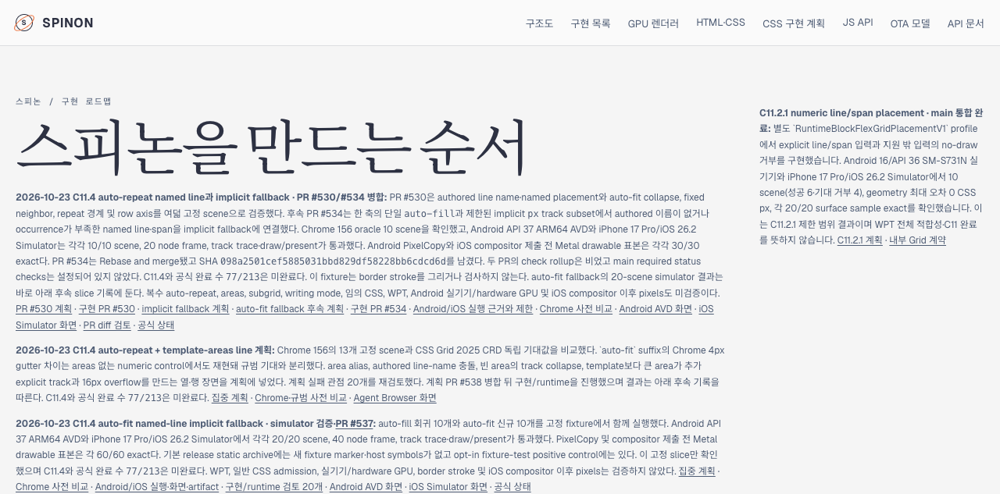

# C11.4 공식 로드맵 집계 정정 근거

## 관측 결과

2026-10-23 Agent Browser로 https://macstudio.tailed42f2.ts.net/spinon/roadmap.html을 확인했다. 동적으로 렌더링된 로드맵 체크박스는 213개였고 72개가 checked였다. 체크박스는 전부 disabled여서 이 검사는 읽기 전용이다. 페이지의 status API 요청은 GitHub main의 spec/STATUS.md를 읽었다. 기존 메인 카운터의 77/213 표기는 상태 원본 안의 문장과 과거 pass58 JSON 값에 있었지만, 해당 pass58 JSON은 checked/total checkbox 수를 저장하지 않았다.

공식 집계는 72/213이다. PR #549는 상태 checkbox를 변경하지 않았고 C11.4 상위 항목은 계속 미완료다. PR #528 이전 main과 현재 main의 spec/STATUS.md를 비교했을 때 226개 원시 checkbox의 checked state 87개는 변하지 않았다. 비교 결과는 checkbox-source-state-comparison.json에 기록했다. 이 원시 목록은 로드맵의 표시 대상 213 ID와 같은 모집단이 아니므로 단순 - [x] 개수로 페이지 합계를 계산하지 않는다.

## 정정 범위

공식 상태 대장, 공개 로드맵 HTML, 적합성 문서, 내부 Grid 계약, 내부 인덱스 및 현재 C11.4 auto-fit 계획에서 잘못된 현재 집계 문구를 72/213으로 고쳤다. PR #549의 구현·검토 산출물에 남은 77/213 문자열은 checkbox DOM count를 입증하지 않는 과거 텍스트로 보존했다. pass58 JSON에도 checked/total 개수는 저장되어 있지 않다. 체크박스 자체는 변경하지 않았다.

## 검토 근거

[문서 변경 적대 검토](./pr-diff-review-30.md) · 30개 분리 관점을 확인했다.

## 사전 확인 화면과 정리

- 원본 화면: tailnet-before-correction.png · 1280×633 · SHA-256 ba5d32805197374ac3f3282d08a7afcd8fd51a84733b615c1e5f7d6ac149a6d9
- Agent Browser 세션은 확인 후 닫았다. 최종 session info에서 active session/page가 없고 후속 process scan에서도 Agent Browser/Chrome 작업 프로세스가 없음을 확인했다. Tailnet 미리보기 server는 유지했다.
- PR #549 merge SHA: fdf5a3a24f3f5f3f1e2f1bc2f5e871f29dbf7ca8. C11.4 전체 구현, 실기기, hardware GPU, WPT 또는 iOS compositor 이후 surface를 이 집계 정정으로 주장하지 않는다.
