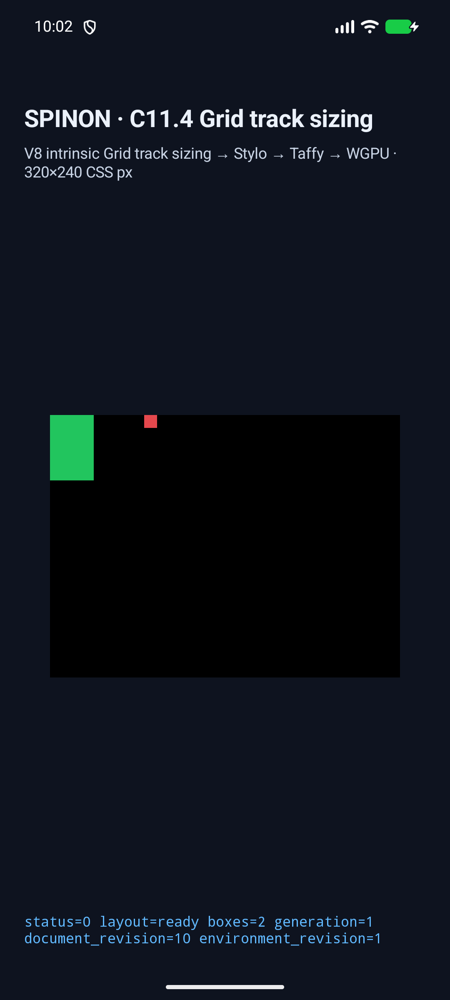
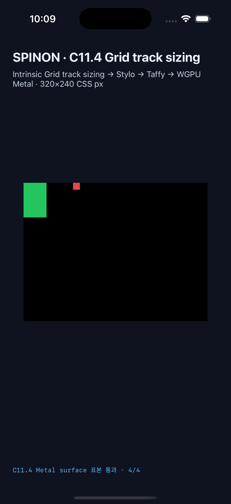

# C11.4 definite minimum-size auto-fit 구현 근거

2026-10-20 현재 작업 브랜치 `feat/c11-4-auto-fit-definite-minimum-20261020`에서 진행한 구현·검증 결과다. C11.4와 C11 상위 상태는 미완료로 유지한다. 이번 slice는 definite minimum-size에 따른 제한 auto-repeat 수와 빈 `auto-fit` track/gutter collapse만 다룬다.

계획: [definite minimum-size auto-fit 집중 계획](../../../../plan/c11-4-auto-fit-min-size-axis.md).

## 변경

- 빈 `auto-fit` track의 직전 gutter도 접어 CSS Grid §7.2.3.2의 양쪽 gutter 규칙을 적용했다. 마지막 repeat component의 trailing collapse는 마지막 occupied track 앞에서 멈춘다.
- Columns·Rows, 190/200/342px minimum-size 경계, prefix/suffix neighbor, 빈 track, single/span-two/second-repeat in-flow item, fixed pattern을 포함한 20개 runtime fixture를 추가했다.
- 이전 C11.4 simulator expectation을 규범에 맞춰 갱신했다. 예를 들어 occupied first repeat flexible track은 154px에서 162px, second-repeat track은 154px에서 170px로 바뀐다.
- Chrome 155는 동일한 장면에서 각각 154px·162px를 관찰했다. 이는 구현 oracle로 복사하지 않고 Chromium gutter 동작과 CSS Grid 규범 기대의 차이로 기록한다.
- Chrome 비교에 남긴 out-of-flow item case는 C11.1 앱 runtime이 `위치 지정 Grid item ... 지원하지 않습니다`로 거부했다. runtime matrix는 두 번째 repeat에 놓은 in-flow item으로 바꿨으며 out-of-flow 지원을 주장하지 않는다.

## 검증

| 검증 | 결과 | 원본 |
|---|---|---|
| `spinon-layout` 회귀 | 188 passed, 0 failed | [rust-layout-suite.log](rust-layout-suite.log) |
| C11.4 fixture ID/source 검사 | 1 passed, 0 failed | [rust-ffi-fixture-test.log](rust-ffi-fixture-test.log) |
| Rust 포맷, whitespace, capture JS syntax | 통과 | 작업 직후 `cargo fmt --all -- --check`, `git diff --check`, `node --check tools/css-reference/capture-c11-4-auto-repeat-neighbors-simulator.mjs` |
| Android 앱 빌드 | `BUILD SUCCESSFUL`, API 37 AVD용 | [android-build.log](android-build.log) · [패키지 검사](android-package.log) |
| Android API 37 ARM64 AVD | `emulator-5554`, 53/53 scene, 각 scene track/frame/collapse/draw 검증 통과 | [실행 결과](../c11-4-auto-fit-min-size-axis-2026-10-20/android-avd-c114-autofit-minsize-android-avd-20261020T010237848Z-6e767f6f/result.json) · [device info](../c11-4-auto-fit-min-size-axis-2026-10-20/android-avd-c114-autofit-minsize-android-avd-20261020T010237848Z-6e767f6f/simulator.json) |
| iOS Simulator 앱 빌드 | Xcode `BUILD SUCCEEDED`; C11 Grid Metal pixel fixture 활성화 | [ios-build-metal-pixels.log](ios-build-metal-pixels.log) |
| iPhone 17 Pro · iOS 26.2 Simulator | 53/53 scene, 각 scene track/frame/collapse/draw 검증 통과 | [실행 결과](../c11-4-auto-fit-min-size-axis-2026-10-20/ios-simulator-c114-autofit-minsize-ios-simulator-20261020T010922301Z-e8f2c7bb/result.json) · [device info](../c11-4-auto-fit-min-size-axis-2026-10-20/ios-simulator-c114-autofit-minsize-ios-simulator-20261020T010922301Z-e8f2c7bb/simulator.json) |
| root 경계 표면 표본 | Android Surface 4/4 exact, iOS Metal drawable 4/4 exact | [Android pixels](../c11-4-auto-fit-min-size-axis-2026-10-20/android-avd-c114-autofit-minsize-android-avd-20261020T010237848Z-6e767f6f/runtime-auto-fill-overflow-neighbors.log) · [iOS pixels](../c11-4-auto-fit-min-size-axis-2026-10-20/ios-simulator-c114-autofit-minsize-ios-simulator-20261020T010922301Z-e8f2c7bb/runtime-auto-fill-overflow-neighbors.log) |
| 구현 실패 경로 검토 | 20개 독립 관점, 구현 결함 미발견 | [implementation-review-20.md](implementation-review-20.md) |

Android AVD는 `sdk_gphone16k_arm64`, API 37, `arm64-v8a`다. iOS target은 iPhone 17 Pro simulator UDID `ACA7BF91-E2D5-4CF7-909A-08D1AD95FF3D`다. 물리 기기는 연결하거나 선택하지 않았다.

Android와 iOS의 같은 overflow 장면에서 표면의 root 안쪽, root 바깥쪽, root 밖으로 그려진 item, root 배경을 각각 확인했다. 바깥쪽 빨간 item은 유지되고 root 경계 바깥은 검정 배경이다. 이 검사는 테두리 stroke 색이나 실제 기기 compositor를 뜻하지 않는다.

### Android AVD

### iPhone 17 Pro Simulator

Second-repeat item의 화면은 [iOS screenshot](../c11-4-auto-fit-min-size-axis-2026-10-20/ios-simulator-c114-autofit-minsize-ios-simulator-20261020T010922301Z-e8f2c7bb/auto-fit-min-columns-second-repeat-200.png)과 [Android screenshot](../c11-4-auto-fit-min-size-axis-2026-10-20/android-avd-c114-autofit-minsize-android-avd-20261020T010237848Z-6e767f6f/auto-fit-min-columns-second-repeat-200.png)에 있다.

## 최초 실행 오류 기록

- 첫 Android AVD capture는 기존 `auto-fit-fixed-neighbors` expectation 154px에서 중단됐다. 새 규범 계산은 162px이며 Android/iOS 기대값과 이전 scene을 고쳐 final 53-scene run에서 확인했다. [초기 runtime log](../c11-4-auto-fit-min-size-axis-2026-10-20/android-avd-c114-autofit-minsize-android-avd-20261020T004957349Z-3057458d/runtime-auto-fit-fixed-neighbors.log).
- 다음 Android AVD capture는 44번째 부근에 out-of-flow Grid item을 보내 C11.1의 명시적인 `위치 지정 Grid item ... 지원하지 않습니다` 오류를 확인했다. 이를 positive runtime case로 취급하지 않고 두 번째 repeat의 in-flow item으로 대체했다. [거부 log](../c11-4-auto-fit-min-size-axis-2026-10-20/android-avd-c114-autofit-minsize-android-avd-20261020T005604668Z-e9c67365/runtime-auto-fit-min-columns-out-of-flow-200.log).
- 첫 iOS build는 Metal 표면 fixture가 비활성인 상태로 성공했지만, overflow pixel stage는 `fixture is not enabled`로 중단됐다. `SPINON_ENABLE_C11_GRID_METAL_SURFACE_PIXELS_TEST=1`을 켜 빌드하고 전체 행렬을 다시 통과시켰다. 최초 로그는 [ios-build.log](ios-build.log)와 [실패 capture](ios-simulator-capture.stdout.log)에 보존했다.
- 두 번째 capture 시도는 시뮬레이터 UDID를 잘못 전달해 시작 전에 거부됐다. 올바른 iPhone 17 Pro UDID로 재실행한 결과가 위 53-scene 성공 run이다.

## 범위 밖

이 근거는 WPT 적합성, 일반 CSS Grid 전체, out-of-flow Grid item, Android 실기기, hardware GPU, iOS compositor 이후 표면 동작을 증명하지 않는다. Chrome 155와 normative gutter 계산의 차이도 호환 완료로 처리하지 않는다.
