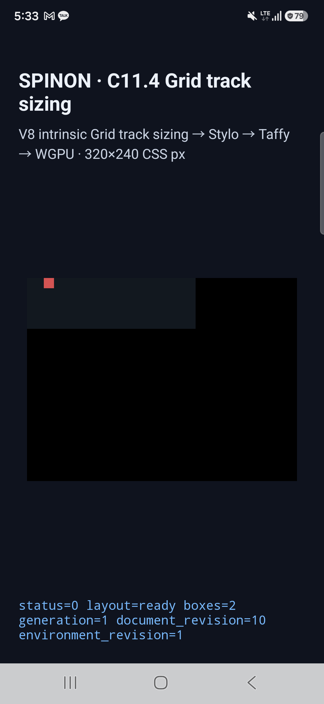

# C11.4 definite minimum-size `auto-fit` 축별 Android 실기기 보충 검증

2026-10-21 사용자가 Android 실기기 검증을 요청해, 기존 API 37 AVD에서 통과한 53-scene 행렬을 연결된 Samsung 기기에서 다시 실행했다. C11.4 전체 완료나 공개 CSS 지원 범위를 의미하지 않는다.

## 기준과 결과

- **규범 oracle:** CSS Grid Level 1 §7.2.3.2와 [축별 auto-fit 계획](../../../../plan/c11-4-auto-fit-min-size-axis.md)에 고정한 반복 수·collapse·gutter 기대값. Chrome 155는 독립 관찰기이며 판정값으로 사용하지 않았다.
- **입력:** [기존 API 37 AVD 결과](../c11-4-auto-fit-min-size-axis-2026-10-20/android-avd-c114-autofit-minsize-android-avd-20261020T010237848Z-6e767f6f/result.json)의 53개 scene ID 전체.
- **기기:** Samsung SM-S731N, Android 16/API 36, `arm64-v8a`, `ro.kernel.qemu=0`, 1080×2340, density 450. SurfaceFlinger renderer는 Samsung Xclipse 940 / Vulkan 1.3.279 / OpenGL ES 3.2다. 자세한 fingerprint와 renderer는 [기기 정보](./android-device-c114-auto-fit-min-size-axis-android-device-20261020T203145959Z-6d7d1d53/device.json)에 있다.
- **APK:** fixture-test opt-in Android build를 새로 설치했다. 로컬 APK와 기기 `base.apk`의 SHA-256은 모두 `77e2ff1cb2f81cb80339e06743cbf6b3b05aa0de1204e004454b09237a91be86`이다. [빌드 로그](./android-build.log) · [설치 hash 확인](./android-device-c114-auto-fit-min-size-axis-android-device-20261020T203145959Z-6d7d1d53/installed-apk-verification.json).

| 관찰 | 결과 |
|---|---:|
| scene layout/frame/track/collapse/gutter assertion | 53/53 통과 |
| trace chunk 복원 및 draw/present | 53/53 통과 |
| API 37 AVD 대비 used track 최대 차이 | 0 CSS px |
| API 37 AVD 대비 관측 node frame 최대 차이 | 0 CSS px |
| overflow SurfaceView PixelCopy 표본 | 4/4 exact |
| scene 재시도 | 0 |

두 실행의 수치 차이는 허용치 1/64 CSS px보다 작다. 전체 장면별 결과는 [실기기 result](./android-device-c114-auto-fit-min-size-axis-android-device-20261020T203145959Z-6d7d1d53/result.json), 실제 설치 APK를 포함한 기기 정보는 [device.json](./android-device-c114-auto-fit-min-size-axis-android-device-20261020T203145959Z-6d7d1d53/device.json), 장면별 AVD 비교는 [comparison.json](./android-device-c114-auto-fit-min-size-axis-android-device-20261020T203145959Z-6d7d1d53/physical-vs-avd-comparison.json)에서 확인할 수 있다.

### 실기기 화면



[overflow 경계 화면](./android-device-c114-auto-fit-min-size-axis-android-device-20261020T203145959Z-6d7d1d53/auto-fill-overflow-neighbors.png) · [PixelCopy 원본 로그](./android-device-c114-auto-fit-min-size-axis-android-device-20261020T203145959Z-6d7d1d53/runtime-auto-fill-overflow-neighbors.log)

## 재현

```sh
mise exec -- env SPINON_ENABLE_C04_RUNTIME_GPU=1 SPINON_ENABLE_C04_RUNTIME_GPU_FIXTURE_TEST=1 bun run build:android
node spec/internal/evidence/c11-4-auto-fit-min-size-axis-physical-android-2026-10-21/run-physical-matrix.mjs R5KYB06SMPE
node spec/internal/evidence/c11-4-auto-fit-min-size-axis-physical-android-2026-10-21/compare-avd-physical.mjs \
  spec/internal/evidence/c11-4-auto-fit-min-size-axis-physical-android-2026-10-21/android-device-c114-auto-fit-min-size-axis-android-device-20261020T203145959Z-6d7d1d53/result.json
```

실행 계획은 [실기기 후속 계획](../../../../plan/c11-4-auto-fit-axis-physical-android.md), 계획 실패 경로 검토는 [20개 관점 기록](./plan-review-20.md)이다. capture harness는 AVD API 37 gate를 유지하면서 명시적인 `android-device` 모드, real-device 판별, 기기 renderer 기록, 설치 APK hash 확인을 추가했다.

Android Gradle Plugin 8.13.2가 compile SDK 37.2를 검증한 범위는 36.1까지라는 기존 경고가 빌드에 남았다. 이 실행은 단일 SM-S731N의 앱 SurfaceView 결과다. OS compositor 이후 화면, 다른 Android 기기, WPT, 일반 CSS Grid 적합성은 검증하지 않았다. C11.4 체크와 공식 완료 수는 유지한다.

수집한 텍스트 로그에서 줄 끝 공백만 제거했다. run ID, runtime marker, 수치와 JSON payload는 변경하지 않았다.

[구현·실기기 검토 20개](./implementation-review-20.md) · [PR diff 검토 30개](./pr-diff-review-30.md) · [원본 파일 SHA-256 manifest](./SHA256SUMS.txt).
