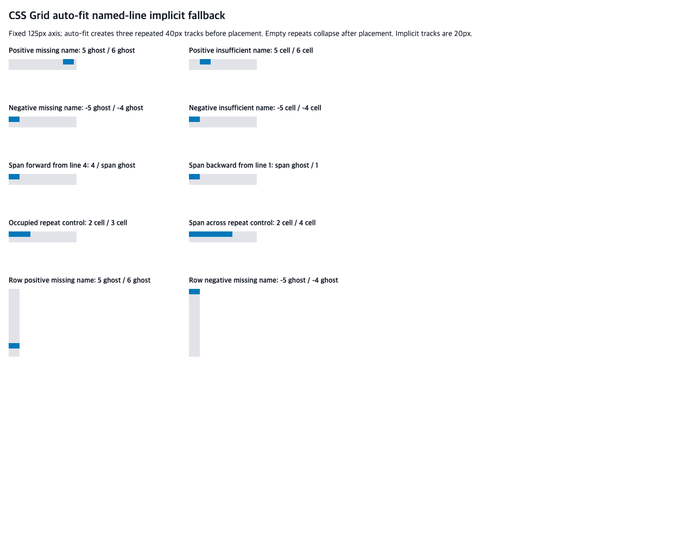

# C11.4 auto-fit named-line implicit fallback 사전 비교

## 범위와 기준

이 비교는 authored auto-repeat line name과 named-line implicit fallback을 결합한 뒤 `auto-fit`의 collapse가 placement/frame에 미치는 고정 사례를 정의한다. Chrome 관측과 표준에서 독립 계산한 기대값을 분리한다. 이 기록은 Spinon 구현 결과, 일반 CSS 지원 또는 C11.4 완료를 뜻하지 않는다.

- 규범 기준: [CSS Grid Layout Module Level 1, 2025 CRD §7.2.3.2](https://www.w3.org/TR/2025/CRD-css-grid-1-20250326/#auto-repeat)에서 `auto-fit`은 placement 뒤 빈 반복 track을 collapse하며, track에 in-flow item이 배치되거나 걸쳐 있으면 빈 track이 아니다. 같은 문서 [§8.3](https://www.w3.org/TR/2025/CRD-css-grid-1-20250326/#line-placement)은 integer named line의 occurrence가 부족하면 implicit lines를 해당 이름으로 보고, named span은 검색 방향 쪽 implicit lines만 센다고 규정한다.
- 고정 oracle: Agent Browser `0.31.1`로 Google Chrome `156.0.8078.48`을 열었다. OS는 macOS `26.5.1` ARM64, viewport `1280×1000` CSS px, DPR 1이다. 원본 JSON과 browser metadata는 각각 `chrome156-observation.json`, `chrome156-browser-metadata.json`에 있다.
- 고정 입력: [`grid-auto-fit-named-line-implicit-fallback.html`](./grid-auto-fit-named-line-implicit-fallback.html). `125px` definite axis, `repeat(auto-fit, [cell] 40px [cell])`, implicit track `20px`, gap 0이다. 배치 전 반복 수는 3이다. 모든 scene은 in-flow 단일 item 하나만 둔다.
- 화면: 
- hash: fixture `f1ed92c6e2feda24fa1231bf0ba4d31ca14fa74acf3cc7de38149edf4e5b24de`; screenshot `38941fc11fc7071f41d6d70fbcf65ca1d55192fd2fdbac25e9821db5094e3919`.
- Browser는 Agent Browser를 사용했고 `terminal-browser`는 사용하지 않았다. 관측 후 `agent-browser close --all`로 탭을 닫았다. 잠시 남았던 idle daemon은 이어진 확인에서 session list가 비고 session info가 `active=false`, `pid=null`이며 프로세스도 사라진 것을 확인했다. 사용자의 일반 Chrome 앱은 별도 프로세스여서 유지했다. [`browser-shutdown.json`](./browser-shutdown.json)에 종료 순서를 기록했다.

## 독립 기대값

독립 계산은 기존 [auto-fill fallback 비교](../c11-4-auto-repeat-named-line-implicit-fallback-precomparison-2026-10-23/README.md)의 line-resolution 결과를 기준으로 한다. §7.2.3.2에 따라 `auto-fit`은 placement까지 `auto-fill`과 같은 3개 repeat track과 같은 logical line을 사용하고, 그 뒤 in-flow item이 놓이지 않은 repeat track만 0으로 collapse한다. 따라서 `ghost`/`cell` occurrence 계산으로 생기는 implicit track 개수와 placement 순서는 auto-fill case에서 유지하되, empty repeat track의 40px만 제거한다. 두 control은 item이 점유하거나 span하는 repeat track을 collapse하지 않는지 확인한다.

각 scene은 Chrome의 expanded `gridTemplateColumns`/`gridTemplateRows` serialization과 root-relative item frame을 함께 기록한다. Track serialization과 track/group 개수는 exact, item frame은 최대 `1/64 CSS px` 차이까지 허용한다. Computed placement 문자열은 CSSOM 관측일 뿐 resolver의 internal integer index라고 해석하지 않는다.

| scene | collapse 뒤 기대 track 크기 | root 기준 item frame 기대값 | 실패 관점 |
| --- | --- | --- | --- |
| `positive-missing` | columns: `0,0,0,20,20,20,20,20,20px` | `(100,0) 20×10px` | absent name, positive occurrence |
| `positive-insufficient` | columns: `0,0,0,20,20px` | `(20,0) 20×10px` | insufficient repeated-name occurrence |
| `negative-missing` | columns: `20,20,20,20,20,0,0,0px` | `(0,0) 20×10px` | absent name, negative occurrence |
| `negative-insufficient` | columns: `20,0,0,0px` | `(0,0) 20×10px` | insufficient negative occurrence |
| `span-forward-missing` | columns: `0,0,0,20px` | `(0,0) 20×10px` | forward span fallback after explicit end line |
| `span-backward-missing` | columns: `20,0,0,0px` | `(0,0) 20×10px` | backward span fallback before explicit start line |
| `occupied-repeat` | columns: `0,40,0px` | `(0,0) 40×10px` | occupied repeat must stay uncollapsed |
| `span-occupied-repeat` | columns: `0,40,40px` | `(0,0) 80×10px` | every repeated track crossed by item must stay uncollapsed |
| `row-positive-missing` | rows: `0,0,0,20,20,20,20,20,20px` | `(0,100) 20×10px` | row-axis positive fallback |
| `row-negative-missing` | rows: `20,20,20,20,20,0,0,0px` | `(0,0) 20×10px` | row-axis negative fallback |

## Chrome 관측

Chrome `gridTemplateColumns`/`gridTemplateRows` line-group serialization, computed placement, viewport와 item frame은 [원본 JSON](./chrome156-observation.json)에 보존한다. 관측값이 위 독립 기대값과 다르면 implementation 전에 원인을 분류하고 plan/fixture를 수정한다. 현재 Chrome은 열·행의 fallback case에서 각각 독립 기대 frame을 관측했고, `occupied-repeat`는 `[0,40,0]`, `span-occupied-repeat`는 `[0,40,40]`을 반환했다.

## 구현 판정 경계

- 구현 slice는 단일 `auto-fit` repeat, fixed `40px` repeat track, fixed `20px` implicit track, definite `125px` axis와 gap 0인 opt-in fixture에 한정한다. `auto-fill`의 기존 10개 scene은 regression control로 남기고, 신규 auto-fit 10개를 추가해 Android API 37 ARM64 AVD와 iPhone 17 Pro/iOS 26.2 Simulator에서 각 20개 전체 matrix를 실행한다.
- Rust track trace와 root/item frame을 scene마다 확인한다. Android PixelCopy와 iOS compositor 제출 전 Metal drawable에서 item 내부·grid 바깥/implicit track의 고정 좌표만 exact 비교한다. collapse된 0px track 내부 pixel은 존재하지 않으므로 그런 pixel 검사는 주장하지 않는다.
- 기본 release archive에는 fixture-only scene marker/entry symbol이 없어야 하고 fixture-test positive control에는 있어야 한다. 정적 archive 결과를 최종 APK/IPA 전체의 fixture 제외로 넓혀 말하지 않는다.
- 계획·implementation/runtime 각각 서로 다른 실패 관점 20개를 검토하고, PR diff는 프로젝트 규칙에 따라 30개 관점으로 별도 검토한다. 범위 차이가 발견되면 기존 review 표를 재사용하지 않는다.
- public CSS admission, multiple repeats, named areas, subgrid, writing mode, 임의 CSS, WPT, 실기기, Android hardware GPU, iOS compositor 이후 surface와 전체 C11.4는 제외한다. 내부 계약 0059 버전 `0.1.0`, C11.4 checkbox와 공식 완료 집계 `77/213`을 유지한다.
