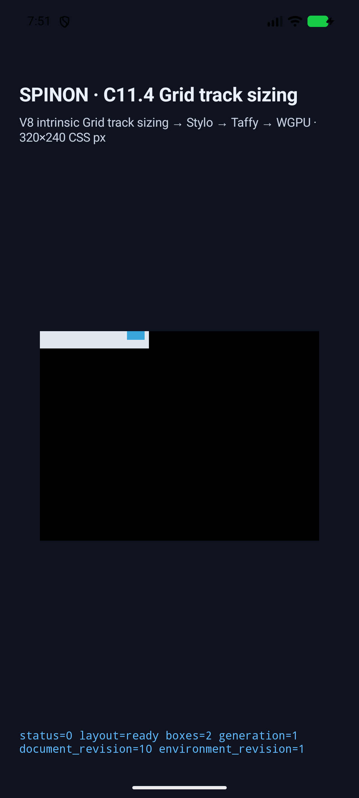
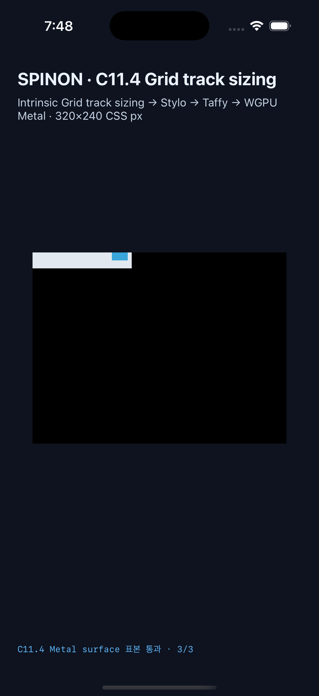

# C11.4 · auto-fit named-line implicit fallback 실행 근거

이 evidence는 [집중 계획](../../../../plan/c11-4-auto-fit-named-line-implicit-fallback.md)의 고정 fixture 범위를 Android·iOS simulator에서 실행한 기록이다. 구현 PR [#537](https://github.com/ohah/spinon/pull/537)에 결과를 연결했다. 기존 auto-fill implicit fallback 10개를 회귀로 유지하고 auto-fit 10개를 추가했다. 제품 layout algorithm은 변경하지 않았다. 기존 symbolic named placement와 auto-fit track sizing 경로가 이 조합을 처리하는지 fixture와 platform harness에서 확인했다.

## 고정 입력과 기대값

기준은 [Chrome 156 사전 비교](../c11-4-auto-fit-named-line-implicit-fallback-precomparison-2026-10-23/README.md)와 CSS Grid 2025 CRD §7.2.3.2·§8.3이다. 단일 definite `125px` axis, `[cell] 40px [cell]`, `20px` implicit track, gap 0이며 배치 전 auto-repeat은 세 track이다. Row controls는 같은 조건을 반대 축에 적용한다.

| scene | placement와 기대 item frame (CSS px) | final auto-fit tracks |
| --- | --- | --- |
| `auto-fit-named-implicit-positive-missing` | `5/6 ghost`, `(100,0) 20×10` | Columns `[0,0,0,20,20,20,20,20,20]` |
| `auto-fit-named-implicit-positive-insufficient` | `5/6 cell`, `(20,0) 20×10` | Columns `[0,0,0,20,20]` |
| `auto-fit-named-implicit-negative-missing` | `-5/-4 ghost`, `(0,0) 20×10` | Columns `[20,20,20,20,20,0,0,0]` |
| `auto-fit-named-implicit-negative-insufficient` | `-5/-4 cell`, `(0,0) 20×10` | Columns `[20,0,0,0]` |
| `auto-fit-named-implicit-span-forward-missing` | line `4` to `span ghost`, `(0,0) 20×10` | Columns `[0,0,0,20]` |
| `auto-fit-named-implicit-span-backward-missing` | `span ghost` to line `1`, `(0,0) 20×10` | Columns `[20,0,0,0]` |
| `auto-fit-named-implicit-occupied-repeat` | `2/3 cell`, `(0,0) 40×10` | Columns `[0,40,0]` |
| `auto-fit-named-implicit-span-occupied-repeat` | `2/4 cell`, `(0,0) 80×10` | Columns `[0,40,40]` |
| `auto-fit-named-implicit-row-positive-missing` | row `5/6 ghost`, `(0,100) 20×10` | Rows `[0,0,0,20,20,20,20,20,20]` |
| `auto-fit-named-implicit-row-negative-missing` | row `-5/-4 ghost`, `(0,0) 20×10` | Rows `[20,20,20,20,20,0,0,0]` |

각 simulator에서 20개 scene 전체(auto-fill 10 + auto-fit 10)의 root/item frame, 최종 track·collapse 상태, trace, draw/present를 확인했다. 플랫폼별 PixelCopy와 compositor 제출 전 Metal drawable 표본은 60/60 exact다. Empty collapsed track에는 표면이 없어 그 내부 색 표본은 만들지 않았다.

## 대표 화면

| Android API 37 ARM64 AVD | iPhone 17 Pro / iOS 26.2 Simulator |
| --- | --- |
|  |  |

두 캡처는 고정 fixture를 앱 화면에서 실행한 simulator screenshot이다. CSS border stroke의 모양이나 OS compositor 이후 iOS 출력은 판정하지 않는다.

## 실행 환경 및 증거

### Android

- API 37 ARM64 AVD `emulator-5558`, model `sdk_gphone64_arm64`; fixture-test APK hash `d54f9ac4c7eb88817daa191b6bc92c552da42c9fa12875d04c97a2cc597f3f13`. 설치된 APK hash도 같다.
- 성공 run: [scene result](./android-avd-c114-auto-fit-named-implicit-fallback-android-avd-20261022T225053720Z-747e4035/result.json), [AVD·APK·source metadata](./android-avd-c114-auto-fit-named-implicit-fallback-android-avd-20261022T225053720Z-747e4035/simulator.json), [install hash 확인](./android-avd-c114-auto-fit-named-implicit-fallback-android-avd-20261022T225053720Z-747e4035/installed-apk-verification.json).
- 결과: 20/20 scene, 40 node frame, 20 track trace 및 draw/present, PixelCopy 60/60 exact.

### iOS

- iPhone 17 Pro / iOS 26.2 Simulator, UDID `ACA7BF91-E2D5-4CF7-909A-08D1AD95FF3D`; app executable SHA-256 `1c8748c19804a01036a0717006c4ee3084cc85f1cfcef749d7a4cf75df4c5408`.
- 성공 run: [scene result](./ios-simulator-c114-auto-fit-named-implicit-fallback-ios-simulator-20261022T224801263Z-5b88c62c/result.json), [Simulator·app·source metadata](./ios-simulator-c114-auto-fit-named-implicit-fallback-ios-simulator-20261022T224801263Z-5b88c62c/simulator.json).
- 결과: 20/20 scene, 40 node frame, 20 track trace 및 draw/present, Metal drawable 60/60 exact. Metal 표본은 OS compositor 제출 전이다.

두 최종 run은 commit `46734170fc4c59e3d4fe44b4cb4f0b38b9823ef3`, tree `a73c5ffde9832b7e04a2907ad60a388895be0745`, tracked diff SHA-256 `18f4159d2753cedc8269063ecd874d2724c181b0c66f01955cde29d9bea90661`를 기록한다.

초기 디버그 실행은 Android expected-color prefix 조회가 auto-fit sample에 sentinel `-1`을 반환하고, iOS 고정 sample 선택 분기가 auto-fit ID를 거부해 중단됐다. 두 harness 경계를 고쳐 최신 source에서 각 20개 전체를 다시 통과했다. 실패한 원본 실행 로그도 같은 evidence root의 별도 run directory에 보존했으며 성공 수에는 포함하지 않았다.

## 기본·fixture-test artifact 경계

macOS ARM64 release `spinon-ffi` static archive를 `c04-runtime-gpu`와 `c04-runtime-gpu-fixture-test,c11-grid-metal-surface-pixels-test` 조합으로 각각 빌드했다. [artifact-boundary.json](./artifact-boundary.json)과 `product-core-fixture-symbols.txt` / `fixture-test-fixture-symbols.txt`에서 product/core archive에는 auto-fit scene marker와 두 C11.4 fixture host symbol이 없고 fixture-test positive control에는 모두 있음을 확인했다. hash와 build log는 증거 root의 `*.sha256` 및 `*-build.log` 파일에 있다.

이는 host static archive의 fixture source 경계 검사다. Android APK·iOS app bundle 전체의 제품 제외 여부나 release bundle 크기를 검증하지 않는다.

## 로컬 검증

- [Rust FFI fixture test](./rust-ffi-fixture-test.log): `exposes_all_fixed_named_auto_repeat_runtime_scenes` 1/1 통과.
- [Fixture module boundary](./fixture-module-boundary.log): 6/6 통과.
- [Rust formatting](./rustfmt-check.log), [workspace Clippy](./workspace-clippy.log), JS syntax, `git diff --check`: 통과.
- [Android fixture-test build](./android-avd-build.log), [iOS fixture-test build](./ios-simulator-build-pass02.log): 성공. 두 빌드에서 runtime GPU, fixture-test 및 C11 Grid surface pixel 검증 flag를 켰다.

## 남은 범위

C11.4 전체, 공식 `77/213`, 일반 CSS admission, 임의 placement·여러 auto-repeat, areas, subgrid, writing mode, WPT, Android 실기기/hardware GPU, CSS border stroke 및 iOS compositor 이후 출력은 검증하지 않았다. 이 결과는 고정 fixture subset에 한정되며 공개 CSS 지원 완료를 의미하지 않는다. 내부 계약 숫자 버전 `0.1.0`은 유지한다.
