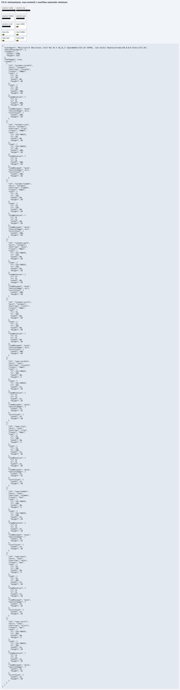

# C11.4 `minmax(auto, max-content)` overflow automatic minimum · test-only 구현

## 범위

[계획과 사전 판정](https://github.com/ohah/spinon/blob/main/plan/c11-4-auto-minmax-max-content-overflow.md)에 정의한 10개 layout unit-test 입력을 기존 overflow regression suite의 하위 모듈로 추가했다. 기존 `minmax(auto, 1fr)` 14개 case는 수정하지 않았다. 구현 source는 [`max_content.rs`](https://github.com/ohah/spinon/blob/main/crates/spinon-layout/src/grid_auto_min_scrollable_overflow_tests/max_content.rs)이고 부모에 test-only 하위 모듈 선언만 더했다.

Columns는 고정 Ahem `XXXXXXXXXX`, definite `60×20px` root와 `minmax(auto,max-content)` 한 track을 사용한다. Rows는 HostDocument intrinsic snapshot의 natural `24×16px` image, `15px` definite column, `30×5px` root를 사용한다. 각 검사 축의 overflow 값만 바꾸고 반대 축은 `visible` control로 고정한다. 행 이미지는 `align-self:flex-start`로 15×10px frame을 유지한다.

`visible`/`clip`은 content-based Minimum source/value와 100/10px MaxContent contribution을, `hidden`/`auto`/`scroll`은 `OverflowAutomaticMinimum` 0px와 동일한 100/10px MaxContent contribution을 확인한다. 최종 used track은 Columns에서 100/60px, Rows에서 10/5px다. Root/item frame, 마지막 stage track, contribution source와 value를 모두 검사한다.

## 검증

- 초기 focused compile은 새 child module에서 부모의 `node` helper를 import하지 않아 `E0425`로 실패했다. 명시 import를 보완한 뒤 아래 gate를 다시 실행했다.
- Source revision: `2fdccabe8e77fc4bbf67bf59b0dabf309b4947eb`.
- PR [#752](https://github.com/ohah/spinon/pull/752) merged at `2026-10-28T10:39:21Z` via Rebase and merge; main merge commit is `5ed428701832d539bd97cf6c2a1dca7253f7e966`.
- `cargo test --locked -p spinon-layout auto_minmax_max_content_follows_overflow_scrollability`: 2 passed.
- `cargo test --locked -p spinon-layout`: 297 passed, 0 failed; doc-tests 0.
- `cargo fmt --all -- --check`: 통과.
- `cargo clippy --locked -p spinon-layout --all-targets -- -D warnings`: 통과.
- Rust case constants와 고정 `expected.json` 10개 결과를 별도 대조했고 모두 일치했다.
- `bun run docs:build`: 기존 문서 1007곳의 dead link로 실패했다. 수정 후 재실행에서 이 evidence와 precomparison 경로는 오류로 나오지 않았다.
- 변경 전후 제품 코드, runtime route, public API, ABI 및 mobile fixture feature는 추가하지 않았다. 따라서 Android/iOS app 또는 Simulator 실행 결과는 없다.

사전 비교는 [Chrome 156 Agent Browser baseline](../c11-4-auto-minmax-max-content-overflow-precomparison-2026-10-28/README.md)이며 Spinon 화면이 아니다.

[구현 실패 관점 20개](implementation-runtime-review-20.md), 별도 [PR diff 실패 관점 30개](pr-diff-review-30.md), 병합 후 [상태·로드맵 동기화 검토 30개](post-merge-status-roadmap-review-30.md)를 기록했다. 이 제한 test slice는 일반 CSS admission, clipping/scrolling 동작 또는 전체 C11.4를 완료하지 않으며 공식 집계 `72/213`을 바꾸지 않는다.
