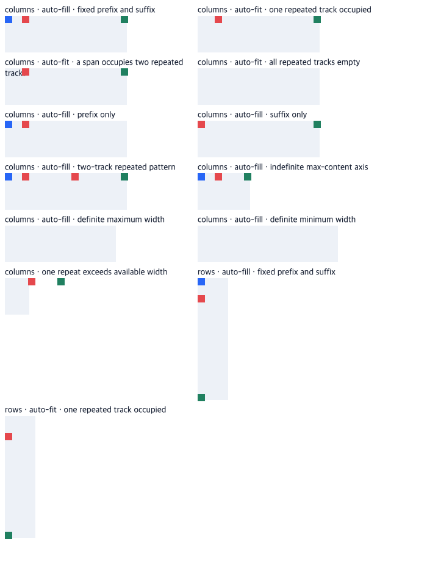

# C11.4 auto-repeat explicit neighbor 사전 비교

**상태:** 계획·Chrome 사전 비교만 완료했다. Spinon 구현, Android/iOS Simulator, WPT 실행은 포함하지 않는다. C11.4 완료 체크와 공식 완료 수는 변경하지 않는다.

## 기준과 재현 조건

- 표준: [CSS Grid Layout Module Level 1, 2025-03-26 CRD §7.2.3.1–7.2.3.2](https://www.w3.org/TR/2025/CRD-css-grid-1-20250326/#repeat-notation). 자동 반복은 한 track list에 한 번만 둘 수 있고 반복 횟수 산정에서는 각 repeated track의 definite max sizing function을, 그것이 없으면 definite min sizing function을 사용한다. 둘 다 definite이면 max 크기를 min 크기보다 작게 보지 않는다. preferred/max size가 definite하면 repeated/non-repeated track과 gap을 합쳐 content box를 넘지 않는 가장 큰 양의 반복 수를 고르고, 하나도 맞지 않으면 한 번을 유지한다. 그것이 없고 minimum size만 definite하면 이를 만족하는 가장 작은 반복 수를 선택하며, 관련 크기가 모두 indefinite이면 한 번 반복한다. `auto-fit`은 item placement 뒤 빈 반복 track과 그 주변 gutter를 접는다.
- 기준 브라우저: Google Chrome `155.0.8059.85`, Agent Browser `0.31.1`, macOS `26.5.1` ARM64, DPR 1, viewport `700×920` CSS px.
- Fixture: [grid-auto-repeat-explicit-neighbors-c114.html](../../../../tests/fixtures/css/c11/grid-auto-repeat-explicit-neighbors-c114.html), SHA-256 `34e5b6a0a1a468eba7f9049ae54c4e025a92afb8abad9b6d973b3fd39c539624`.
- 원 관찰: [chrome155-observation.json](./chrome155-observation.json). Chrome `getComputedStyle()`의 resolved track list, grid/item `getBoundingClientRect()`, scroll size, viewport와 browser version을 보존한다.
- WPT 관련 입력: read-only checkout `c999c58338ee1d223df5ad62e48be1202ced0d37`, `css/css-grid/grid-definition/grid-auto-fit-columns-001.html`, SHA-256 `11410caa92c400b653ac781ef7f1103c871cebb108c52b75f2e8308b2531ba63`. 해당 파일의 `gridAutoRepeatAndFixedBefore`, `gridAutoRepeatAndFixedAfter`, `gridAutoRepeatAndFixed` 사례는 line names, percentage, integer repeat, intrinsic sizing을 섞는다. WPT 파일은 실행하지 않았으며 아래 제한 fixture를 WPT pass로 세지 않는다.

## Chrome 155 관찰값

모든 definite grid는 `8px` gap을 쓴다. `minmax(40px, 1fr)` repeated track의 값과 grid/item 좌표를 함께 기록했다.

| Case | axis size와 track list | resolved track list | root rect / 확인할 점 |
| --- | --- | --- | --- |
| `columns-auto-fill-both` | width `200px`; `20px + repeat(auto-fill,minmax(40px,1fr)) + 10px` | `20 46 46 46 10px` | width `200px`; prefix/repeat/suffix item x=`8/36/198px` |
| `columns-auto-fit-one` | width `200px`; 같은 list, repeated track 하나에 item | `20 154 0 0 10px` | suffix item x=`514px` (grid x=`324px`); empty repeats와 gutter collapse 뒤에도 suffix 순서 유지 |
| `columns-auto-fit-span-two` | width `200px`; item이 repeat 두 track을 span | `20 73 73 0 10px` | suffix item x=`198px`; span에 포함된 두 track은 점유 유지 |
| `columns-auto-fit-empty` | width `200px`; 반복 track 모두 비움 | `20 0 0 0 10px` | grid width `200px`; repeated empty track 전부 collapse |
| `columns-auto-fill-prefix-only` | width `200px`; `20px + repeat(auto-fill,minmax(40px,1fr))` | `20 52 52 52px` | prefix item x=`324px`, 첫 repeat item x=`352px` |
| `columns-auto-fill-suffix-only` | width `200px`; `repeat(auto-fill,minmax(40px,1fr)) + 10px` | `55.3281 55.3281 55.3281 10px` | suffix item x=`198px`; ideal `55.333…px` 대비 1/64 CSS px 양자화 범위 |
| `columns-auto-fill-pattern` | width `200px`; prefix `20px`, 2-track pattern `minmax(30px,1fr) 20px`, suffix `10px` | `20 45 20 45 20 10px` | 두 pattern repetition과 각 component 순서 확인 |
| `columns-auto-fill-indefinite` | width `max-content`; `20px + repeat(auto-fill,40px) + 10px` | `20 40 10px` | root width `86px`; indefinite axis는 한 번 반복 |
| `columns-auto-fill-max-size` | width `max-content`, max-width `200px`; fixed prefix/suffix와 `minmax(40px,1fr)` | `20 40 40 40 10px` | root width `182px`; definite maximum으로 세 반복 수 선택 |
| `columns-auto-fill-min-size` | width `max-content`, min-width `200px`; 같은 pattern | `20 40 40 40 40 10px` | root width `230px`; minimum을 만족하는 네 반복 수 선택 |
| `columns-auto-repeat-overflow` | width `40px`; `30px + repeat(auto-fill,40px) + 20px` | `30 40 20px` | root width `40px`; 한 반복을 유지하며 content overflow 발생 |
| `rows-auto-fill-both` | height `200px`; prefix `20px`, 반복 `minmax(40px,1fr)`, suffix `10px` | `20 46 46 46 10px` | prefix/repeat/suffix item y=`456/484/646px` |
| `rows-auto-fit-one` | height `200px`; 같은 list, repeated track 하나에 item | `20 154 0 0 10px` | suffix item y=`872px`; row auto-fit collapse 뒤 suffix 유지 |

사용한 수치 오차는 Chrome track serialization의 1/64 CSS px fraction에만 허용한다. 정수·item/root rect는 fixture에서 기록한 CSS px 값과 일치해야 한다. auto-repeat count·track sequence·placement·collapse는 CSS Grid 규칙과 독립적으로 대조하고 Chrome 출력만으로 표준을 정의하지 않는다.

## 화면

이 700×920 PNG는 Chrome DOM fixture의 눈으로 확인할 수 있는 화면이다. Spinon 구현 결과나 모바일 surface pixel을 보여주지 않는다.

## 제한

- 이 fixture는 direct fixed-`px` explicit neighbors만 다룬다. named line/area, non-px neighbor, repeat 외부의 integer `repeat()`, 한 track list의 복수 auto-repeat, 양 축 동시 auto-repeat은 이번 확장 범위 밖이다.
- WPT suite, Rust stage trace, app runtime, Android API 37 ARM64 AVD, iOS Simulator, artifact boundary는 확인하지 않았다.
- C11.4 전체 contribution algorithm·auto-repeat placement/gutter matrix·WPT 적합성은 미완료다.

## 해시

[SHA256SUMS](./SHA256SUMS)는 repo root에서 실행하는 `shasum -a 256 -c` 기준으로 계획, conformance/status, plan review, fixture와 Chrome 자료를 고정한다. WPT 원본은 현재 worktree 밖의 read-only checkout이므로 위 commit/hash를 별도로 적었다.
