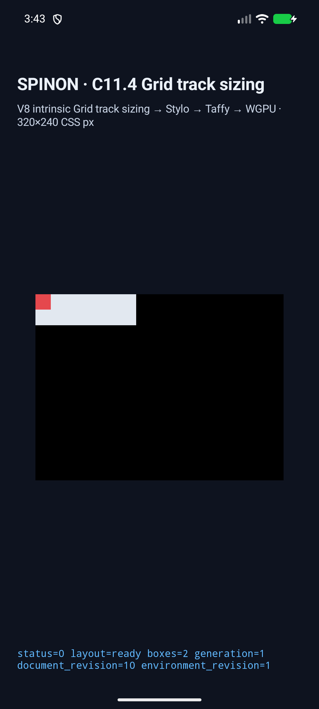
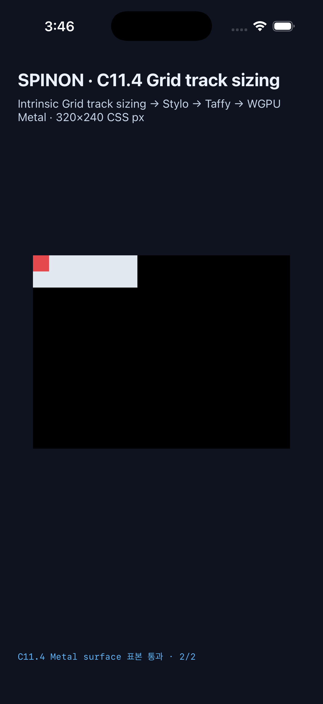
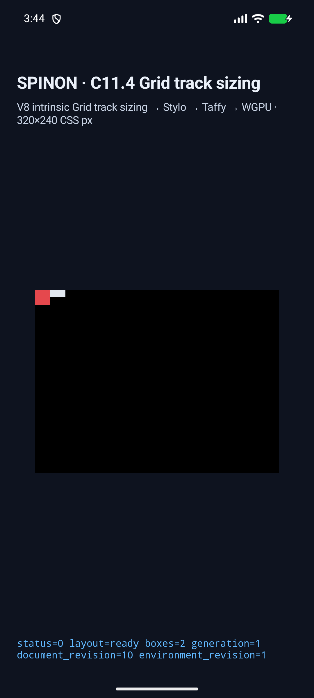
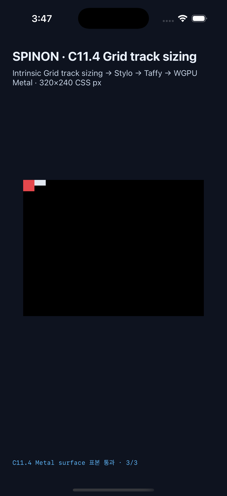

# C11.4 auto-repeat fixed maximum 제한 runtime 구현 근거

2026-10-29, `minmax(auto | min-content | max-content, fixed-breadth)` 반복 트랙을 기존 C11.4 opt-in Grid 경로에 연결했다. 이 기록은 한 고정 fixture profile의 후보 구현 및 simulator 관찰이며 C11.4 전체 완료를 뜻하지 않는다.

## 고정 입력과 기대값

[Chrome 156 사전 비교](../c11-4-auto-repeat-inflexible-fixed-maximum-precomparison-2026-10-29/README.md)의 49 scene과 정확히 같은 ID 집합을 사용한다. 세 inflexible minimum × `40px`/`30%`/`calc(15px + 25%)` × Columns/Rows × `auto-fill`/`auto-fit` 36 scene, maximum이 minimum보다 작은 overflow 대조군 6 scene, 129/130px repeat-count 경계 2 scene, 기존 fixed-minimum control 1 scene, 두 track repeat fragment 4 scene으로 구성된다. 비율 maximum은 definite positive axis basis에서만 허용하고 `calc()`는 기존의 정확한 `length + percentage` typed expression으로 제한한다.

독립 반복 수 계산은 `n × pattern breadth + (n × track count − 1) × gap ≤ definite content size`를 만족하는 가장 큰 양의 정수다. `auto-fit`의 빈 반복 트랙/gutter collapse, maximum보다 큰 20px intrinsic item minimum의 overflow, row/column 축을 함께 검사한다.

## Rust·fixture 검사

다음 targeted 검사는 모두 통과했다.

```sh
cargo test --locked -p spinon-layout fixed_maximum_auto_repeat_matches_all_chrome_precomparison_scenes -- --nocapture
cargo test --locked -p spinon-style-to-layout intrinsic_minimum_fixed_maximum_auto_repeat_tracks_are_preserved_by_projection -- --nocapture
cargo test --locked -p spinon-style track_sizing_profile_preserves_inflexible_minimum_fixed_maximum_auto_repeat_tracks -- --nocapture
cargo test --locked -p spinon-ffi --features c04-runtime-gpu-fixture-test fixed_maximum_auto_repeat_catalog_is_exact_and_routed -- --nocapture
node --test tools/css-reference/fixture-module-boundary.test.mjs
cargo clippy --locked -p spinon-layout -p spinon-style -p spinon-style-to-layout -p spinon-ffi --features spinon-ffi/c04-runtime-gpu-fixture-test --all-targets -- -D warnings
cargo fmt --all -- --check
```

Layout은 Chrome 사전 비교 49/49, Stylo→layout projection은 intrinsic minimum 및 maximum breadth 전달, Stylo cascade는 36개 min/max 조합을 검사한다. FFI catalog는 oracle ID와 49개 scene의 정확한 집합 일치를 확인한다. Fixture module boundary test는 21/21 통과했다. 신규 fixture는 `c04-runtime-gpu-fixture-test`에서만 연결된다.

## Android·iOS 실행

최종 캡처는 구현 source revision `0435059826bedb29bbe15a046fdbca2ec6cc88c3`의 tracked diff SHA-256 `1ba94d52a5c14347c35002b5998a033e37805fa2aedab0744af1fc621a2c8a22`에 묶여 있다. 각 simulator metadata의 `sourceRevision`에는 개별 source snapshot SHA-256이 있다. 최종 두 실행은 각각 49/49 scene에서 geometry, track list/collapse, trace 및 draw/present를 확인했다.

| 환경 | 실행 | 픽셀 관찰 | APK/app SHA-256 |
| --- | --- | --- | --- |
| Android API 37 ARM64 AVD, `sdk_gphone64_arm64`, `emulator-5556` | [49 scene 결과](./android-avd-c114-auto-repeat-fixed-maximum-android-avd-20261029T064318832Z-6620d4a9/result.json) · [기기/source metadata](./android-avd-c114-auto-repeat-fixed-maximum-android-avd-20261029T064318832Z-6620d4a9/simulator.json) · [49 화면 SHA-256 manifest](./android-avd-c114-auto-repeat-fixed-maximum-android-avd-20261029T064318832Z-6620d4a9/screenshot-manifest.json) | PixelCopy 104/104 RGBA exact | `bad1fd7fec0d5567dabdc7dbde76dcc2f26443d261c7f5c31fe7bb4c279086e9` |
| iPhone 17 Pro, iOS 26.2 Simulator | [49 scene 결과](./ios-simulator-c114-auto-repeat-fixed-maximum-ios-simulator-20261029T064625210Z-bb79b8bb/result.json) · [기기/source metadata](./ios-simulator-c114-auto-repeat-fixed-maximum-ios-simulator-20261029T064625210Z-bb79b8bb/simulator.json) · [49 화면 SHA-256 manifest](./ios-simulator-c114-auto-repeat-fixed-maximum-ios-simulator-20261029T064625210Z-bb79b8bb/screenshot-manifest.json) | Metal drawable 104/104 RGBA exact | `d281bca3388fe91113d9f4b43fb80fb7e19d20a8af20664e7443c4019ab24954` |

일반 scene 43개는 scene당 2 표본, overflow 대조군 6개는 root 내부와 item의 root 내부/외부 3 표본으로 총 104 표본이다. [검증 스크립트](./verify-simulator-runs.py)에서 두 run의 fixture ID 집합, draw/present, binary hash, 전체 exact sample log와 대표 화면을 대조했고 결과는 [pixel-summary.json](./pixel-summary.json)에 남겼다. 49 scene 화면은 모두 캡처했고 각 run의 manifest에 파일명·크기·SHA-256을 기록했다. 저장소에는 각 플랫폼의 정상 배치와 root 바깥 overflow를 보여 주는 대표 PNG 2장씩을 보존했다. 보존한 text log는 Git diff 검사에서 불필요한 trailing whitespace만 제거했으며 status, 좌표, RGBA 및 시간 필드는 바꾸지 않았다. Android AVD는 software-rendered다. iOS 표본은 Metal drawable에서 compositor 제출 전에 읽었다. 어느 결과도 실기기나 compositor 이후 화면을 증명하지 않는다.

대표 캡처:

| Android AVD | iOS Simulator |
| --- | --- |
|  |  |
|  |  |

## Build와 artifact 경계

Android app build는 `mise exec -- env SPINON_ENABLE_C04_RUNTIME_GPU_FIXTURE_TEST=1 bun run build:android`, iOS Simulator build는 아래 명령으로 통과했다.

```sh
SPINON_ENABLE_C04_RUNTIME_GPU=1 \
SPINON_ENABLE_C04_RUNTIME_GPU_FIXTURE_TEST=1 \
SPINON_ENABLE_C11_GRID_METAL_SURFACE_PIXELS_TEST=1 \
mise exec -- bun run build:ios-sim
```

`spinon-ffi` static archive의 기본 release build는 60,201,432 bytes, SHA-256 `4ceeff25b1056334f27ffc8870f4d7ba7abb9f2ed996c19c68dc69fc8eecf390`이며 신규 marker `columns-auto-fill-auto-percent30-130`가 없다. `c04-runtime-gpu-fixture-test` positive-control build는 80,466,592 bytes, SHA-256 `4acfeeef54f303b7a3aaf1ee0f43459c52d911a1aa07a085fee108c630cae942`이며 `columns-auto-fill-auto-percent30-130`, `columns-overflow-auto-max10-basis10`, `rows-auto-fit-two-track-pattern-135`가 있다. 이것은 macOS static FFI archive 한정 확인이며 APK/IPA 번들 전체에서 fixture가 빠졌다는 증거가 아니다.

## 검증 중 수정된 실패

- simulator capture matrix에 scene 49개를 더했을 때 공용 catalog 기대값 `545`가 남아 fixture boundary 검사 21개 중 일부가 실패했다. 모든 관련 assertion을 `594`로 갱신한 뒤 21/21 통과했다.
- iOS 첫 pixel capture는 Metal surface pixel feature define 없이 실행되어 fixture-disabled 결과를 돌려줬다. 올바른 `SPINON_ENABLE_C11_GRID_METAL_SURFACE_PIXELS_TEST=1`로 다시 빌드한 앱에서 49개 scene을 재실행했다.
- Android의 이전 설치 APK가 최신 build와 다른 경우를 확인해 최종 설치 APK SHA-256이 build APK와 일치하는지 확인한 실행만 최종 결과로 남겼다.

이전 시도는 성공 근거로 세지 않는다. 최종 구현/runtime 실패 관점 20개와 PR diff 검토 30개는 [각 검토 문서](./implementation-review-20.md), [PR diff 검토](./pr-diff-review-30.md)에 기록한다.

## 제한과 상태

이는 fixture-test opt-in 안에서 고정한 49개 장면이다. 0px maximum의 automatic-repeat floor behavior는 비교 장면에 없어 검증 범위로 주장하지 않는다. arbitrary CSS author admission, indefinite percentage basis, arbitrary `calc()` AST, flexible maximum, 여러 auto-repeat, 전체 WPT, 전체 C11.4, Android hardware GPU 및 iOS compositor 이후 pixel을 지원·검증했다고 주장하지 않는다. C11.4 checkbox와 공식 완료 `72/213`은 유지한다.
