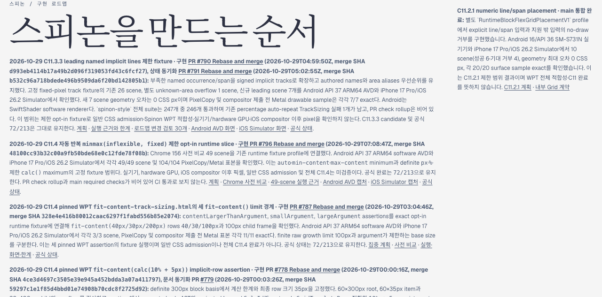

# C11.4 Tailnet 로드맵 동기화 pass02

2026-10-29, 로드맵 링크 수정 PR #798을 병합한 뒤 공식 로드맵을 Tailnet 미리보기에 다시 동기화했다. 이 변경은 공개 HTML 경로의 링크 수정만 배포하며 C11.4 지원 범위나 완료 상태를 바꾸지 않는다.

## 동기화 근거

- 원본은 `origin/main`의 `spec/public/roadmap.html`, revision `95e77ceb44dce8029baa8c2b3533e38e61ab0f18`이다. PR #798은 2026-10-29T07:22:09Z Rebase and merge됐다.
- 원본과 설치된 roadmap은 393,072 byte이며 SHA-256은 `c72b1df9c0d2f5dfe0c6c56d10f7d33ecc3ea08ad51d333d9552f71df9cc89b0`이다.
- 교체 전 로컬·Tailnet 경로는 모두 HTTP 200이었고 직전 PR #797 동기화본의 SHA-256 `6eea06730005041b77a6515f85e4a7f954708f7562266dfd4392263f4ab272ec`를 반환했다. 이전 파일은 byte-exact backup으로 보존했다.
- Tailscale 상태는 Running이었다. roadmap.html 하나만 같은 디렉터리 임시 파일에서 원자 교체했고 다른 route를 바꾸거나 파일을 삭제하지 않았다. 미리보기 서버는 재시작하지 않았다.
- 교체 뒤 로컬과 [Tailnet 로드맵](https://macstudio.tailed42f2.ts.net/spinon/roadmap.html)은 모두 HTTP 200, 393,072 byte, 위 원본 SHA-256을 반환했다.

## Agent Browser 확인

터미널 브라우저가 아닌 Agent Browser로 Tailnet 로드맵을 열었다. 페이지 제목은 “스피논 구현 로드맵”이었고 C11.4 행에 PR #796 merge SHA, 49/49 scene, 104/104 표본, 공식 집계 72/213과 미완료 한계가 표시됐다.

| 로드맵 링크 | Agent Browser 결과 |
| --- | --- |
| 계획 Markdown | GitHub main 문서 화면이 열림 |
| Chrome 사전 비교 Markdown | GitHub main 문서 화면이 열림 |
| 49-scene 실행 근거 Markdown | GitHub main 문서 화면이 열림; 49 scene·Android·iOS 본문 확인 |
| Android 대표 캡처 | GitHub 이미지 화면에서 1080×2400 이미지가 로드됨 |
| iOS 대표 캡처 | GitHub 이미지 화면에서 1206×2622 이미지가 로드됨 |
| 공식 상태 Markdown anchor | GitHub 상태 문서가 열리고 C11 및 C11.4 heading 확인 |

브라우저에서 확인한 대표 캡처는 아래와 같다. 확인 뒤 Agent Browser 세션을 닫았고 agent-browser 및 전용 Chrome 프로세스가 남지 않았음을 확인했다.

## 범위

C11.4는 계속 미완료이고 공식 완료 집계는 72/213으로 유지한다. Android 근거는 software AVD, iOS 표본은 compositor 제출 전 Metal drawable이다. 일반 CSS admission, 실기기/hardware GPU, compositor 이후 iOS 픽셀, 전체 WPT 적합성 및 C11.4 전체 완료를 주장하지 않는다.
