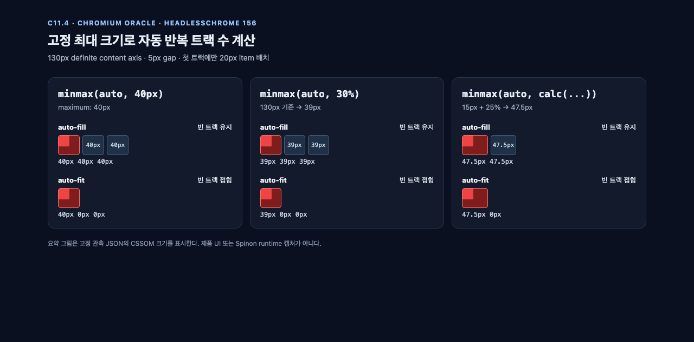

# C11.4 자동 반복 고정 최대 breadth 사전 비교

## 질문과 범위

현재 `RuntimeBlockFlexGridTrackSizingV1` 경로는 최소 크기가 고정된 자동 반복 트랙만 허용한다. CSS Grid `fixed-size` 문법에는 두 번째 형식인 `minmax(<inflexible-breadth>, <fixed-breadth>)`도 있다. 따라서 `minmax(auto, 40px)`, `minmax(min-content, 40px)`, `minmax(max-content, 40px)`도 문법상 허용된다. 현재 `auto_repeat_track_has_fixed_minimum` 사전 검사는 Taffy에 전달하기 전에 이 세 트랙을 거부한다.

이 비교는 세 intrinsic 최소 키워드에 대해 빠진 fixed-maximum 분기를 고정한다. 양의 고정 길이, 백분율, 기존에 타입화된 2항 `calc(length + percentage)` 범위도 확인한다. 임의의 calc 트리, definite하지 않은 백분율 기준 크기, 한 축에 여러 자동 반복 구성 요소가 있는 경우, 일반 공개 CSS 허용은 범위에 포함하지 않는다.

## 명세에 따른 기대값

고정한 CSS Grid Level 1 2025 CRD §7.2.3.1은 자동 반복을 하나 이상의 `<fixed-size>` 트랙으로 정의한다. 문법에는 `minmax(<fixed-breadth>, <track-breadth>)`와 `minmax(<inflexible-breadth>, <fixed-breadth>)`가 모두 포함된다. 같은 절에서 `auto`, `min-content`, `max-content`는 inflexible breadth이고 `<fixed-breadth>`는 음수가 아닌 length-percentage다.

preferred axis가 definite하면 §7.2.3.2에 따라 content box를 넘지 않는 가장 큰 양의 반복 횟수를 선택한다. definite maximum track size가 반복 횟수 계산의 트랙 크기이며 트랙 사이 gap도 계산에 포함한다. `auto-fit`은 배치 후 비어 있는 반복 트랙을 접고, `auto-fill`은 이를 유지한다.

130px content axis와 5px gap의 결과:

| 최대 breadth | 해석 크기 | `auto-fill` 반복 수 | 첫 트랙 하나만 차지했을 때 `auto-fit` 사용 트랙 |
| --- | ---: | ---: | --- |
| `40px` | 40px | 3 | `[40, 0, 0]px` |
| `30%` | 39px | 3 | `[39, 0, 0]px` |
| `calc(15px + 25%)` | 47.5px | 2 | `[47.5, 0]px` |

반복 수는 `n × 트랙 크기 + (n − 1) × 5px ≤ content 크기`를 만족하는 가장 큰 양의 정수 `n`으로 독립 계산한다. 40px 트랙의 경계는 129px에서 2개, 130px에서 3개가 되는지도 확인한다. 10px 최대값보다 20px item의 intrinsic minimum이 큰 대조군으로 최소 크기가 고정 최대값을 넘을 수 있는지도 검사한다.

## Chromium 관측

- 브라우저: Agent Browser 0.31.1, `HeadlessChrome/156.0.0.0`.
- 호스트: macOS 26.5.1, arm64; viewport 1280×633 CSS px; DPR 1.
- fixture: [grid-auto-repeat-fixed-maximum-c114-precomparison.html](../../../../tests/fixtures/css/c11/grid-auto-repeat-fixed-maximum-c114-precomparison.html), SHA-256 `6662e72ee62f9d5e0524a90f9092d1adec36dd201271f0f7d1bdc32cff84d7bc`.
- 총 49개 관측을 담았다. 세 intrinsic 최소값 × 세 최대 breadth × 두 축 × `auto-fill`/`auto-fit` 조합 36개, 최대값이 최소값보다 작은 대조군 6개, 129/130px 고정 길이 경계 2개, 기존 fixed-minimum 양성 대조군 1개, 두 트랙 반복 조각 4개다.
- 49개 모두 독립 공식과 기대한 item/root geometry에 맞았다. `python3 spec/internal/evidence/c11-4-auto-repeat-inflexible-fixed-maximum-precomparison-2026-10-29/verify-precomparison.py`로 로컬 검증을 다시 실행할 수 있다. 이 검증기는 fixture hash, 정확한 scene ID 집합, scene 필드, 트랙, frame과 요약 HTML의 6개 CSSOM 값을 검사한다. 원본 DOM 관측은 [chrome-headless-observed.json](./chrome-headless-observed.json)에 있고 전체 페이지 캡처는 [chrome-headless-full.png](./chrome-headless-full.png)에 있다.
- 로컬 검증은 각 scene에서 축별 트랙 목록, 정확한 트랙 수, 계산된 사용 크기, 20×20px item frame을 확인했다. 이는 Chromium oracle 비교이며 Spinon WPT 통과 결과가 아니다.
- PR 본문에 첨부하는 간결 비교 화면은 [chrome-headless-summary.png](./chrome-headless-summary.png)이며 동일한 값을 선언한 [chrome-headless-summary.html](./chrome-headless-summary.html)로 렌더링했다. 이는 Chrome CSSOM 관측의 요약 그림이지 제품 UI나 Spinon runtime 캡처가 아니다. 관측값의 근거는 고정 JSON과 verifier다.

## SHA-256

| 산출물 | SHA-256 |
| --- | --- |
| fixture HTML | `6662e72ee62f9d5e0524a90f9092d1adec36dd201271f0f7d1bdc32cff84d7bc` |
| 원본 브라우저 관측 | `0dfaf97f424b6c92500841539ebdd660dcd830da9fe8da7029baf9bfc458d223` |
| 전체 페이지 화면 | `348e22178c777f5e1f6eac52e55c22fa8f0c1fef5b09d24eb1de0693460b08c5` |
| 요약 화면 HTML | `9ce1ee5bc5989407a71e3dfa5052125288b7dce671559785c2c36f24e0714086` |
| 요약 화면 PNG | `b898a838863730171eaef408581d37e2ee78aab3a4c353a7a5278ade74d67278` |
| 관측 검증기 | `bf512e7af5ed84d82d1b974e1327b99202d8ee104469abb7d61af4302aba4ee9` |

## 브라우저 정리

이름이 지정된 Agent Browser 세션 `spinon-c11-auto-repeat-fixed-maximum-20261029`을 닫았다. 마지막 세션 조회는 `active=false`, `pid=null`이었다.

## 참고

- [CSS Grid Layout Module Level 1, 2025-03-26 CRD §7.2.3](https://www.w3.org/TR/2025/CRD-css-grid-1-20250326/#repeat-notation)
- [현재 layout 사전 검사](../../../../crates/spinon-layout/src/grid.rs)
- [C11.4 상위 계획](../../../../plan/c11-4-grid-track-sizing.md)
